# 04 Screen-by-screen specifications

258 screens. Each entry: image, purpose, layout, components, data, actions, navigation, permissions, mobile interactions. Data in the images is fictional.

## 00-foundation

### Splash

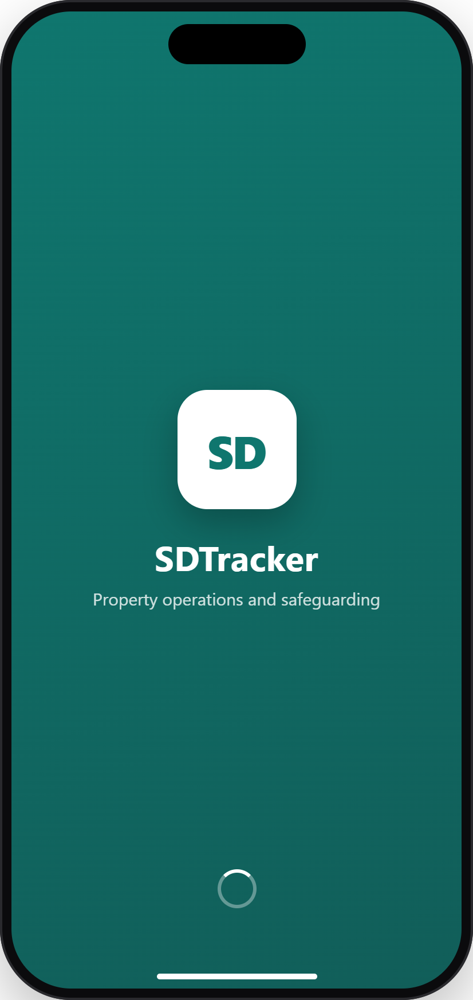

- **Purpose:** Brand moment while the session and role permissions load.
- **Layout:** Centred app mark and name on the brand gradient, spinner at the bottom.
- **Components:** App icon mark, Spinner
- **Data displayed:** None. Resolves the Supabase session, then the user profile and page permissions (the web app shows "Loading your access…" until they are ready).
- **Actions:** None.
- **Navigation:** Goes to Sign in when there is no session, otherwise Home.
- **Permissions:** Public.
- **Mobile interactions:** Respects Reduce Motion.

### Sign in

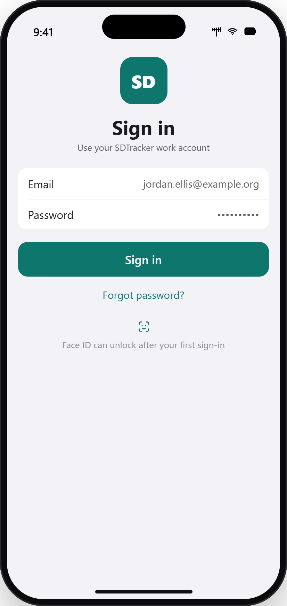

- **Purpose:** Authenticate with Supabase Auth (email and password).
- **Layout:** Brand mark, title, grouped email/password rows, primary button, forgot-password link, biometric hint.
- **Components:** Inset text fields, Primary button, Inline error banner, Face ID prompt (after first sign-in)
- **Data displayed:** Email, password.
- **Actions:** Sign in, Forgot password, Face ID unlock of the stored session.
- **Navigation:** On success → Home. Blocked accounts → Access blocked screen.
- **Permissions:** Public. Archived or deleted users cannot sign in (server enforces account lifecycle).
- **Mobile interactions:** Password AutoFill, secure text entry, error announced to VoiceOver.

### Sign in — error

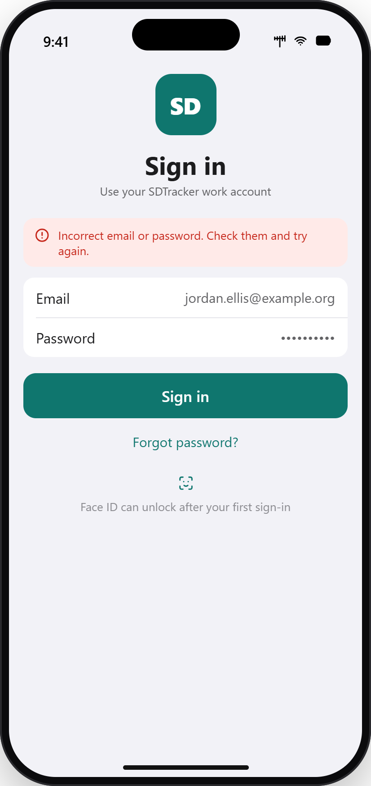

- **Purpose:** Authenticate with Supabase Auth (email and password).
- **Layout:** Brand mark, title, grouped email/password rows, primary button, forgot-password link, biometric hint.
- **Components:** Inset text fields, Primary button, Inline error banner, Face ID prompt (after first sign-in)
- **Data displayed:** Email, password.
- **Actions:** Sign in, Forgot password, Face ID unlock of the stored session.
- **Navigation:** On success → Home. Blocked accounts → Access blocked screen.
- **Permissions:** Public. Archived or deleted users cannot sign in (server enforces account lifecycle).
- **Mobile interactions:** Password AutoFill, secure text entry, error announced to VoiceOver.

### Reset password

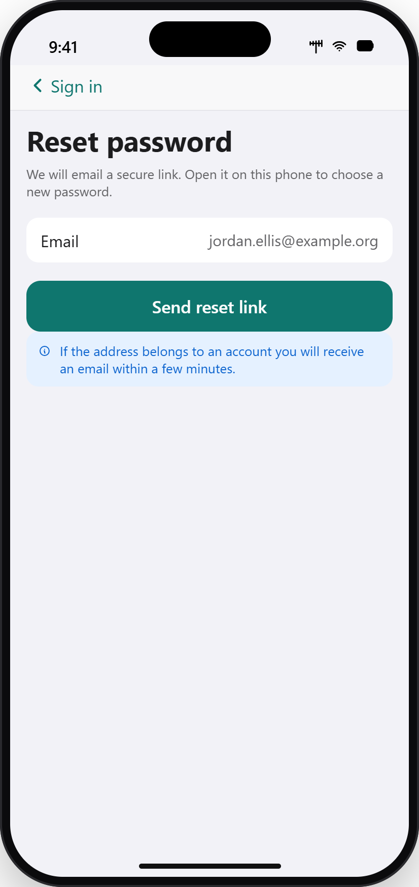

- **Purpose:** Start (and complete) a password reset.
- **Layout:** Inline nav, explanatory text, email row, primary button, confirmation banner.
- **Components:** Inset field, Primary button, Info banner
- **Data displayed:** Email; new password and confirmation on the return screen.
- **Actions:** Send link, set new password.
- **Navigation:** Back to Sign in; the link deep-links to the set-password step.
- **Permissions:** Public.
- **Mobile interactions:** Universal link opens the app directly.

### Session lock

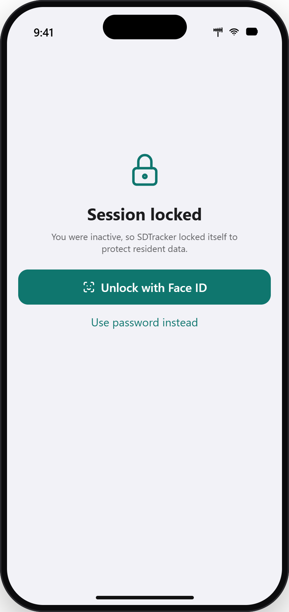

- **Purpose:** Protect data after inactivity (web: Session Lock modal and inactivity timeout in Settings).
- **Layout:** Full-screen lock with biometric unlock.
- **Components:** Lock glyph, Primary button
- **Data displayed:** No data shown while locked.
- **Actions:** Unlock (Face ID / passcode), switch to password, sign out.
- **Navigation:** Returns to the screen you were on.
- **Permissions:** Any signed-in role.
- **Mobile interactions:** App-switcher snapshot is blurred.

### Access denied

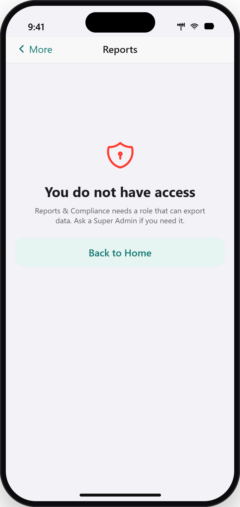

- **Purpose:** Shown when a role or Page Access override blocks a page (web: AccessDeniedView).
- **Layout:** Centred glyph, plain-language reason naming the required role, one button.
- **Components:** Empty-state glyph, Button
- **Data displayed:** Page name and the role or grant required.
- **Actions:** Back to Home.
- **Navigation:** Replaces the destination.
- **Permissions:** Shown to any user lacking access; the page is normally hidden from navigation so this appears only via a link or push notification.
- **Mobile interactions:** Does not reveal the page content.

### Page under maintenance

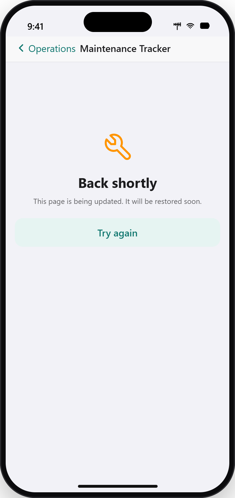

- **Purpose:** Page Maintenance Mode set by a Super Admin (web: PageMaintenanceView).
- **Layout:** Centred glyph, short message from settings, retry.
- **Components:** Empty-state glyph, Button
- **Data displayed:** Maintenance message from system settings.
- **Actions:** Try again.
- **Navigation:** Replaces the page.
- **Permissions:** All roles see it; a Super Admin sees a banner and can still open the page.
- **Mobile interactions:** —

### Authentication blocked

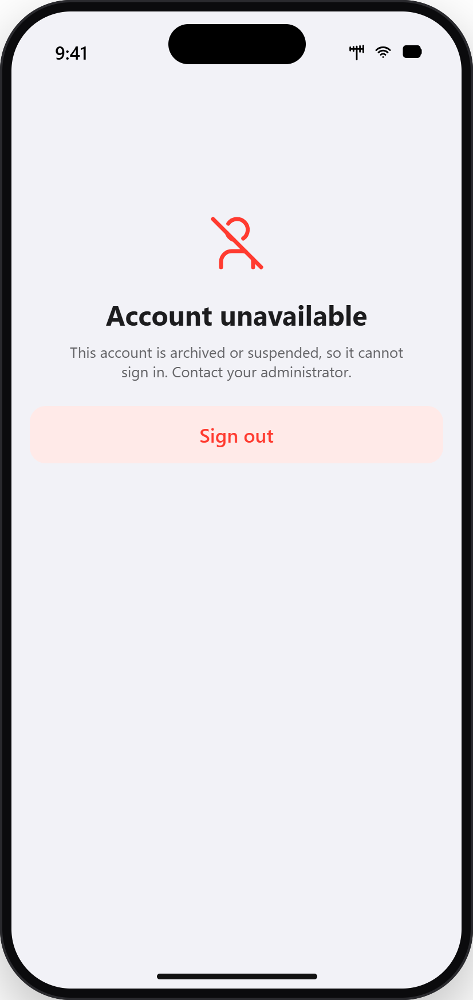

- **Purpose:** Explains why sign-in is refused (web: AuthenticationBlockedView; archived/deleted users are blocked by the lifecycle rules).
- **Layout:** Centred glyph and message, sign-out.
- **Components:** Empty-state glyph, Button
- **Data displayed:** Reason only; no record data.
- **Actions:** Sign out.
- **Navigation:** Returns to Sign in.
- **Permissions:** Public.
- **Mobile interactions:** —

### Offline / sync state

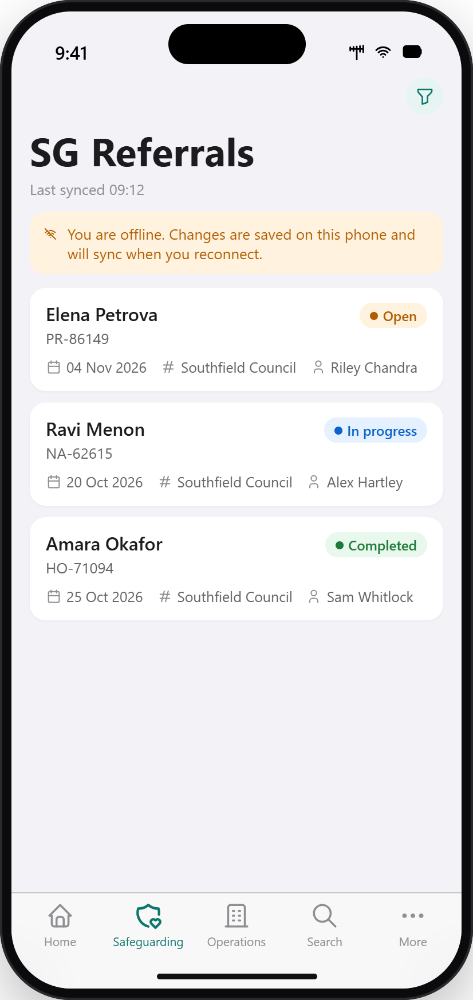

- **Purpose:** Keep working without signal; the web app shows a live-data banner and a Sync button.
- **Layout:** Banner under the nav bar; cached cards stay readable.
- **Components:** Status banner, Cached cards, Sync indicator
- **Data displayed:** Cached copy of the permitted data.
- **Actions:** Pull to sync, retry.
- **Navigation:** Stays on the same screen.
- **Permissions:** Cache is cleared on sign-out.
- **Mobile interactions:** Queued edits show a clock badge until sent.

### Loading, empty, error and success states

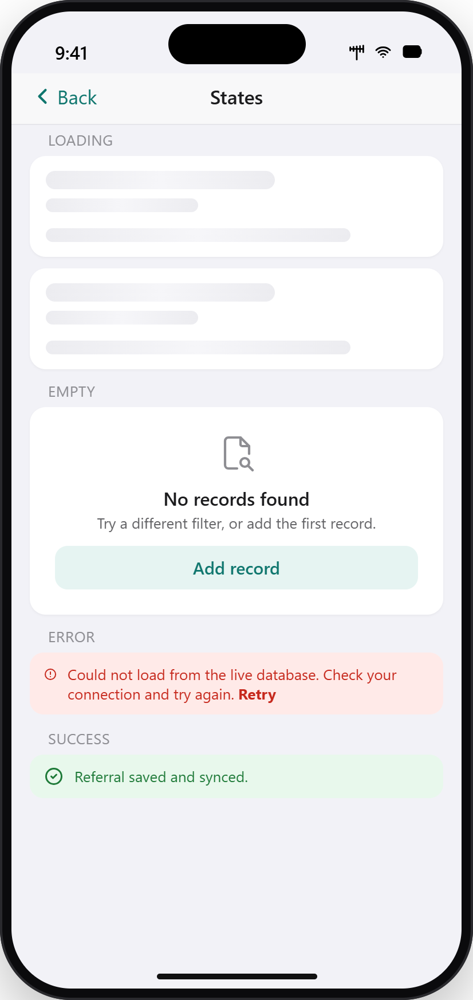

- **Purpose:** One consistent pattern for the four states the web app already has.
- **Layout:** Skeleton cards, centred empty state with action, red banner with Retry, green confirmation.
- **Components:** Skeleton, Empty state, Error banner, Success banner / toast
- **Data displayed:** —
- **Actions:** Retry, Add record.
- **Navigation:** —
- **Permissions:** —
- **Mobile interactions:** Success is a toast that auto-dismisses; errors persist until resolved.

## 01-navigation

### Search — start

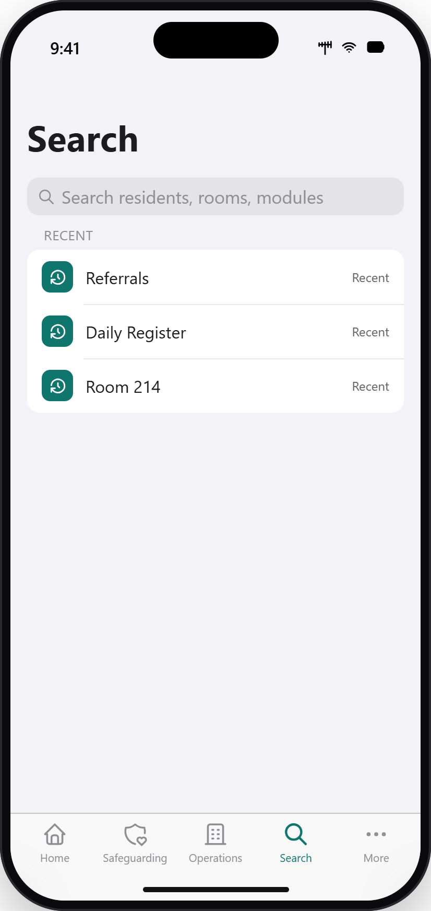

- **Purpose:** Global search (web: Quick Jump) across residents, records, properties and modules.
- **Layout:** Large title, native search field, scope chips, grouped results with type labels.
- **Components:** Search field, Scope chips, Result rows
- **Data displayed:** Results respect site scope and page permissions; resident names and refs are matched.
- **Actions:** Type, filter by scope, open a result, clear recents.
- **Navigation:** Result → record detail or module.
- **Permissions:** Never returns records from pages or sites the role cannot see.
- **Mobile interactions:** Debounced; recents stored on device only.

### Search — results

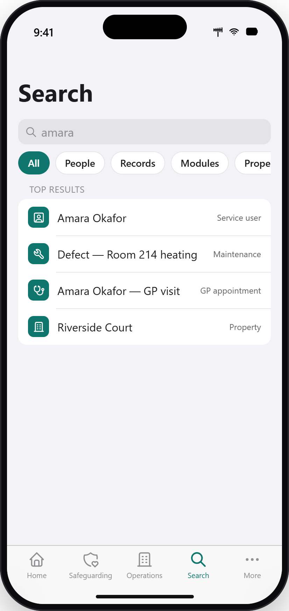

- **Purpose:** Global search (web: Quick Jump) across residents, records, properties and modules.
- **Layout:** Large title, native search field, scope chips, grouped results with type labels.
- **Components:** Search field, Scope chips, Result rows
- **Data displayed:** Results respect site scope and page permissions; resident names and refs are matched.
- **Actions:** Type, filter by scope, open a result, clear recents.
- **Navigation:** Result → record detail or module.
- **Permissions:** Never returns records from pages or sites the role cannot see.
- **Mobile interactions:** Debounced; recents stored on device only.

### Notifications

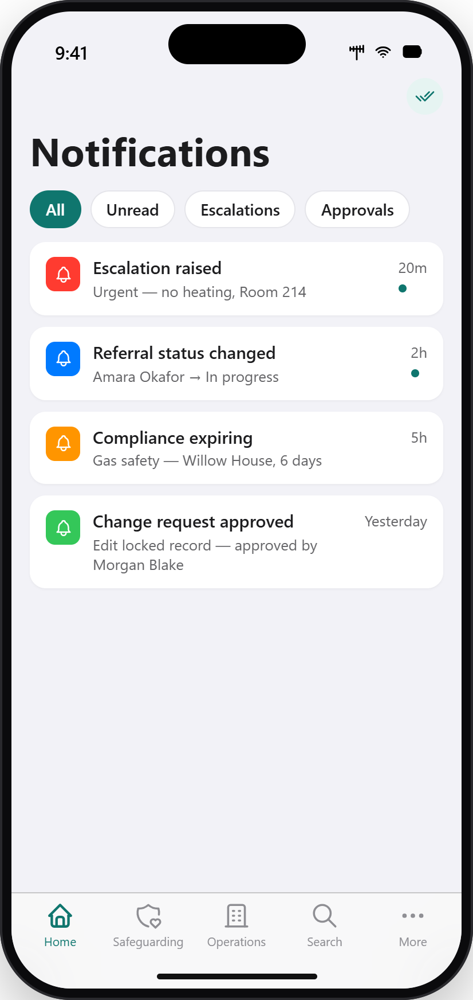

- **Purpose:** In-app notification list (web: header bell and notification centre) plus push.
- **Layout:** Large title, filter chips, notification cards with unread dot, mark-all-read.
- **Components:** Chips, Notification cards, Mark all read
- **Data displayed:** Event, title, detail, time, read state.
- **Actions:** Open the related record, mark read, clear all.
- **Navigation:** Tap → record. Opened from the Home bell.
- **Permissions:** Only events for sites and modules the role can see (web notification scope rules).
- **Mobile interactions:** Swipe to mark read or clear; push opens the same record.

### App settings (personal)

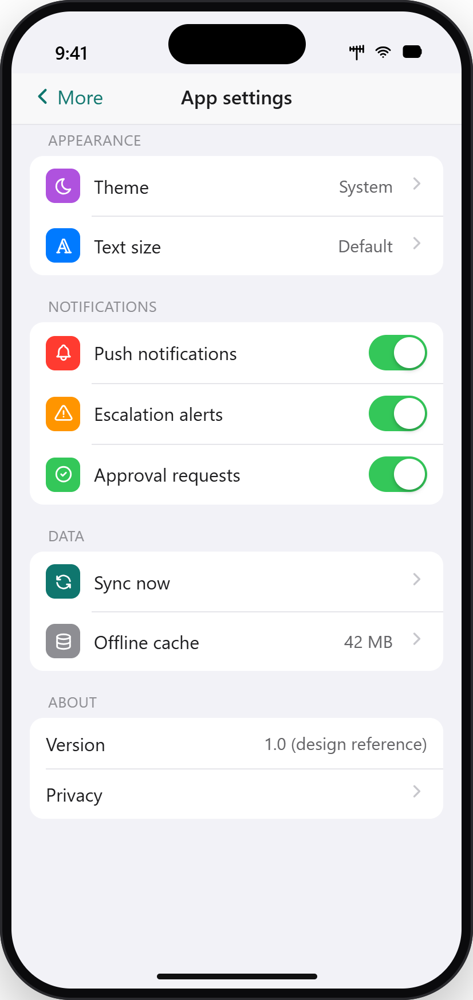

- **Purpose:** Per-device preferences. Distinct from the admin-only System Settings page.
- **Layout:** Grouped settings list.
- **Components:** Inset lists, Toggles
- **Data displayed:** Local preferences; push subscriptions.
- **Actions:** Change theme/text size, toggle alerts, sync, clear cache.
- **Navigation:** Pushed from More.
- **Permissions:** All roles.
- **Mobile interactions:** Honours system Dynamic Type.

### Home — personalise widgets

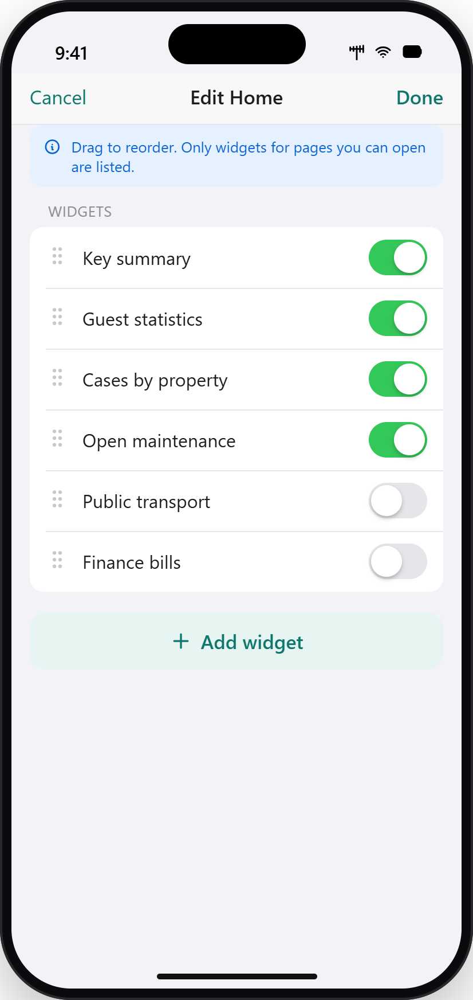

- **Purpose:** Reorder, hide and add widgets (web: personalised dashboard builder).
- **Layout:** Reorderable list with toggles and an Add widget button.
- **Components:** Reorder handles, Toggles
- **Data displayed:** Widget library filtered by page access.
- **Actions:** Reorder, hide, add, reset to default.
- **Navigation:** Done returns to Home.
- **Permissions:** Own layout only; widgets for pages the role cannot view never appear.
- **Mobile interactions:** Drag with haptics.

## 08-roles/super-admin

### Home — Super Admin

- **Purpose:** Role-aware landing screen for Platform owner.
- **Layout:** Large-title bar with notifications bell (badge) and profile; greeting and site scope pill; KPI grid; quick actions; needs-attention list; guest statistics chart; approvals card for finance roles.
- **Components:** KPI cards, Quick action tiles, Needs-attention cards, Donut chart, Tab bar
- **Data displayed:** Counts come from the same permitted, site-scoped data as the web Executive Dashboard; scope: All sites.
- **Actions:** Open a KPI or card to jump to its module; quick actions open the create form; pull to refresh.
- **Navigation:** KPI → filtered list. Bell → Notifications. Avatar → Profile.
- **Permissions:** Widgets are shown only for pages the role can view. Page Access, Page Maintenance, Roles & RBAC, Field Options, restore of archived/deleted users and properties.
- **Mobile interactions:** Widgets can be reordered and hidden (web: personalised dashboard builder); long-press to edit.

### Safeguarding hub — Super Admin

- **Purpose:** Module landing for the Safeguarding category.
- **Layout:** Large title, search, inset list of modules with coloured symbol tiles.
- **Components:** Inset list, Symbol tiles, Search field
- **Data displayed:** Module names from the web page registry.
- **Actions:** Open module; search modules.
- **Navigation:** Row → module list.
- **Permissions:** Shows only modules Super Admin can open (14 of 14).
- **Mobile interactions:** Recently used modules float to the top.

### Operations hub — Super Admin

- **Purpose:** Module landing for Overview and Facilities & Welfare.
- **Layout:** Large title, search, inset list of modules.
- **Components:** Inset list, Symbol tiles
- **Data displayed:** Module names from the web page registry.
- **Actions:** Open module.
- **Navigation:** Row → module list.
- **Permissions:** Shows only modules Super Admin can open (18 of 18).
- **Mobile interactions:** —

### More — Super Admin

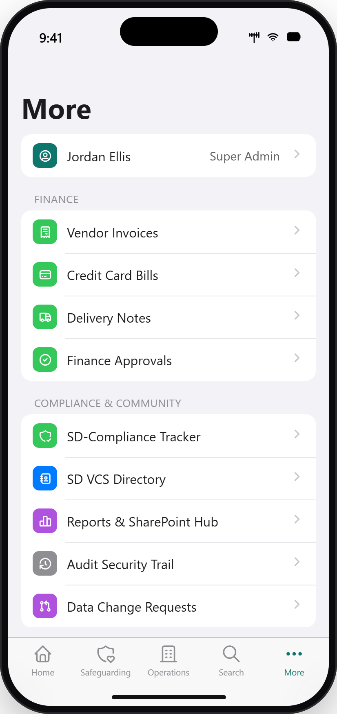

- **Purpose:** Everything not in the other four tabs, grouped by the web categories, filtered by role.
- **Layout:** Profile row, then grouped lists for Finance, Compliance & Community and Admin & Governance, then notifications and sign out.
- **Components:** Inset lists, Profile row
- **Data displayed:** Module names from the page registry; groups empty for this role are hidden.
- **Actions:** Open module, profile, sign out.
- **Navigation:** Row → module.
- **Permissions:** Page Access, Page Maintenance, Roles & RBAC, Field Options, restore of archived/deleted users and properties.
- **Mobile interactions:** Groups collapse when empty; nothing is greyed-out — unavailable modules are simply absent.

### Profile — Super Admin

- **Purpose:** Account, access summary and device security.
- **Layout:** Avatar header, access group, security group, sign out.
- **Components:** Avatar, Inset lists, Toggle, Destructive button
- **Data displayed:** Name, email, role, assigned sites, count of pages the role can open.
- **Actions:** Change password, toggle Face ID, set auto-lock, sign out.
- **Navigation:** Pushed from Home or More.
- **Permissions:** Read-only for role and sites (only an admin changes them).
- **Mobile interactions:** Biometric toggle prompts Face ID to confirm.

## 08-roles/admin

### Home — Admin

- **Purpose:** Role-aware landing screen for Administrator.
- **Layout:** Large-title bar with notifications bell (badge) and profile; greeting and site scope pill; KPI grid; quick actions; needs-attention list; guest statistics chart; approvals card for finance roles.
- **Components:** KPI cards, Quick action tiles, Needs-attention cards, Donut chart, Tab bar
- **Data displayed:** Counts come from the same permitted, site-scoped data as the web Executive Dashboard; scope: All sites.
- **Actions:** Open a KPI or card to jump to its module; quick actions open the create form; pull to refresh.
- **Navigation:** KPI → filtered list. Bell → Notifications. Avatar → Profile.
- **Permissions:** Widgets are shown only for pages the role can view. Users, Properties, Audit trail, Settings, Email notifications, finance; no restore, no Roles/Page Access.
- **Mobile interactions:** Widgets can be reordered and hidden (web: personalised dashboard builder); long-press to edit.

### Safeguarding hub — Admin

- **Purpose:** Module landing for the Safeguarding category.
- **Layout:** Large title, search, inset list of modules with coloured symbol tiles.
- **Components:** Inset list, Symbol tiles, Search field
- **Data displayed:** Module names from the web page registry.
- **Actions:** Open module; search modules.
- **Navigation:** Row → module list.
- **Permissions:** Shows only modules Admin can open (14 of 14).
- **Mobile interactions:** Recently used modules float to the top.

### Operations hub — Admin

- **Purpose:** Module landing for Overview and Facilities & Welfare.
- **Layout:** Large title, search, inset list of modules.
- **Components:** Inset list, Symbol tiles
- **Data displayed:** Module names from the web page registry.
- **Actions:** Open module.
- **Navigation:** Row → module list.
- **Permissions:** Shows only modules Admin can open (18 of 18).
- **Mobile interactions:** —

### More — Admin

- **Purpose:** Everything not in the other four tabs, grouped by the web categories, filtered by role.
- **Layout:** Profile row, then grouped lists for Finance, Compliance & Community and Admin & Governance, then notifications and sign out.
- **Components:** Inset lists, Profile row
- **Data displayed:** Module names from the page registry; groups empty for this role are hidden.
- **Actions:** Open module, profile, sign out.
- **Navigation:** Row → module.
- **Permissions:** Users, Properties, Audit trail, Settings, Email notifications, finance; no restore, no Roles/Page Access.
- **Mobile interactions:** Groups collapse when empty; nothing is greyed-out — unavailable modules are simply absent.

### Profile — Admin

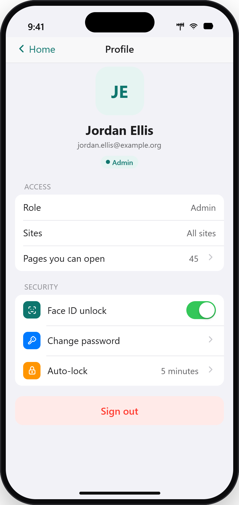

- **Purpose:** Account, access summary and device security.
- **Layout:** Avatar header, access group, security group, sign out.
- **Components:** Avatar, Inset lists, Toggle, Destructive button
- **Data displayed:** Name, email, role, assigned sites, count of pages the role can open.
- **Actions:** Change password, toggle Face ID, set auto-lock, sign out.
- **Navigation:** Pushed from Home or More.
- **Permissions:** Read-only for role and sites (only an admin changes them).
- **Mobile interactions:** Biometric toggle prompts Face ID to confirm.

## 08-roles/regional-manager

### Home — Regional Manager

- **Purpose:** Role-aware landing screen for Manager (regional).
- **Layout:** Large-title bar with notifications bell (badge) and profile; greeting and site scope pill; KPI grid; quick actions; needs-attention list; guest statistics chart; approvals card for finance roles.
- **Components:** KPI cards, Quick action tiles, Needs-attention cards, Donut chart, Tab bar
- **Data displayed:** Counts come from the same permitted, site-scoped data as the web Executive Dashboard; scope: All sites.
- **Actions:** Open a KPI or card to jump to its module; quick actions open the create form; pull to refresh.
- **Navigation:** KPI → filtered list. Bell → Notifications. Avatar → Profile.
- **Permissions:** Widgets are shown only for pages the role can view. Reports and export; no Users/Properties pages, no deletes, no Audit/Settings.
- **Mobile interactions:** Widgets can be reordered and hidden (web: personalised dashboard builder); long-press to edit.

### Safeguarding hub — Regional Manager

- **Purpose:** Module landing for the Safeguarding category.
- **Layout:** Large title, search, inset list of modules with coloured symbol tiles.
- **Components:** Inset list, Symbol tiles, Search field
- **Data displayed:** Module names from the web page registry.
- **Actions:** Open module; search modules.
- **Navigation:** Row → module list.
- **Permissions:** Shows only modules Regional Manager can open (14 of 14).
- **Mobile interactions:** Recently used modules float to the top.

### Operations hub — Regional Manager

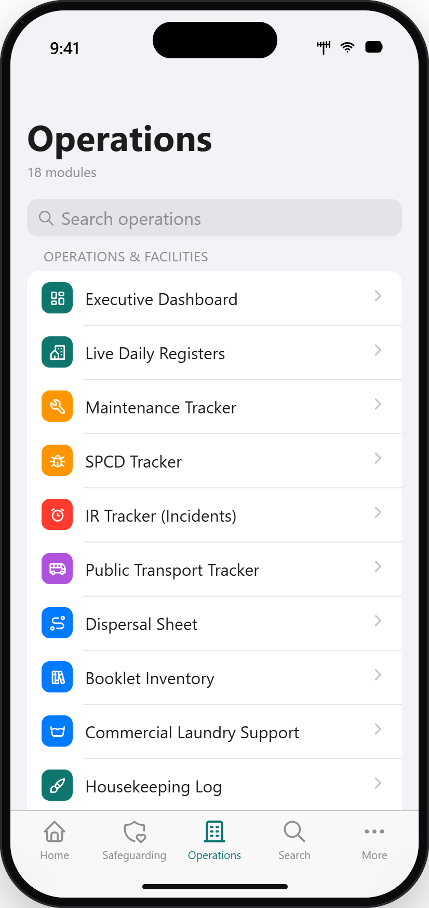

- **Purpose:** Module landing for Overview and Facilities & Welfare.
- **Layout:** Large title, search, inset list of modules.
- **Components:** Inset list, Symbol tiles
- **Data displayed:** Module names from the web page registry.
- **Actions:** Open module.
- **Navigation:** Row → module list.
- **Permissions:** Shows only modules Regional Manager can open (18 of 18).
- **Mobile interactions:** —

### More — Regional Manager

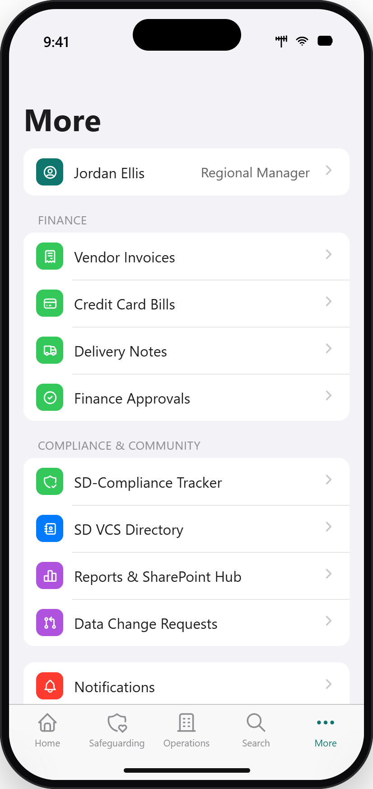

- **Purpose:** Everything not in the other four tabs, grouped by the web categories, filtered by role.
- **Layout:** Profile row, then grouped lists for Finance, Compliance & Community and Admin & Governance, then notifications and sign out.
- **Components:** Inset lists, Profile row
- **Data displayed:** Module names from the page registry; groups empty for this role are hidden.
- **Actions:** Open module, profile, sign out.
- **Navigation:** Row → module.
- **Permissions:** Reports and export; no Users/Properties pages, no deletes, no Audit/Settings.
- **Mobile interactions:** Groups collapse when empty; nothing is greyed-out — unavailable modules are simply absent.

### Profile — Regional Manager

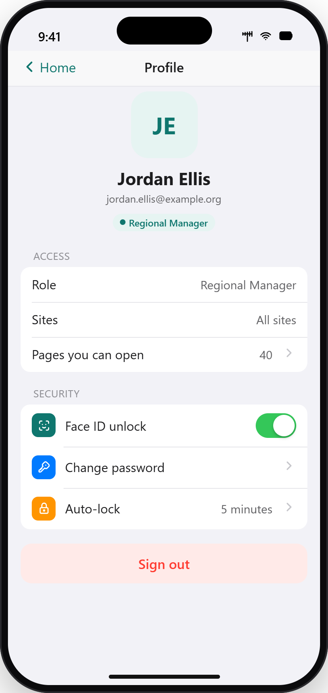

- **Purpose:** Account, access summary and device security.
- **Layout:** Avatar header, access group, security group, sign out.
- **Components:** Avatar, Inset lists, Toggle, Destructive button
- **Data displayed:** Name, email, role, assigned sites, count of pages the role can open.
- **Actions:** Change password, toggle Face ID, set auto-lock, sign out.
- **Navigation:** Pushed from Home or More.
- **Permissions:** Read-only for role and sites (only an admin changes them).
- **Mobile interactions:** Biometric toggle prompts Face ID to confirm.

## 08-roles/general-manager

### Home — General Manager

- **Purpose:** Role-aware landing screen for Manager (site).
- **Layout:** Large-title bar with notifications bell (badge) and profile; greeting and site scope pill; KPI grid; quick actions; needs-attention list; guest statistics chart; approvals card for finance roles.
- **Components:** KPI cards, Quick action tiles, Needs-attention cards, Donut chart, Tab bar
- **Data displayed:** Counts come from the same permitted, site-scoped data as the web Executive Dashboard; scope: Assigned sites.
- **Actions:** Open a KPI or card to jump to its module; quick actions open the create form; pull to refresh.
- **Navigation:** KPI → filtered list. Bell → Notifications. Avatar → Profile.
- **Permissions:** Widgets are shown only for pages the role can view. Reports and export; Users and Properties limited to own sites and lower roles.
- **Mobile interactions:** Widgets can be reordered and hidden (web: personalised dashboard builder); long-press to edit.

### Safeguarding hub — General Manager

- **Purpose:** Module landing for the Safeguarding category.
- **Layout:** Large title, search, inset list of modules with coloured symbol tiles.
- **Components:** Inset list, Symbol tiles, Search field
- **Data displayed:** Module names from the web page registry.
- **Actions:** Open module; search modules.
- **Navigation:** Row → module list.
- **Permissions:** Shows only modules General Manager can open (14 of 14).
- **Mobile interactions:** Recently used modules float to the top.

### Operations hub — General Manager

- **Purpose:** Module landing for Overview and Facilities & Welfare.
- **Layout:** Large title, search, inset list of modules.
- **Components:** Inset list, Symbol tiles
- **Data displayed:** Module names from the web page registry.
- **Actions:** Open module.
- **Navigation:** Row → module list.
- **Permissions:** Shows only modules General Manager can open (18 of 18).
- **Mobile interactions:** —

### More — General Manager

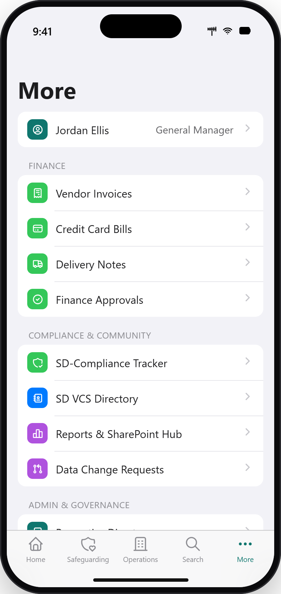

- **Purpose:** Everything not in the other four tabs, grouped by the web categories, filtered by role.
- **Layout:** Profile row, then grouped lists for Finance, Compliance & Community and Admin & Governance, then notifications and sign out.
- **Components:** Inset lists, Profile row
- **Data displayed:** Module names from the page registry; groups empty for this role are hidden.
- **Actions:** Open module, profile, sign out.
- **Navigation:** Row → module.
- **Permissions:** Reports and export; Users and Properties limited to own sites and lower roles.
- **Mobile interactions:** Groups collapse when empty; nothing is greyed-out — unavailable modules are simply absent.

### Profile — General Manager

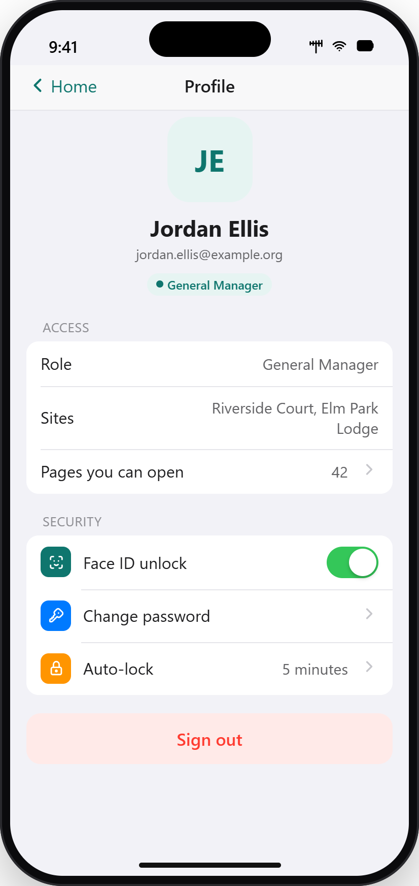

- **Purpose:** Account, access summary and device security.
- **Layout:** Avatar header, access group, security group, sign out.
- **Components:** Avatar, Inset lists, Toggle, Destructive button
- **Data displayed:** Name, email, role, assigned sites, count of pages the role can open.
- **Actions:** Change password, toggle Face ID, set auto-lock, sign out.
- **Navigation:** Pushed from Home or More.
- **Permissions:** Read-only for role and sites (only an admin changes them).
- **Mobile interactions:** Biometric toggle prompts Face ID to confirm.

## 08-roles/area-manager

### Home — Area Manager

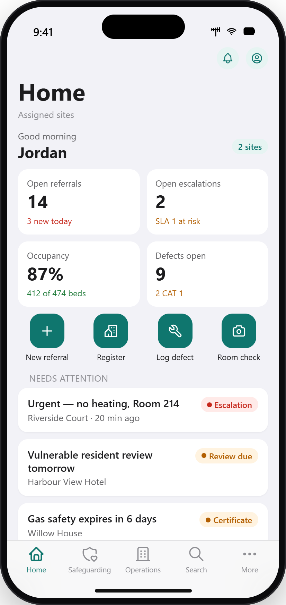

- **Purpose:** Role-aware landing screen for Manager (area).
- **Layout:** Large-title bar with notifications bell (badge) and profile; greeting and site scope pill; KPI grid; quick actions; needs-attention list; guest statistics chart; approvals card for finance roles.
- **Components:** KPI cards, Quick action tiles, Needs-attention cards, Donut chart, Tab bar
- **Data displayed:** Counts come from the same permitted, site-scoped data as the web Executive Dashboard; scope: Assigned sites.
- **Actions:** Open a KPI or card to jump to its module; quick actions open the create form; pull to refresh.
- **Navigation:** KPI → filtered list. Bell → Notifications. Avatar → Profile.
- **Permissions:** Widgets are shown only for pages the role can view. Same as General Manager.
- **Mobile interactions:** Widgets can be reordered and hidden (web: personalised dashboard builder); long-press to edit.

### Safeguarding hub — Area Manager

- **Purpose:** Module landing for the Safeguarding category.
- **Layout:** Large title, search, inset list of modules with coloured symbol tiles.
- **Components:** Inset list, Symbol tiles, Search field
- **Data displayed:** Module names from the web page registry.
- **Actions:** Open module; search modules.
- **Navigation:** Row → module list.
- **Permissions:** Shows only modules Area Manager can open (14 of 14).
- **Mobile interactions:** Recently used modules float to the top.

### Operations hub — Area Manager

- **Purpose:** Module landing for Overview and Facilities & Welfare.
- **Layout:** Large title, search, inset list of modules.
- **Components:** Inset list, Symbol tiles
- **Data displayed:** Module names from the web page registry.
- **Actions:** Open module.
- **Navigation:** Row → module list.
- **Permissions:** Shows only modules Area Manager can open (18 of 18).
- **Mobile interactions:** —

### More — Area Manager

- **Purpose:** Everything not in the other four tabs, grouped by the web categories, filtered by role.
- **Layout:** Profile row, then grouped lists for Finance, Compliance & Community and Admin & Governance, then notifications and sign out.
- **Components:** Inset lists, Profile row
- **Data displayed:** Module names from the page registry; groups empty for this role are hidden.
- **Actions:** Open module, profile, sign out.
- **Navigation:** Row → module.
- **Permissions:** Same as General Manager.
- **Mobile interactions:** Groups collapse when empty; nothing is greyed-out — unavailable modules are simply absent.

### Profile — Area Manager

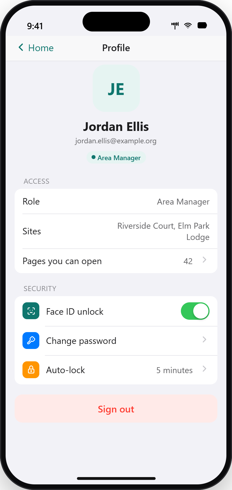

- **Purpose:** Account, access summary and device security.
- **Layout:** Avatar header, access group, security group, sign out.
- **Components:** Avatar, Inset lists, Toggle, Destructive button
- **Data displayed:** Name, email, role, assigned sites, count of pages the role can open.
- **Actions:** Change password, toggle Face ID, set auto-lock, sign out.
- **Navigation:** Pushed from Home or More.
- **Permissions:** Read-only for role and sites (only an admin changes them).
- **Mobile interactions:** Biometric toggle prompts Face ID to confirm.

## 08-roles/staff

### Home — Staff

- **Purpose:** Role-aware landing screen for Frontline staff.
- **Layout:** Large-title bar with notifications bell (badge) and profile; greeting and site scope pill; KPI grid; quick actions; needs-attention list; guest statistics chart; approvals card for finance roles.
- **Components:** KPI cards, Quick action tiles, Needs-attention cards, Donut chart, Tab bar
- **Data displayed:** Counts come from the same permitted, site-scoped data as the web Executive Dashboard; scope: Assigned sites.
- **Actions:** Open a KPI or card to jump to its module; quick actions open the create form; pull to refresh.
- **Navigation:** KPI → filtered list. Bell → Notifications. Avatar → Profile.
- **Permissions:** Widgets are shown only for pages the role can view. Create and edit records; no export, no archive/restore, no Reports/Audit/Settings; Users and Properties limited to own sites.
- **Mobile interactions:** Widgets can be reordered and hidden (web: personalised dashboard builder); long-press to edit.

### Safeguarding hub — Staff

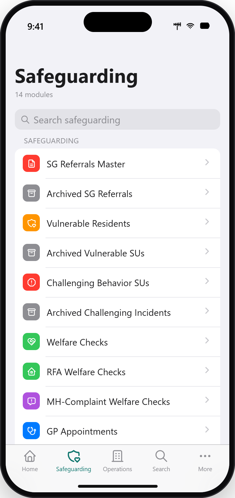

- **Purpose:** Module landing for the Safeguarding category.
- **Layout:** Large title, search, inset list of modules with coloured symbol tiles.
- **Components:** Inset list, Symbol tiles, Search field
- **Data displayed:** Module names from the web page registry.
- **Actions:** Open module; search modules.
- **Navigation:** Row → module list.
- **Permissions:** Shows only modules Staff can open (14 of 14).
- **Mobile interactions:** Recently used modules float to the top.

### Operations hub — Staff

- **Purpose:** Module landing for Overview and Facilities & Welfare.
- **Layout:** Large title, search, inset list of modules.
- **Components:** Inset list, Symbol tiles
- **Data displayed:** Module names from the web page registry.
- **Actions:** Open module.
- **Navigation:** Row → module list.
- **Permissions:** Shows only modules Staff can open (18 of 18).
- **Mobile interactions:** —

### More — Staff

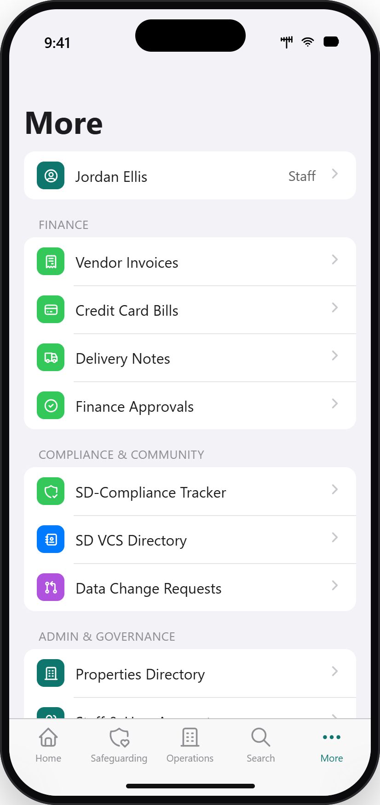

- **Purpose:** Everything not in the other four tabs, grouped by the web categories, filtered by role.
- **Layout:** Profile row, then grouped lists for Finance, Compliance & Community and Admin & Governance, then notifications and sign out.
- **Components:** Inset lists, Profile row
- **Data displayed:** Module names from the page registry; groups empty for this role are hidden.
- **Actions:** Open module, profile, sign out.
- **Navigation:** Row → module.
- **Permissions:** Create and edit records; no export, no archive/restore, no Reports/Audit/Settings; Users and Properties limited to own sites.
- **Mobile interactions:** Groups collapse when empty; nothing is greyed-out — unavailable modules are simply absent.

### Profile — Staff

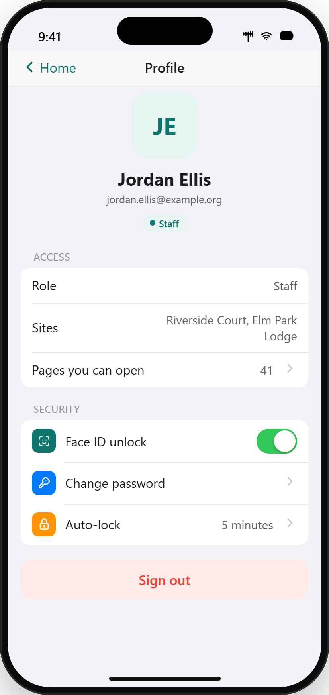

- **Purpose:** Account, access summary and device security.
- **Layout:** Avatar header, access group, security group, sign out.
- **Components:** Avatar, Inset lists, Toggle, Destructive button
- **Data displayed:** Name, email, role, assigned sites, count of pages the role can open.
- **Actions:** Change password, toggle Face ID, set auto-lock, sign out.
- **Navigation:** Pushed from Home or More.
- **Permissions:** Read-only for role and sites (only an admin changes them).
- **Mobile interactions:** Biometric toggle prompts Face ID to confirm.

## 02-home

### Home — Super Admin

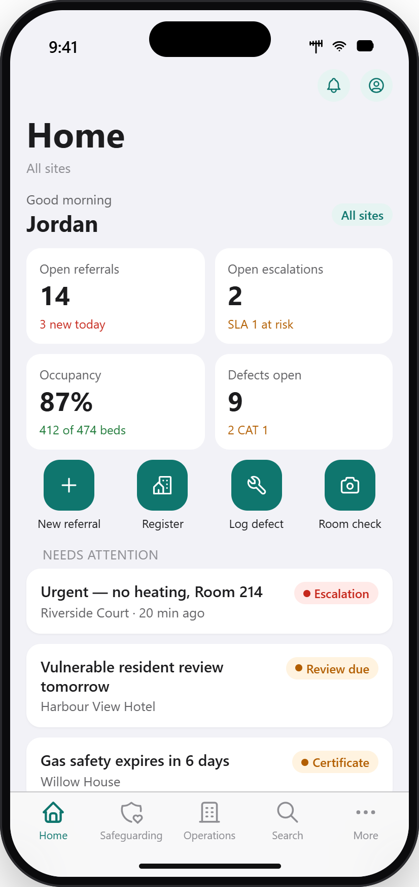

- **Purpose:** Role-aware landing screen for Platform owner.
- **Layout:** Large-title bar with notifications bell (badge) and profile; greeting and site scope pill; KPI grid; quick actions; needs-attention list; guest statistics chart; approvals card for finance roles.
- **Components:** KPI cards, Quick action tiles, Needs-attention cards, Donut chart, Tab bar
- **Data displayed:** Counts come from the same permitted, site-scoped data as the web Executive Dashboard; scope: All sites.
- **Actions:** Open a KPI or card to jump to its module; quick actions open the create form; pull to refresh.
- **Navigation:** KPI → filtered list. Bell → Notifications. Avatar → Profile.
- **Permissions:** Widgets are shown only for pages the role can view. Page Access, Page Maintenance, Roles & RBAC, Field Options, restore of archived/deleted users and properties.
- **Mobile interactions:** Widgets can be reordered and hidden (web: personalised dashboard builder); long-press to edit.

## 04-operations

### Live Daily Registers — hub

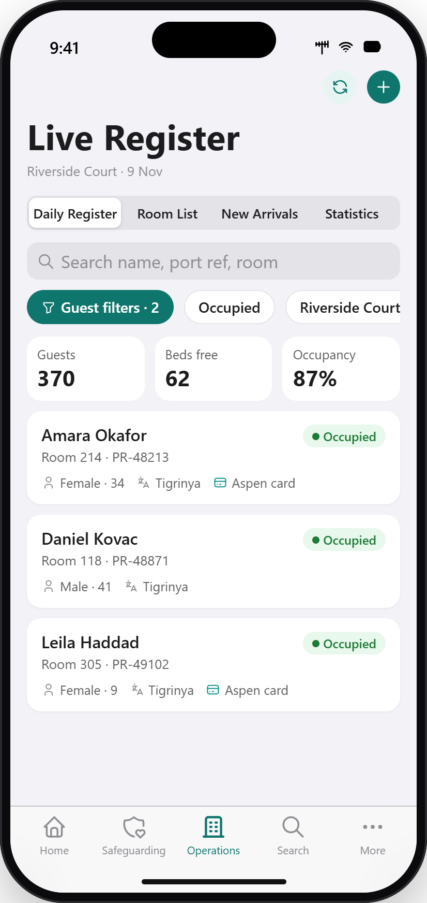

- **Purpose:** The real-time headcount register: residents, rooms, arrivals, statistics.
- **Layout:** Large title with site and date; segmented control for the four primary views (the other 5 web sheets sit under a "More views" row: Live Register Statistics, User Guide, Cross Checks & Validation, Language Summary, Family Groups, Summary & Guest Statistics); KPI strip; guest-filter chip; resident cards.
- **Components:** Segmented control, Search field, Filter chips, KPI strip, Resident cards
- **Data displayed:** Room, port ref, name, age, nationality/language, Aspen card flag, occupied state.
- **Actions:** Search, open Guest filters, add resident, refresh/sync, export (permitted roles).
- **Navigation:** Card → resident detail. Chip → Guest filters sheet.
- **Permissions:** Page "dailyRegisters": view for all roles; no create on this page per page-action rules; allocation done from New Arrivals / forms.
- **Mobile interactions:** Swipe card for Move room / Check out; site and date pickers in the nav subtitle.

### Daily Register — Guest filters sheet

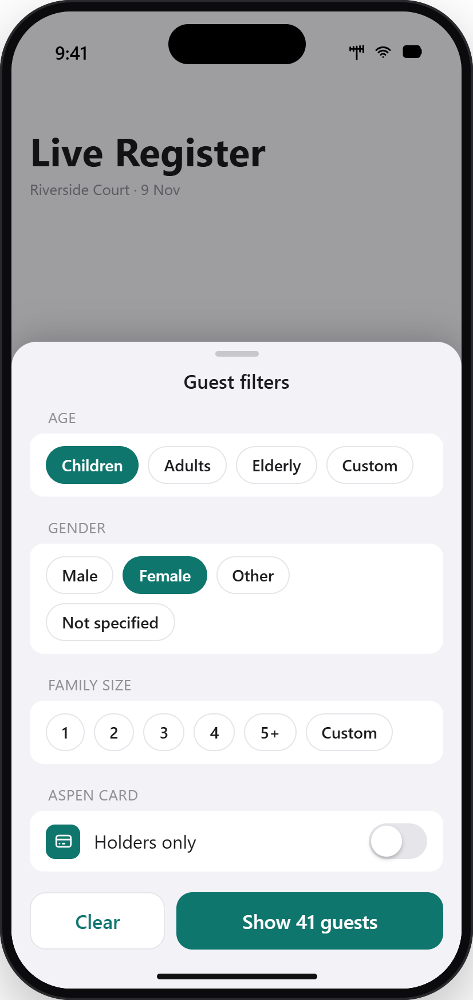

- **Purpose:** Age, gender, family size and Aspen card filters (collapsible panel on web).
- **Layout:** Large sheet; chip groups for each filter; Clear and result-count button.
- **Components:** Bottom sheet, Chip groups, Toggle
- **Data displayed:** Age uses DOB, then stored age, then age group (children <18, elderly 65+). Family size uses family-group members, or people sharing the room.
- **Actions:** Select filters, Clear, apply.
- **Navigation:** Applies to the register list; Dashboard cards deep-link here with the filter set.
- **Permissions:** Same site scoping as the register.
- **Mobile interactions:** Selections persist as removable chips on the list.

### Room List — interconnecting rooms

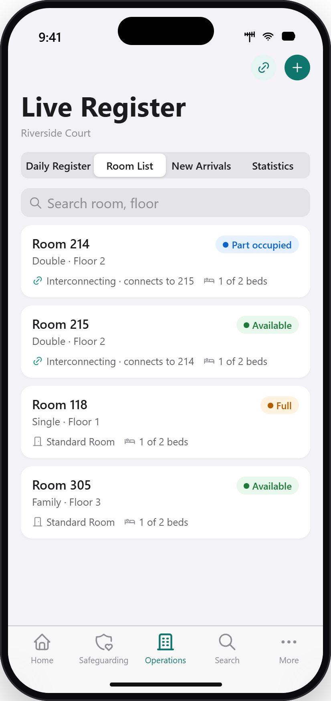

- **Purpose:** Room inventory with interconnecting status, connected rooms, occupancy and availability.
- **Layout:** Segmented hub; room cards with type, connection badge, occupancy and availability badge; link button for managers.
- **Components:** Room cards, Interconnecting badge, Availability badge
- **Data displayed:** Room number, type, interconnecting status, connected rooms, current occupancy, availability.
- **Actions:** Open room, add room, connect rooms (managers).
- **Navigation:** Link button → Connect rooms sheet.
- **Permissions:** Configure links: Super Admin, Admin, General/Area Manager. Staff view and allocate only.
- **Mobile interactions:** Group availability (fully / partially / none) shown on the badge.

### Connect rooms sheet

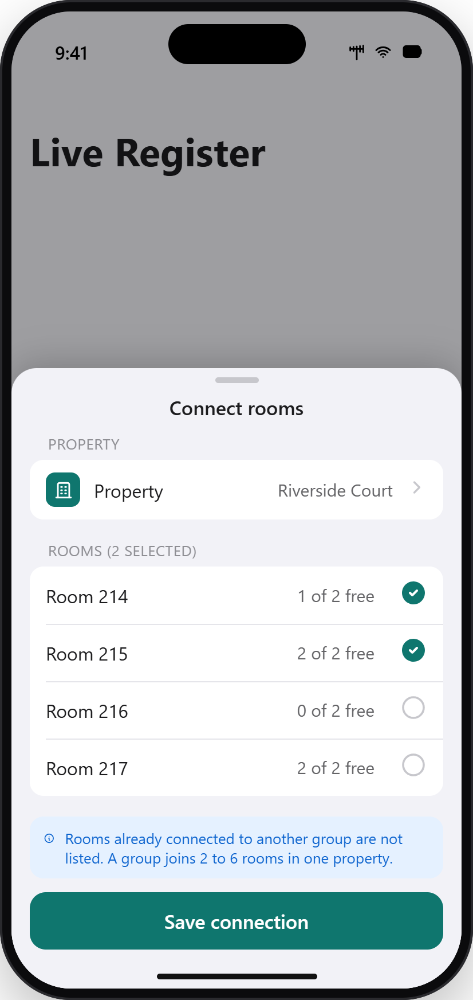

- **Purpose:** Configure an interconnecting group (managers).
- **Layout:** Sheet with property, searchable room checklist with free beds, rules note, save.
- **Components:** Bottom sheet, Checklist, Banner
- **Data displayed:** Rooms of the property not already in a group, with free beds.
- **Actions:** Select 2–6 rooms, Save, Remove connection (when editing).
- **Navigation:** Returns to the Room List.
- **Permissions:** Super Admin, Admin, General Manager, Area Manager (enforced in app, API and database).
- **Mobile interactions:** Validation: same property, no duplicates, no room in two groups.

### SU allocation — room selection

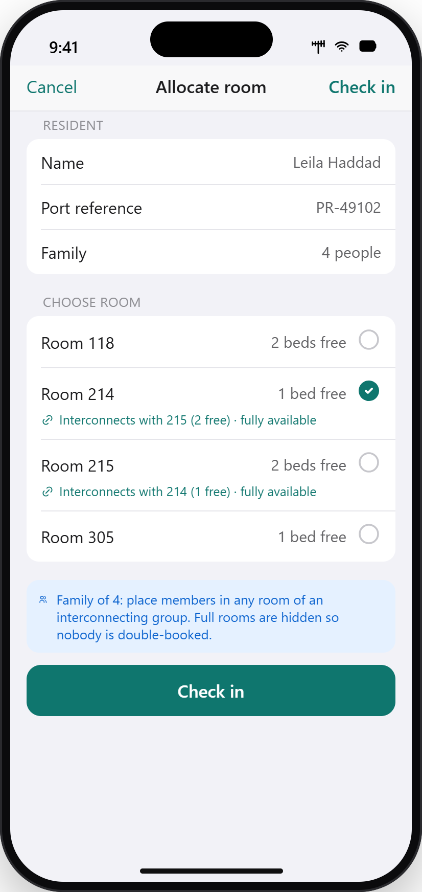

- **Purpose:** Place a resident (or family) in a room, showing interconnecting availability.
- **Layout:** Resident summary, room picker with free beds and connected-room hints, family note.
- **Components:** Inset rows, Radio selection, Info banner
- **Data displayed:** Rooms with at least one free bed; connected room numbers and their free beds; group availability.
- **Actions:** Pick room, check in, repeat for other family members in connected rooms.
- **Navigation:** From New Arrivals or the register form; returns to the register.
- **Permissions:** Create/edit on dailyRegisters; allocation rules unchanged (capacity, one active placement per port ref).
- **Mobile interactions:** Selecting a connected room offers "Place next family member here".

### Daily Register — Guest statistics

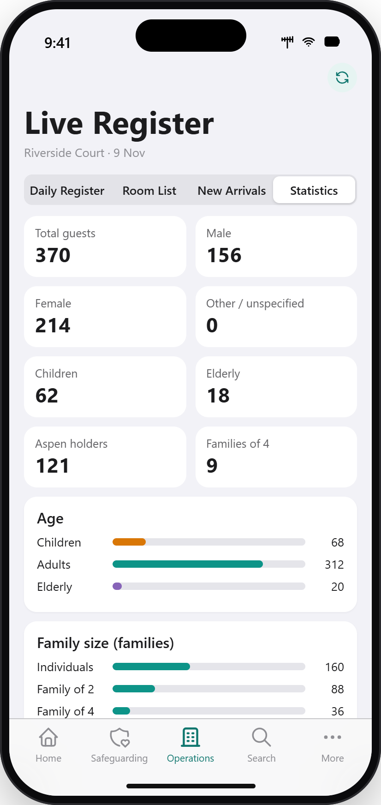

- **Purpose:** Summary cards and charts for the selected site and date.
- **Layout:** KPI grid then chart cards (bars/donut); every figure is tappable.
- **Components:** KPI cards, Bar charts, Donut charts
- **Data displayed:** Counts de-duplicated per guest; family cards count families.
- **Actions:** Tap a figure → Daily Register filtered to it.
- **Navigation:** Deep link with filter, site and date.
- **Permissions:** Site scope applies.
- **Mobile interactions:** Charts expose values to VoiceOver as a list.

### Daily Register — Family Groups

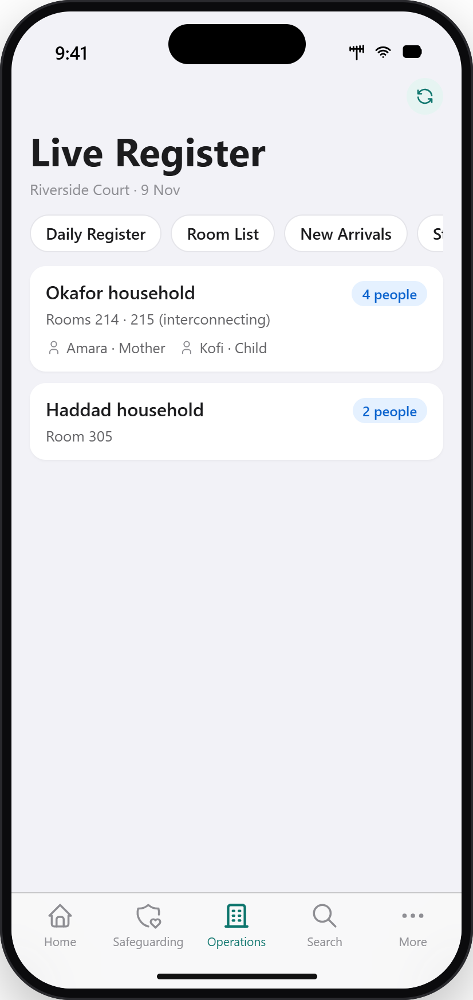

- **Purpose:** Households and who is in each (web: Family Groups tab).
- **Layout:** Household cards with member count and rooms.
- **Components:** Household cards
- **Data displayed:** Family name, members, relationship, rooms.
- **Actions:** Open household, add or remove member.
- **Navigation:** Card → household detail.
- **Permissions:** Needs family groups access.
- **Mobile interactions:** Swipe a member to remove with reason.

### Daily Register — Cross checks & validation

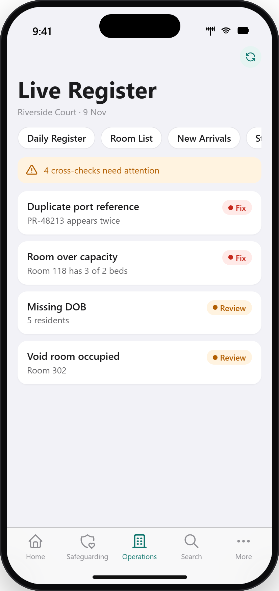

- **Purpose:** Data-quality checks across rooms and residents.
- **Layout:** Summary banner then check cards.
- **Components:** Banner, Check cards
- **Data displayed:** Check name, count, affected records.
- **Actions:** Open affected record, mark reviewed.
- **Navigation:** Card → filtered register.
- **Permissions:** Same as register.
- **Mobile interactions:** —

### Daily Register — Nationality & language summary

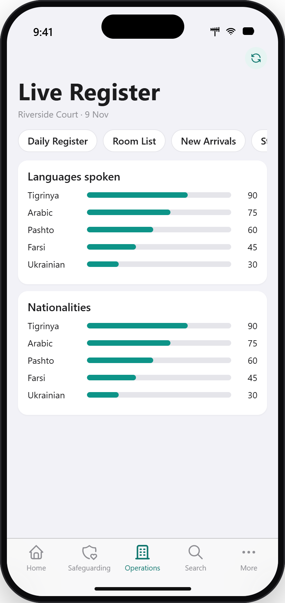

- **Purpose:** Counts of languages and nationalities.
- **Layout:** Bar lists.
- **Components:** Bar charts
- **Data displayed:** Counts per language/nationality.
- **Actions:** Tap a bar to filter the register.
- **Navigation:** Deep link to register.
- **Permissions:** Site scope.
- **Mobile interactions:** —

### Daily Register — User Guide

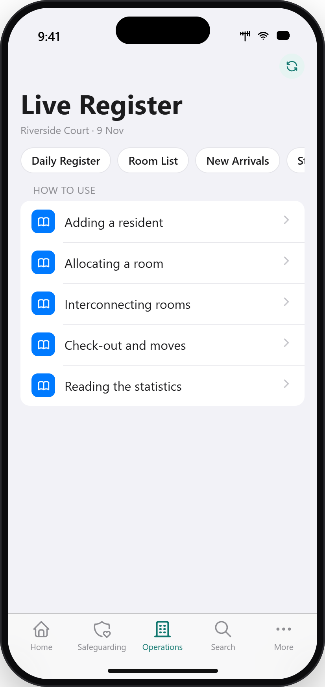

- **Purpose:** In-app help (web: User Guide tab).
- **Layout:** List of help articles.
- **Components:** Inset list
- **Data displayed:** Static guide content.
- **Actions:** Open article.
- **Navigation:** Row → article.
- **Permissions:** All roles.
- **Mobile interactions:** —

### Daily Register — New Arrivals

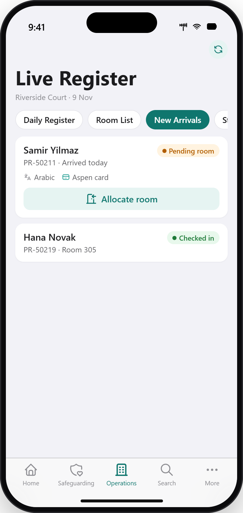

- **Purpose:** Intake queue for people arriving today.
- **Layout:** Arrival cards with status and Allocate room action.
- **Components:** Arrival cards, Primary action
- **Data displayed:** Port ref, name, language, Aspen card, hotel, room, status.
- **Actions:** Allocate room, edit, check in.
- **Navigation:** Allocate → room picker.
- **Permissions:** Create/edit.
- **Mobile interactions:** Check-in creates the register entry and carries the Aspen card.

### Daily Register — Summary

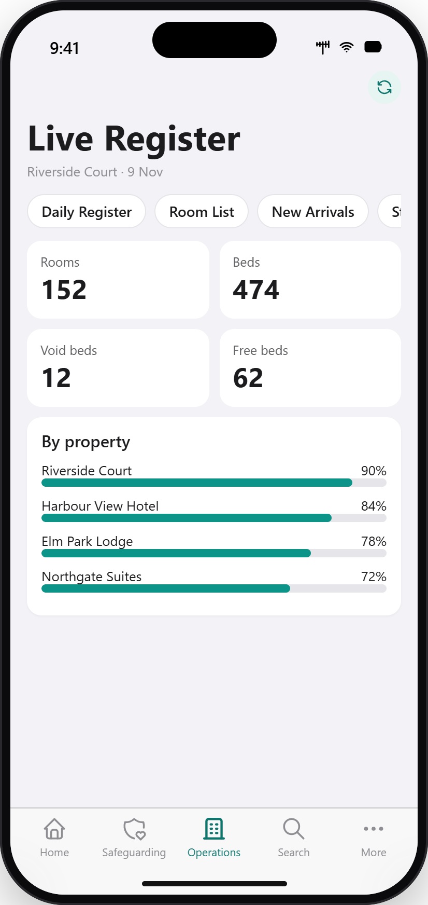

- **Purpose:** Room and bed summary by property.
- **Layout:** KPI grid and per-property occupancy bars.
- **Components:** KPI cards, Progress bars
- **Data displayed:** Rooms, beds, void, free, occupancy.
- **Actions:** Tap a property to filter.
- **Navigation:** Deep link.
- **Permissions:** Site scope.
- **Mobile interactions:** —

### Live Daily Registers — Detail

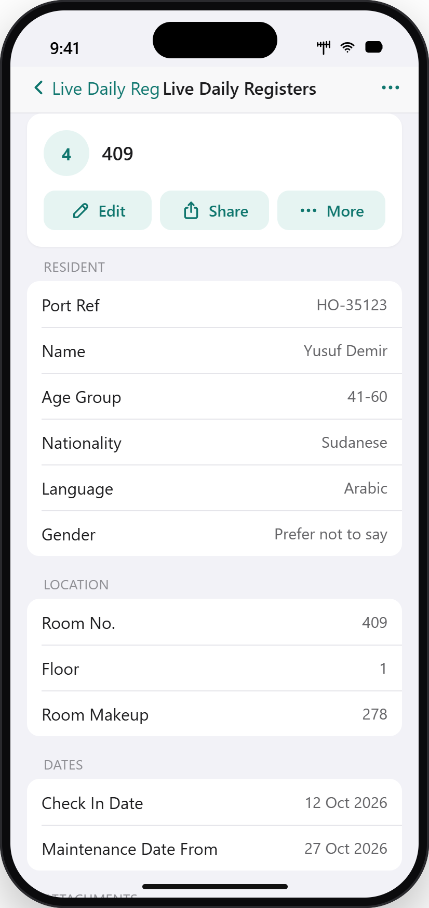

- **Purpose:** Read and act on one record.
- **Layout:** Inline navigation bar, summary card (avatar/initials, name, status, quick actions), grouped inset sections, attachments and history.
- **Components:** Summary card, Quick action buttons, Grouped inset list, Attachments row, Audit-trail row
- **Data displayed:** All fields of the web record, grouped: Resident, Location, Dates, Case details.
- **Actions:** Edit, share, overflow menu (archive, delete where permitted), open attachments, open audit trail.
- **Navigation:** Back to list; Edit → form; Attachments → viewer; Audit trail → timeline.
- **Permissions:** Visible when the user can view "dailyRegisters" (role rules plus any per-user Page Access override).
- **Mobile interactions:** Long-press a value to copy; tap phone/email to call/compose; share sheet for export.

### Live Daily Registers — Form

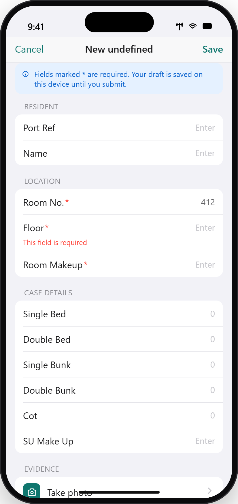

- **Purpose:** Create or edit a record.
- **Layout:** Modal form: Cancel / title / Save, grouped sections (Resident, Location, Dates, Case details), evidence section.
- **Components:** Inset form rows, Pickers (date, time, select), Toggles for Yes/No, Multiline notes, Camera / Scan / Files rows, Inline validation, Draft banner
- **Data displayed:** 26 fields from the web form (6 pickers, 3 dates).
- **Actions:** Save, Cancel (confirm if edited), attach evidence.
- **Navigation:** Presented modally from the list or detail; Save returns to the record.
- **Permissions:** Needs create/edit on "dailyRegisters". Visible when the user can view "dailyRegisters" (role rules plus any per-user Page Access override).
- **Mobile interactions:** Native pickers, keyboard avoidance with Next/Done, inline errors, draft kept on device.

### Maintenance Tracker — List

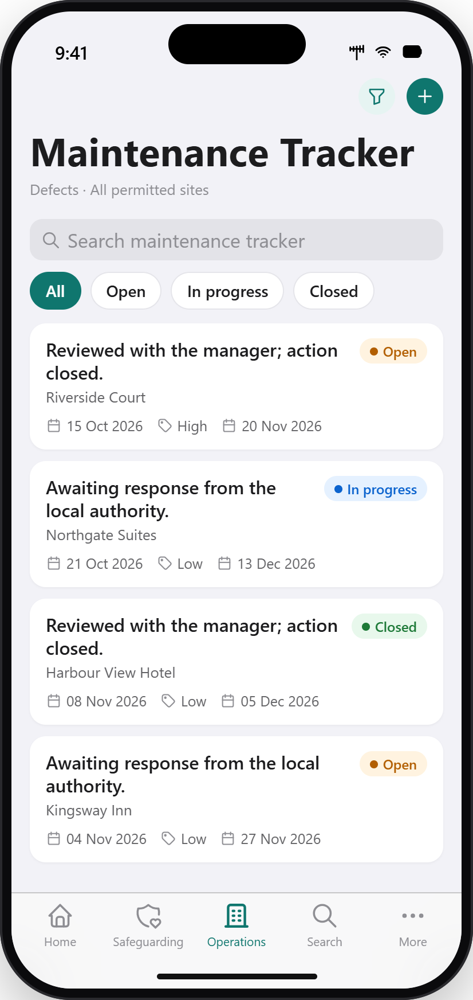

- **Purpose:** Property defect reports, emergency CAT 1 hazards, and contractor remediation.
- **Layout:** Large-title navigation bar, optional segmented control, search field, status chips, then a card per record. Bottom tab bar stays visible.
- **Components:** Large title bar, Search field, Filter chips, Record cards with status badge, Pull-to-refresh, Add button (nav bar)
- **Data displayed:** Each card shows the record title, subtitle and up to three facts. Source fields: Report Date, Priority Category, Timescale, Location, Hotel / Site, Room / Unit, HO Criteria Code, Defect Description…
- **Actions:** Log defect. Open record, filter, search, swipe for quick actions (edit / archive where permitted). Page actions in the web app: view, create, edit, delete, export.
- **Navigation:** Tap card → Detail. Filter button → filter sheet. Plus → form (modal).
- **Permissions:** Visible when the user can view "maintenance" (role rules plus any per-user Page Access override).
- **Mobile interactions:** Priority colour band on each card; photo capture for evidence; criteria guide in a sheet. Swipe left for actions; pull down to sync; infinite scroll replaces desktop pagination.

### Maintenance Tracker — Detail

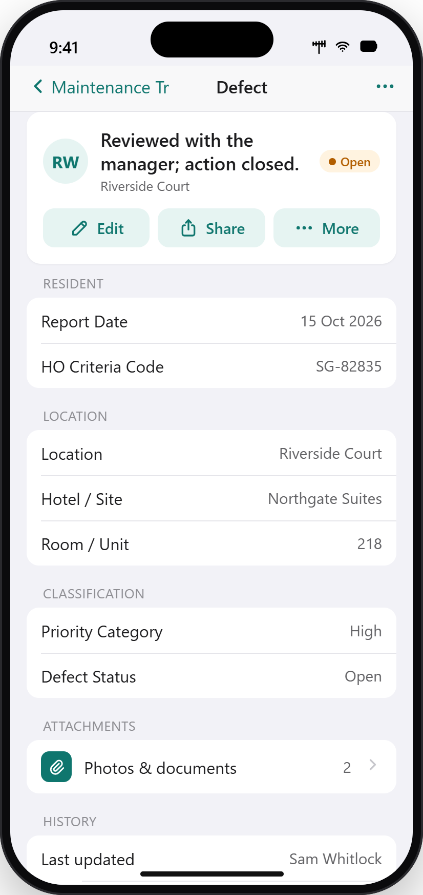

- **Purpose:** Read and act on one Defect.
- **Layout:** Inline navigation bar, summary card (avatar/initials, name, status, quick actions), grouped inset sections, attachments and history.
- **Components:** Summary card, Quick action buttons, Grouped inset list, Attachments row, Audit-trail row
- **Data displayed:** All fields of the web record, grouped: Resident, Location, Classification, Dates, Case details.
- **Actions:** Edit, share, overflow menu (archive, delete where permitted), open attachments, open audit trail.
- **Navigation:** Back to list; Edit → form; Attachments → viewer; Audit trail → timeline.
- **Permissions:** Visible when the user can view "maintenance" (role rules plus any per-user Page Access override).
- **Mobile interactions:** Long-press a value to copy; tap phone/email to call/compose; share sheet for export.

### Maintenance Tracker — Form

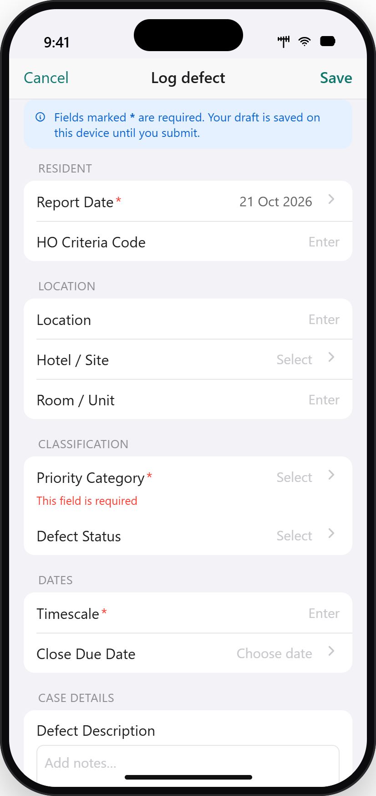

- **Purpose:** Create or edit a Defect.
- **Layout:** Modal form: Cancel / title / Save, grouped sections (Resident, Location, Classification, Dates, Case details), evidence section.
- **Components:** Inset form rows, Pickers (date, time, select), Toggles for Yes/No, Multiline notes, Camera / Scan / Files rows, Inline validation, Draft banner
- **Data displayed:** 15 fields from the web form (3 pickers, 3 dates).
- **Actions:** Save, Cancel (confirm if edited), attach evidence.
- **Navigation:** Presented modally from the list or detail; Save returns to the record.
- **Permissions:** Needs create/edit on "maintenance". Visible when the user can view "maintenance" (role rules plus any per-user Page Access override).
- **Mobile interactions:** Native pickers, keyboard avoidance with Next/Done, inline errors, draft kept on device.

### Maintenance Tracker — Filter sheet

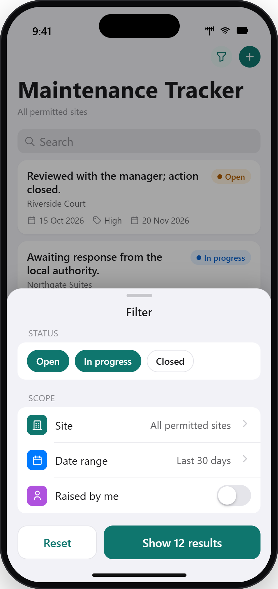

- **Purpose:** Narrow the Maintenance Tracker list without leaving it.
- **Layout:** Medium bottom sheet over the list; grabber, grouped controls, Reset and primary apply button.
- **Components:** Bottom sheet, Status chips (multi-select), Inset rows (site, date range), Toggle
- **Data displayed:** Status values and site list from the same sources as the web filters; result count is live.
- **Actions:** Apply, Reset, dismiss by swipe.
- **Navigation:** Sheet; returns to the list.
- **Permissions:** Site choices are limited to the sites the signed-in role may see.
- **Mobile interactions:** Haptic on apply; selection count shown on the filter button.

### SPCD Tracker — List

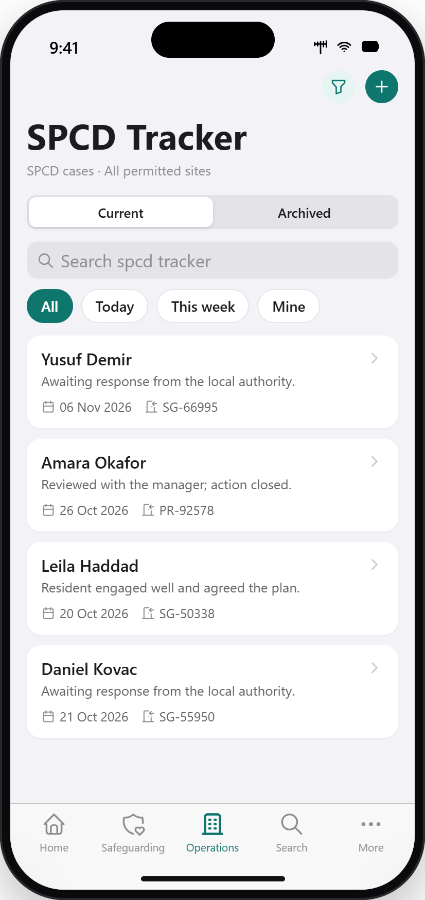

- **Purpose:** Special Pest Control & Decontamination logs and resolution statuses.
- **Layout:** Large-title navigation bar, optional segmented control (Current / Archived), search field, status chips, then a card per record. Bottom tab bar stays visible.
- **Components:** Large title bar, Search field, Filter chips, Record cards with status badge, Pull-to-refresh, Add button (nav bar)
- **Data displayed:** Each card shows the record title, subtitle and up to three facts. Source fields: Case Date, Hotel / Site, Room Number, Service User Name, PORT / NASS Ref, Date of Birth, Raised By, Action Taken / Description…
- **Actions:** Add SPCD entry. Open record, filter, search, swipe for quick actions (edit / archive where permitted). Page actions in the web app: view, create, edit, delete, export.
- **Navigation:** Tap card → Detail. Filter button → filter sheet. Plus → form (modal).
- **Permissions:** Visible when the user can view "spcd" (role rules plus any per-user Page Access override).
- **Mobile interactions:** Current and Archived become a segmented control. Swipe left for actions; pull down to sync; infinite scroll replaces desktop pagination.

### SPCD Tracker — Detail

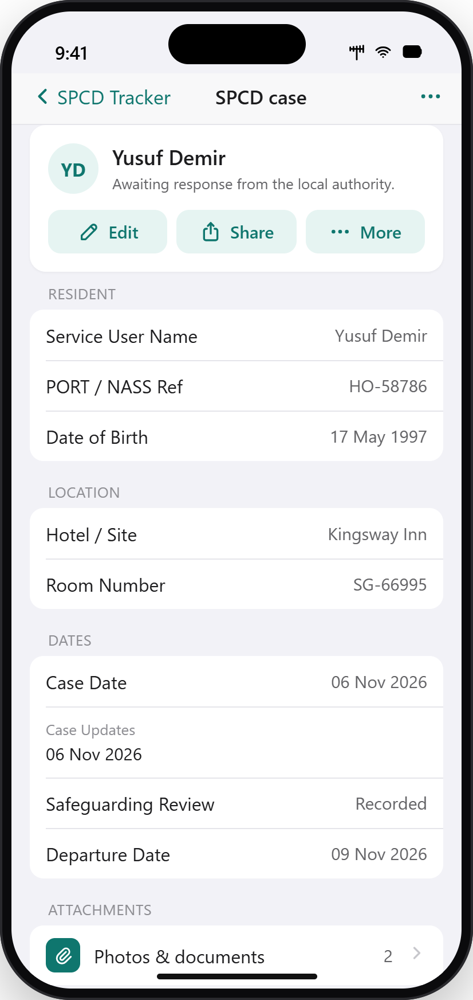

- **Purpose:** Read and act on one SPCD case.
- **Layout:** Inline navigation bar, summary card (avatar/initials, name, status, quick actions), grouped inset sections, attachments and history.
- **Components:** Summary card, Quick action buttons, Grouped inset list, Attachments row, Audit-trail row
- **Data displayed:** All fields of the web record, grouped: Resident, Location, Dates, Case details.
- **Actions:** Edit, share, overflow menu (archive, delete where permitted), open attachments, open audit trail.
- **Navigation:** Back to list; Edit → form; Attachments → viewer; Audit trail → timeline.
- **Permissions:** Visible when the user can view "spcd" (role rules plus any per-user Page Access override).
- **Mobile interactions:** Long-press a value to copy; tap phone/email to call/compose; share sheet for export.

### SPCD Tracker — Form

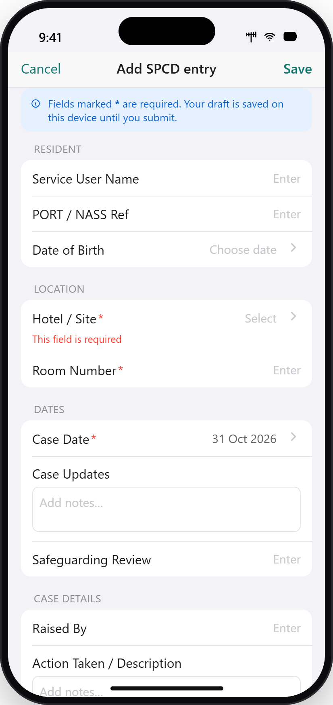

- **Purpose:** Create or edit a SPCD case.
- **Layout:** Modal form: Cancel / title / Save, grouped sections (Resident, Location, Dates, Case details), evidence section.
- **Components:** Inset form rows, Pickers (date, time, select), Toggles for Yes/No, Multiline notes, Camera / Scan / Files rows, Inline validation, Draft banner
- **Data displayed:** 13 fields from the web form (1 pickers, 3 dates).
- **Actions:** Save, Cancel (confirm if edited), attach evidence.
- **Navigation:** Presented modally from the list or detail; Save returns to the record.
- **Permissions:** Needs create/edit on "spcd". Visible when the user can view "spcd" (role rules plus any per-user Page Access override).
- **Mobile interactions:** Native pickers, keyboard avoidance with Next/Done, inline errors, draft kept on device.

### SPCD Tracker — Filter sheet

- **Purpose:** Narrow the SPCD Tracker list without leaving it.
- **Layout:** Medium bottom sheet over the list; grabber, grouped controls, Reset and primary apply button.
- **Components:** Bottom sheet, Status chips (multi-select), Inset rows (site, date range), Toggle
- **Data displayed:** Status values and site list from the same sources as the web filters; result count is live.
- **Actions:** Apply, Reset, dismiss by swipe.
- **Navigation:** Sheet; returns to the list.
- **Permissions:** Site choices are limited to the sites the signed-in role may see.
- **Mobile interactions:** Haptic on apply; selection count shown on the filter button.

### IR Tracker (Incidents) — List

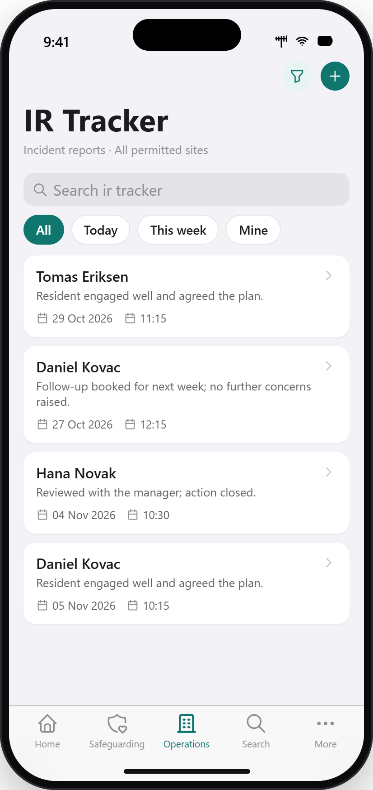

- **Purpose:** Property incidents, witness accounts and police logs.
- **Layout:** Large-title navigation bar, optional segmented control, search field, status chips, then a card per record. Bottom tab bar stays visible.
- **Components:** Large title bar, Search field, Filter chips, Record cards with status badge, Pull-to-refresh, Add button (nav bar)
- **Data displayed:** Each card shows the record title, subtitle and up to three facts. Source fields: SITE, DATE, SU NAME, Port Ref, Incident Time, Witnesses (Security, Welfare, Managers, SUs, etc.), IR SUMMARY, IN for 1st review…
- **Actions:** Log incident report. Open record, filter, search, swipe for quick actions (edit / archive where permitted). Page actions in the web app: view, create, edit, delete, export.
- **Navigation:** Tap card → Detail. Filter button → filter sheet. Plus → form (modal).
- **Permissions:** Visible when the user can view "irTracker" (role rules plus any per-user Page Access override).
- **Mobile interactions:** Incident report cards; summary and submitted-to-CRH flag on detail. Swipe left for actions; pull down to sync; infinite scroll replaces desktop pagination.

### IR Tracker (Incidents) — Detail

- **Purpose:** Read and act on one Incident report.
- **Layout:** Inline navigation bar, summary card (avatar/initials, name, status, quick actions), grouped inset sections, attachments and history.
- **Components:** Summary card, Quick action buttons, Grouped inset list, Attachments row, Audit-trail row
- **Data displayed:** All fields of the web record, grouped: Resident, Location, Dates, Case details.
- **Actions:** Edit, share, overflow menu (archive, delete where permitted), open attachments, open audit trail.
- **Navigation:** Back to list; Edit → form; Attachments → viewer; Audit trail → timeline.
- **Permissions:** Visible when the user can view "irTracker" (role rules plus any per-user Page Access override).
- **Mobile interactions:** Long-press a value to copy; tap phone/email to call/compose; share sheet for export.

### IR Tracker (Incidents) — Form

- **Purpose:** Create or edit a Incident report.
- **Layout:** Modal form: Cancel / title / Save, grouped sections (Resident, Location, Dates, Case details), evidence section.
- **Components:** Inset form rows, Pickers (date, time, select), Toggles for Yes/No, Multiline notes, Camera / Scan / Files rows, Inline validation, Draft banner
- **Data displayed:** 11 fields from the web form (1 pickers, 1 dates).
- **Actions:** Save, Cancel (confirm if edited), attach evidence.
- **Navigation:** Presented modally from the list or detail; Save returns to the record.
- **Permissions:** Needs create/edit on "irTracker". Visible when the user can view "irTracker" (role rules plus any per-user Page Access override).
- **Mobile interactions:** Native pickers, keyboard avoidance with Next/Done, inline errors, draft kept on device.

### IR Tracker (Incidents) — Filter sheet

- **Purpose:** Narrow the IR Tracker (Incidents) list without leaving it.
- **Layout:** Medium bottom sheet over the list; grabber, grouped controls, Reset and primary apply button.
- **Components:** Bottom sheet, Status chips (multi-select), Inset rows (site, date range), Toggle
- **Data displayed:** Status values and site list from the same sources as the web filters; result count is live.
- **Actions:** Apply, Reset, dismiss by swipe.
- **Navigation:** Sheet; returns to the list.
- **Permissions:** Site choices are limited to the sites the signed-in role may see.
- **Mobile interactions:** Haptic on apply; selection count shown on the filter button.

### Public Transport Tracker — List

- **Purpose:** Service user travel tickets, bus passes, and exceptional circumstances.
- **Layout:** Large-title navigation bar, optional segmented control (Overview / Feedback / Challenges / Funding / Oyster), search field, status chips, then a card per record. Bottom tab bar stays visible.
- **Components:** Large title bar, Search field, Filter chips, Record cards with status badge, Pull-to-refresh, Add button (nav bar)
- **Data displayed:** Each card shows the record title, subtitle and up to three facts. Source fields: Hotel / Site, Site Manager, Staff Place, Reporting Staff Member, Approval URN, Service User Name(s), Port Ref(s), Accommodation Address…
- **Actions:** Issue transport authorisation. Open record, filter, search, swipe for quick actions (edit / archive where permitted). Page actions in the web app: view, create, edit, delete, export.
- **Navigation:** Tap card → Detail. Filter button → filter sheet. Plus → form (modal).
- **Permissions:** Visible when the user can view "publicTransport" (role rules plus any per-user Page Access override).
- **Mobile interactions:** Five tabs become a scrollable segmented control. Swipe left for actions; pull down to sync; infinite scroll replaces desktop pagination.

### Public Transport Tracker — Detail

- **Purpose:** Read and act on one Transport authorisation.
- **Layout:** Inline navigation bar, summary card (avatar/initials, name, status, quick actions), grouped inset sections, attachments and history.
- **Components:** Summary card, Quick action buttons, Grouped inset list, Attachments row, Audit-trail row
- **Data displayed:** All fields of the web record, grouped: Resident, Location, Dates, Case details.
- **Actions:** Edit, share, overflow menu (archive, delete where permitted), open attachments, open audit trail.
- **Navigation:** Back to list; Edit → form; Attachments → viewer; Audit trail → timeline.
- **Permissions:** Visible when the user can view "publicTransport" (role rules plus any per-user Page Access override).
- **Mobile interactions:** Long-press a value to copy; tap phone/email to call/compose; share sheet for export.

### Public Transport Tracker — Form

- **Purpose:** Create or edit a Transport authorisation.
- **Layout:** Modal form: Cancel / title / Save, grouped sections (Resident, Location, Dates, Case details), evidence section.
- **Components:** Inset form rows, Pickers (date, time, select), Toggles for Yes/No, Multiline notes, Camera / Scan / Files rows, Inline validation, Draft banner
- **Data displayed:** 13 fields from the web form (2 pickers, 1 dates).
- **Actions:** Save, Cancel (confirm if edited), attach evidence.
- **Navigation:** Presented modally from the list or detail; Save returns to the record.
- **Permissions:** Needs create/edit on "publicTransport". Visible when the user can view "publicTransport" (role rules plus any per-user Page Access override).
- **Mobile interactions:** Native pickers, keyboard avoidance with Next/Done, inline errors, draft kept on device.

### Public Transport Tracker — Filter sheet

- **Purpose:** Narrow the Public Transport Tracker list without leaving it.
- **Layout:** Medium bottom sheet over the list; grabber, grouped controls, Reset and primary apply button.
- **Components:** Bottom sheet, Status chips (multi-select), Inset rows (site, date range), Toggle
- **Data displayed:** Status values and site list from the same sources as the web filters; result count is live.
- **Actions:** Apply, Reset, dismiss by swipe.
- **Navigation:** Sheet; returns to the list.
- **Permissions:** Site choices are limited to the sites the signed-in role may see.
- **Mobile interactions:** Haptic on apply; selection count shown on the filter button.

### Dispersal Sheet — List

- **Purpose:** Notice issuance, departure schedules, exit briefings, and relocation tracking.
- **Layout:** Large-title navigation bar, optional segmented control (Dispersal / Evictions), search field, status chips, then a card per record. Bottom tab bar stays visible.
- **Components:** Large title bar, Search field, Filter chips, Record cards with status badge, Pull-to-refresh, Add button (nav bar)
- **Data displayed:** Each card shows the record title, subtitle and up to three facts. Source fields: S.No, Site / Hotel, Flat / Room No, SU Port / NASS Ref, Reason for Departure, Date Received, Dispersal Date, Date Left Property…
- **Actions:** Add dispersal. Open record, filter, search, swipe for quick actions (edit / archive where permitted). Page actions in the web app: view, create, edit, delete, export.
- **Navigation:** Tap card → Detail. Filter button → filter sheet. Plus → form (modal).
- **Permissions:** Visible when the user can view "dispersal" (role rules plus any per-user Page Access override).
- **Mobile interactions:** Dispersal and eviction tables become cards under a two-segment control. Swipe left for actions; pull down to sync; infinite scroll replaces desktop pagination.

### Dispersal Sheet — Detail

- **Purpose:** Read and act on one Dispersal.
- **Layout:** Inline navigation bar, summary card (avatar/initials, name, status, quick actions), grouped inset sections, attachments and history.
- **Components:** Summary card, Quick action buttons, Grouped inset list, Attachments row, Audit-trail row
- **Data displayed:** All fields of the web record, grouped: Resident, Location, Dates, Case details.
- **Actions:** Edit, share, overflow menu (archive, delete where permitted), open attachments, open audit trail.
- **Navigation:** Back to list; Edit → form; Attachments → viewer; Audit trail → timeline.
- **Permissions:** Visible when the user can view "dispersal" (role rules plus any per-user Page Access override).
- **Mobile interactions:** Long-press a value to copy; tap phone/email to call/compose; share sheet for export.

### Dispersal Sheet — Form

- **Purpose:** Create or edit a Dispersal.
- **Layout:** Modal form: Cancel / title / Save, grouped sections (Resident, Location, Dates, Case details), evidence section.
- **Components:** Inset form rows, Pickers (date, time, select), Toggles for Yes/No, Multiline notes, Camera / Scan / Files rows, Inline validation, Draft banner
- **Data displayed:** 10 fields from the web form (1 pickers, 4 dates).
- **Actions:** Save, Cancel (confirm if edited), attach evidence.
- **Navigation:** Presented modally from the list or detail; Save returns to the record.
- **Permissions:** Needs create/edit on "dispersal". Visible when the user can view "dispersal" (role rules plus any per-user Page Access override).
- **Mobile interactions:** Native pickers, keyboard avoidance with Next/Done, inline errors, draft kept on device.

### Dispersal Sheet — Filter sheet

- **Purpose:** Narrow the Dispersal Sheet list without leaving it.
- **Layout:** Medium bottom sheet over the list; grabber, grouped controls, Reset and primary apply button.
- **Components:** Bottom sheet, Status chips (multi-select), Inset rows (site, date range), Toggle
- **Data displayed:** Status values and site list from the same sources as the web filters; result count is live.
- **Actions:** Apply, Reset, dismiss by swipe.
- **Navigation:** Sheet; returns to the list.
- **Permissions:** Site choices are limited to the sites the signed-in role may see.
- **Mobile interactions:** Haptic on apply; selection count shown on the filter button.

### Booklet Inventory — List

- **Purpose:** Multi-lingual informational booklet collection and replenishment logs.
- **Layout:** Stock cards with a collected/target progress bar. Large-title navigation bar, optional segmented control, search field, status chips, then a card per record. Bottom tab bar stays visible.
- **Components:** Large title bar, Search field, Filter chips, Record cards with status badge, Pull-to-refresh, Add button (nav bar)
- **Data displayed:** Each card shows the record title, subtitle and up to three facts. Source fields: Hotel / Site, Agent / Provider, Booklet Type, Language, Target / To Collect, Collected Booklets, Booklets Received, Notes…
- **Actions:** Add booklet stock. Open record, filter, search, swipe for quick actions (edit / archive where permitted). Page actions in the web app: view, create, edit, delete, export.
- **Navigation:** Tap card → Detail. Filter button → filter sheet. Plus → form (modal).
- **Permissions:** Visible when the user can view "booklets" (role rules plus any per-user Page Access override).
- **Mobile interactions:** Stock rows with a collected/target progress bar. Swipe left for actions; pull down to sync; infinite scroll replaces desktop pagination.

### Booklet Inventory — Detail

- **Purpose:** Read and act on one Booklet stock.
- **Layout:** Inline navigation bar, summary card (avatar/initials, name, status, quick actions), grouped inset sections, attachments and history.
- **Components:** Summary card, Quick action buttons, Grouped inset list, Attachments row, Audit-trail row
- **Data displayed:** All fields of the web record, grouped: Resident, Location, Classification, Case details.
- **Actions:** Edit, share, overflow menu (archive, delete where permitted), open attachments, open audit trail.
- **Navigation:** Back to list; Edit → form; Attachments → viewer; Audit trail → timeline.
- **Permissions:** Visible when the user can view "booklets" (role rules plus any per-user Page Access override).
- **Mobile interactions:** Long-press a value to copy; tap phone/email to call/compose; share sheet for export.

### Booklet Inventory — Form

- **Purpose:** Create or edit a Booklet stock.
- **Layout:** Modal form: Cancel / title / Save, grouped sections (Resident, Location, Classification, Case details), evidence section.
- **Components:** Inset form rows, Pickers (date, time, select), Toggles for Yes/No, Multiline notes, Camera / Scan / Files rows, Inline validation, Draft banner
- **Data displayed:** 8 fields from the web form (3 pickers, 0 dates).
- **Actions:** Save, Cancel (confirm if edited), attach evidence.
- **Navigation:** Presented modally from the list or detail; Save returns to the record.
- **Permissions:** Needs create/edit on "booklets". Visible when the user can view "booklets" (role rules plus any per-user Page Access override).
- **Mobile interactions:** Native pickers, keyboard avoidance with Next/Done, inline errors, draft kept on device.

### Booklet Inventory — Filter sheet

- **Purpose:** Narrow the Booklet Inventory list without leaving it.
- **Layout:** Medium bottom sheet over the list; grabber, grouped controls, Reset and primary apply button.
- **Components:** Bottom sheet, Status chips (multi-select), Inset rows (site, date range), Toggle
- **Data displayed:** Status values and site list from the same sources as the web filters; result count is live.
- **Actions:** Apply, Reset, dismiss by swipe.
- **Navigation:** Sheet; returns to the list.
- **Permissions:** Site choices are limited to the sites the signed-in role may see.
- **Mobile interactions:** Haptic on apply; selection count shown on the filter button.

### Commercial Laundry Support — List

- **Purpose:** Weekly laundry cycle weights, contractor invoices, and variance flags.
- **Layout:** Large-title navigation bar, optional segmented control (Daily log / Summaries), search field, status chips, then a card per record. Bottom tab bar stays visible.
- **Components:** Large title bar, Search field, Filter chips, Record cards with status badge, Pull-to-refresh, Add button (nav bar)
- **Data displayed:** Each card shows the record title, subtitle and up to three facts. Source fields: Property / Hotel, Log Period, Dirty Laundry Sent, Clean Laundry Returned, Discrepancies, Discrepancy Details, Remarks / Actions Taken, Staff / Auditor…
- **Actions:** Add laundry log. Open record, filter, search, swipe for quick actions (edit / archive where permitted). Page actions in the web app: view, create, edit, delete, export.
- **Navigation:** Tap card → Detail. Filter button → filter sheet. Plus → form (modal).
- **Permissions:** Visible when the user can view "laundry" (role rules plus any per-user Page Access override).
- **Mobile interactions:** Daily room-by-room log with steppers; weekly and monthly summaries in a second segment. Swipe left for actions; pull down to sync; infinite scroll replaces desktop pagination.

### Commercial Laundry Support — Detail

- **Purpose:** Read and act on one Laundry log.
- **Layout:** Inline navigation bar, summary card (avatar/initials, name, status, quick actions), grouped inset sections, attachments and history.
- **Components:** Summary card, Quick action buttons, Grouped inset list, Attachments row, Audit-trail row
- **Data displayed:** All fields of the web record, grouped: Location, Dates, Case details.
- **Actions:** Edit, share, overflow menu (archive, delete where permitted), open attachments, open audit trail.
- **Navigation:** Back to list; Edit → form; Attachments → viewer; Audit trail → timeline.
- **Permissions:** Visible when the user can view "laundry" (role rules plus any per-user Page Access override).
- **Mobile interactions:** Long-press a value to copy; tap phone/email to call/compose; share sheet for export.

### Commercial Laundry Support — Form

- **Purpose:** Create or edit a Laundry log.
- **Layout:** Modal form: Cancel / title / Save, grouped sections (Location, Dates, Case details), evidence section.
- **Components:** Inset form rows, Pickers (date, time, select), Toggles for Yes/No, Multiline notes, Camera / Scan / Files rows, Inline validation, Draft banner
- **Data displayed:** 10 fields from the web form (1 pickers, 2 dates).
- **Actions:** Save, Cancel (confirm if edited), attach evidence.
- **Navigation:** Presented modally from the list or detail; Save returns to the record.
- **Permissions:** Needs create/edit on "laundry". Visible when the user can view "laundry" (role rules plus any per-user Page Access override).
- **Mobile interactions:** Native pickers, keyboard avoidance with Next/Done, inline errors, draft kept on device.

### Commercial Laundry Support — Filter sheet

- **Purpose:** Narrow the Commercial Laundry Support list without leaving it.
- **Layout:** Medium bottom sheet over the list; grabber, grouped controls, Reset and primary apply button.
- **Components:** Bottom sheet, Status chips (multi-select), Inset rows (site, date range), Toggle
- **Data displayed:** Status values and site list from the same sources as the web filters; result count is live.
- **Actions:** Apply, Reset, dismiss by swipe.
- **Navigation:** Sheet; returns to the list.
- **Permissions:** Site choices are limited to the sites the signed-in role may see.
- **Mobile interactions:** Haptic on apply; selection count shown on the filter button.

### Housekeeping Log — List

- **Purpose:** Daily room cleaning logs, communal sanitisation audits, and housekeeping inspections.
- **Layout:** Large-title navigation bar, optional segmented control, search field, status chips, then a card per record. Bottom tab bar stays visible.
- **Components:** Large title bar, Search field, Filter chips, Record cards with status badge, Pull-to-refresh, Read-only (no add)
- **Data displayed:** Each card shows the record title, subtitle and up to three facts. Source fields: Date, Property / Site, Communal fridges cleaned (Thu & Sun), Inspected / Signed off by, Remarks & Follow-up…
- **Actions:** Open record, filter, search, swipe for quick actions (edit / archive where permitted). Page actions in the web app: view, create, edit, delete, export.
- **Navigation:** Tap card → Detail. Filter button → filter sheet. Plus → form (modal).
- **Permissions:** Visible when the user can view "housekeeping" (role rules plus any per-user Page Access override).
- **Mobile interactions:** Daily checklist becomes toggles per task with inspector sign-off. Swipe left for actions; pull down to sync; infinite scroll replaces desktop pagination.

### Housekeeping Log — Checklist form

- **Purpose:** Daily housekeeping checklist with inspector sign-off.
- **Layout:** Header details, grouped checklist rows, auto grade banner, photo evidence.
- **Components:** Toggle rows, Sign-off row
- **Data displayed:** Date, property, task toggles, inspected by.
- **Actions:** Mark items, add photo to a failed item, save, sign off.
- **Navigation:** Modal from list; Save returns to the list.
- **Permissions:** Create/edit on this page.
- **Mobile interactions:** Failed items require a note and photo; swipe through groups.

### Housekeeping Log — Detail

- **Purpose:** Read and act on one Housekeeping log.
- **Layout:** Inline navigation bar, summary card (avatar/initials, name, status, quick actions), grouped inset sections, attachments and history.
- **Components:** Summary card, Quick action buttons, Grouped inset list, Attachments row, Audit-trail row
- **Data displayed:** All fields of the web record, grouped: Location, Dates, Case details.
- **Actions:** Edit, share, overflow menu (archive, delete where permitted), open attachments, open audit trail.
- **Navigation:** Back to list; Edit → form; Attachments → viewer; Audit trail → timeline.
- **Permissions:** Visible when the user can view "housekeeping" (role rules plus any per-user Page Access override).
- **Mobile interactions:** Long-press a value to copy; tap phone/email to call/compose; share sheet for export.

### Housekeeping Log — Filter sheet

- **Purpose:** Narrow the Housekeeping Log list without leaving it.
- **Layout:** Medium bottom sheet over the list; grabber, grouped controls, Reset and primary apply button.
- **Components:** Bottom sheet, Status chips (multi-select), Inset rows (site, date range), Toggle
- **Data displayed:** Status values and site list from the same sources as the web filters; result count is live.
- **Actions:** Apply, Reset, dismiss by swipe.
- **Navigation:** Sheet; returns to the list.
- **Permissions:** Site choices are limited to the sites the signed-in role may see.
- **Mobile interactions:** Haptic on apply; selection count shown on the filter button.

### Hot Meals Tracker — List

- **Purpose:** Daily hot meal distribution, vendor buffet temperature logs, and quality scores.
- **Layout:** Large-title navigation bar, optional segmented control (Vendor buffet / SU meals / Consumption / Box requests), search field, status chips, then a card per record. Bottom tab bar stays visible.
- **Components:** Large title bar, Search field, Filter chips, Record cards with status badge, Pull-to-refresh, Add button (nav bar)
- **Data displayed:** Each card shows the record title, subtitle and up to three facts. Source fields: Property / Hotel, Week Range, Date From, Date To, Compliance & Quality Notes, Audited By…
- **Actions:** Add meal log. Open record, filter, search, swipe for quick actions (edit / archive where permitted). Page actions in the web app: view, create, edit, delete, export.
- **Navigation:** Tap card → Detail. Filter button → filter sheet. Plus → form (modal).
- **Permissions:** Visible when the user can view "food" (role rules plus any per-user Page Access override).
- **Mobile interactions:** Four tabs become a segmented control; weekly grid becomes a day-by-day stepper. Swipe left for actions; pull down to sync; infinite scroll replaces desktop pagination.

### Hot Meals Tracker — Detail

- **Purpose:** Read and act on one Hot meals log.
- **Layout:** Inline navigation bar, summary card (avatar/initials, name, status, quick actions), grouped inset sections, attachments and history.
- **Components:** Summary card, Quick action buttons, Grouped inset list, Attachments row, Audit-trail row
- **Data displayed:** All fields of the web record, grouped: Location, Dates, Case details.
- **Actions:** Edit, share, overflow menu (archive, delete where permitted), open attachments, open audit trail.
- **Navigation:** Back to list; Edit → form; Attachments → viewer; Audit trail → timeline.
- **Permissions:** Visible when the user can view "food" (role rules plus any per-user Page Access override).
- **Mobile interactions:** Long-press a value to copy; tap phone/email to call/compose; share sheet for export.

### Hot Meals Tracker — Form

- **Purpose:** Create or edit a Hot meals log.
- **Layout:** Modal form: Cancel / title / Save, grouped sections (Location, Dates, Case details), evidence section.
- **Components:** Inset form rows, Pickers (date, time, select), Toggles for Yes/No, Multiline notes, Camera / Scan / Files rows, Inline validation, Draft banner
- **Data displayed:** 6 fields from the web form (1 pickers, 2 dates).
- **Actions:** Save, Cancel (confirm if edited), attach evidence.
- **Navigation:** Presented modally from the list or detail; Save returns to the record.
- **Permissions:** Needs create/edit on "food". Visible when the user can view "food" (role rules plus any per-user Page Access override).
- **Mobile interactions:** Native pickers, keyboard avoidance with Next/Done, inline errors, draft kept on device.

### Hot Meals Tracker — Filter sheet

- **Purpose:** Narrow the Hot Meals Tracker list without leaving it.
- **Layout:** Medium bottom sheet over the list; grabber, grouped controls, Reset and primary apply button.
- **Components:** Bottom sheet, Status chips (multi-select), Inset rows (site, date range), Toggle
- **Data displayed:** Status values and site list from the same sources as the web filters; result count is live.
- **Actions:** Apply, Reset, dismiss by swipe.
- **Navigation:** Sheet; returns to the list.
- **Permissions:** Site choices are limited to the sites the signed-in role may see.
- **Mobile interactions:** Haptic on apply; selection count shown on the filter button.

### Food Consumption (In & Out) — List

- **Purpose:** Daily meal consumption ratings, portion waste percentages, and special box requests.
- **Layout:** Large-title navigation bar, optional segmented control (Consumption / Box requests / Vendor buffet / SU meals), search field, status chips, then a card per record. Bottom tab bar stays visible.
- **Components:** Large title bar, Search field, Filter chips, Record cards with status badge, Pull-to-refresh, Add button (nav bar)
- **Data displayed:** Each card shows the record title, subtitle and up to three facts. Source fields: Date, Property / Hotel, Feedback / Comments, Reported / Inspected By…
- **Actions:** Add report. Open record, filter, search, swipe for quick actions (edit / archive where permitted). Page actions in the web app: view, create, edit, delete, export.
- **Navigation:** Tap card → Detail. Filter button → filter sheet. Plus → form (modal).
- **Permissions:** Visible when the user can view "foodConsumption" (role rules plus any per-user Page Access override).
- **Mobile interactions:** Consumption ratings as cards with portion-waste bars. Swipe left for actions; pull down to sync; infinite scroll replaces desktop pagination.

### Food Consumption (In & Out) — Detail

- **Purpose:** Read and act on one Food consumption.
- **Layout:** Inline navigation bar, summary card (avatar/initials, name, status, quick actions), grouped inset sections, attachments and history.
- **Components:** Summary card, Quick action buttons, Grouped inset list, Attachments row, Audit-trail row
- **Data displayed:** All fields of the web record, grouped: Resident, Location, Dates, Case details.
- **Actions:** Edit, share, overflow menu (archive, delete where permitted), open attachments, open audit trail.
- **Navigation:** Back to list; Edit → form; Attachments → viewer; Audit trail → timeline.
- **Permissions:** Visible when the user can view "foodConsumption" (role rules plus any per-user Page Access override).
- **Mobile interactions:** Long-press a value to copy; tap phone/email to call/compose; share sheet for export.

### Food Consumption (In & Out) — Form

- **Purpose:** Create or edit a Food consumption.
- **Layout:** Modal form: Cancel / title / Save, grouped sections (Resident, Location, Dates, Case details), evidence section.
- **Components:** Inset form rows, Pickers (date, time, select), Toggles for Yes/No, Multiline notes, Camera / Scan / Files rows, Inline validation, Draft banner
- **Data displayed:** 4 fields from the web form (1 pickers, 1 dates).
- **Actions:** Save, Cancel (confirm if edited), attach evidence.
- **Navigation:** Presented modally from the list or detail; Save returns to the record.
- **Permissions:** Needs create/edit on "foodConsumption". Visible when the user can view "foodConsumption" (role rules plus any per-user Page Access override).
- **Mobile interactions:** Native pickers, keyboard avoidance with Next/Done, inline errors, draft kept on device.

### Food Consumption (In & Out) — Filter sheet

- **Purpose:** Narrow the Food Consumption (In & Out) list without leaving it.
- **Layout:** Medium bottom sheet over the list; grabber, grouped controls, Reset and primary apply button.
- **Components:** Bottom sheet, Status chips (multi-select), Inset rows (site, date range), Toggle
- **Data displayed:** Status values and site list from the same sources as the web filters; result count is live.
- **Actions:** Apply, Reset, dismiss by swipe.
- **Navigation:** Sheet; returns to the list.
- **Permissions:** Site choices are limited to the sites the signed-in role may see.
- **Mobile interactions:** Haptic on apply; selection count shown on the filter button.

### Food Survey Checks — List

- **Purpose:** Resident meal satisfaction survey, dietary requirements, and 21-rating matrices.
- **Layout:** Large-title navigation bar, optional segmented control (Details / Rating matrix / Service / Dishes), search field, status chips, then a card per record. Bottom tab bar stays visible.
- **Components:** Large title bar, Search field, Filter chips, Record cards with status badge, Pull-to-refresh, Add button (nav bar)
- **Data displayed:** Each card shows the record title, subtitle and up to three facts. Source fields: Survey Date, Property / Site, Port Ref, House Officer, Food Quality, Server Quality, Cleanliness, Menu Diversity…
- **Actions:** New food survey. Open record, filter, search, swipe for quick actions (edit / archive where permitted). Page actions in the web app: view, create, edit, delete, export.
- **Navigation:** Tap card → Detail. Filter button → filter sheet. Plus → form (modal).
- **Permissions:** Visible when the user can view "foodSurveys" (role rules plus any per-user Page Access override).
- **Mobile interactions:** Four survey sections become a stepper; the 21-meal matrix becomes tappable rating rows. Swipe left for actions; pull down to sync; infinite scroll replaces desktop pagination.

### Food Survey Checks — Detail

- **Purpose:** Read and act on one Food survey.
- **Layout:** Inline navigation bar, summary card (avatar/initials, name, status, quick actions), grouped inset sections, attachments and history.
- **Components:** Summary card, Quick action buttons, Grouped inset list, Attachments row, Audit-trail row
- **Data displayed:** All fields of the web record, grouped: Resident, Location, Dates, Case details.
- **Actions:** Edit, share, overflow menu (archive, delete where permitted), open attachments, open audit trail.
- **Navigation:** Back to list; Edit → form; Attachments → viewer; Audit trail → timeline.
- **Permissions:** Visible when the user can view "foodSurveys" (role rules plus any per-user Page Access override).
- **Mobile interactions:** Long-press a value to copy; tap phone/email to call/compose; share sheet for export.

### Food Survey Checks — Form

- **Purpose:** Create or edit a Food survey.
- **Layout:** Modal form: Cancel / title / Save, grouped sections (Resident, Location, Dates, Case details), evidence section.
- **Components:** Inset form rows, Pickers (date, time, select), Toggles for Yes/No, Multiline notes, Camera / Scan / Files rows, Inline validation, Draft banner
- **Data displayed:** 12 fields from the web form (5 pickers, 1 dates).
- **Actions:** Save, Cancel (confirm if edited), attach evidence.
- **Navigation:** Presented modally from the list or detail; Save returns to the record.
- **Permissions:** Needs create/edit on "foodSurveys". Visible when the user can view "foodSurveys" (role rules plus any per-user Page Access override).
- **Mobile interactions:** Native pickers, keyboard avoidance with Next/Done, inline errors, draft kept on device.

### Food Survey Checks — Filter sheet

- **Purpose:** Narrow the Food Survey Checks list without leaving it.
- **Layout:** Medium bottom sheet over the list; grabber, grouped controls, Reset and primary apply button.
- **Components:** Bottom sheet, Status chips (multi-select), Inset rows (site, date range), Toggle
- **Data displayed:** Status values and site list from the same sources as the web filters; result count is live.
- **Actions:** Apply, Reset, dismiss by swipe.
- **Navigation:** Sheet; returns to the list.
- **Permissions:** Site choices are limited to the sites the signed-in role may see.
- **Mobile interactions:** Haptic on apply; selection count shown on the filter button.

### Food Wastage Tracker — List

- **Purpose:** Portion surplus tracking, meal wastage auditing, and disposal compliance.
- **Layout:** Large-title navigation bar, optional segmented control, search field, status chips, then a card per record. Bottom tab bar stays visible.
- **Components:** Large title bar, Search field, Filter chips, Record cards with status badge, Pull-to-refresh, Add button (nav bar)
- **Data displayed:** Each card shows the record title, subtitle and up to three facts. Source fields: SITE, DATE, FOOD ITEM, QUANTITY WASTED, REMARKS…
- **Actions:** Log food wastage. Open record, filter, search, swipe for quick actions (edit / archive where permitted). Page actions in the web app: view, create, edit, delete, export.
- **Navigation:** Tap card → Detail. Filter button → filter sheet. Plus → form (modal).
- **Permissions:** Visible when the user can view "foodWastage" (role rules plus any per-user Page Access override).
- **Mobile interactions:** Wastage entries with item-row stepper and master list picker. Swipe left for actions; pull down to sync; infinite scroll replaces desktop pagination.

### Food Wastage Tracker — Detail

- **Purpose:** Read and act on one Food wastage.
- **Layout:** Inline navigation bar, summary card (avatar/initials, name, status, quick actions), grouped inset sections, attachments and history.
- **Components:** Summary card, Quick action buttons, Grouped inset list, Attachments row, Audit-trail row
- **Data displayed:** All fields of the web record, grouped: Location, Dates, Case details.
- **Actions:** Edit, share, overflow menu (archive, delete where permitted), open attachments, open audit trail.
- **Navigation:** Back to list; Edit → form; Attachments → viewer; Audit trail → timeline.
- **Permissions:** Visible when the user can view "foodWastage" (role rules plus any per-user Page Access override).
- **Mobile interactions:** Long-press a value to copy; tap phone/email to call/compose; share sheet for export.

### Food Wastage Tracker — Form

- **Purpose:** Create or edit a Food wastage.
- **Layout:** Modal form: Cancel / title / Save, grouped sections (Location, Dates, Case details), evidence section.
- **Components:** Inset form rows, Pickers (date, time, select), Toggles for Yes/No, Multiline notes, Camera / Scan / Files rows, Inline validation, Draft banner
- **Data displayed:** 5 fields from the web form (1 pickers, 1 dates).
- **Actions:** Save, Cancel (confirm if edited), attach evidence.
- **Navigation:** Presented modally from the list or detail; Save returns to the record.
- **Permissions:** Needs create/edit on "foodWastage". Visible when the user can view "foodWastage" (role rules plus any per-user Page Access override).
- **Mobile interactions:** Native pickers, keyboard avoidance with Next/Done, inline errors, draft kept on device.

### Food Wastage Tracker — Filter sheet

- **Purpose:** Narrow the Food Wastage Tracker list without leaving it.
- **Layout:** Medium bottom sheet over the list; grabber, grouped controls, Reset and primary apply button.
- **Components:** Bottom sheet, Status chips (multi-select), Inset rows (site, date range), Toggle
- **Data displayed:** Status values and site list from the same sources as the web filters; result count is live.
- **Actions:** Apply, Reset, dismiss by swipe.
- **Navigation:** Sheet; returns to the list.
- **Permissions:** Site choices are limited to the sites the signed-in role may see.
- **Mobile interactions:** Haptic on apply; selection count shown on the filter button.

### Room Checks (30-Point Audit) — List

- **Purpose:** 30-point room condition and safety inspection matrix with automated grading.
- **Layout:** Large-title navigation bar, optional segmented control, search field, status chips, then a card per record. Bottom tab bar stays visible.
- **Components:** Large title bar, Search field, Filter chips, Record cards with status badge, Pull-to-refresh, Add button (nav bar)
- **Data displayed:** Each card shows the record title, subtitle and up to three facts. Source fields: Date, Property / Site, Room No, AIC Ref, Inspector, Comments…
- **Actions:** New room check. Open record, filter, search, swipe for quick actions (edit / archive where permitted). Page actions in the web app: view, create, edit, delete, export.
- **Navigation:** Tap card → Detail. Filter button → filter sheet. Plus → form (modal).
- **Permissions:** Visible when the user can view "roomChecks" (role rules plus any per-user Page Access override).
- **Mobile interactions:** 30-point audit becomes grouped pass / fail rows with photo evidence and an auto grade. Swipe left for actions; pull down to sync; infinite scroll replaces desktop pagination.

### Room Checks (30-Point Audit) — Checklist form

- **Purpose:** 30-point room condition and safety inspection with automatic grading.
- **Layout:** Header details, grouped checklist rows, auto grade banner, photo evidence.
- **Components:** Pass/Fail segmented pills, Auto-grade banner, Camera row
- **Data displayed:** Room, officer, 30 items grouped by area, final comments.
- **Actions:** Mark items, add photo to a failed item, save, sign off.
- **Navigation:** Modal from list; Save returns to the list.
- **Permissions:** Create/edit on this page.
- **Mobile interactions:** Failed items require a note and photo; swipe through groups.

### Room Checks (30-Point Audit) — Detail

- **Purpose:** Read and act on one Room check.
- **Layout:** Inline navigation bar, summary card (avatar/initials, name, status, quick actions), grouped inset sections, attachments and history.
- **Components:** Summary card, Quick action buttons, Grouped inset list, Attachments row, Audit-trail row
- **Data displayed:** All fields of the web record, grouped: Resident, Location, Dates, Case details.
- **Actions:** Edit, share, overflow menu (archive, delete where permitted), open attachments, open audit trail.
- **Navigation:** Back to list; Edit → form; Attachments → viewer; Audit trail → timeline.
- **Permissions:** Visible when the user can view "roomChecks" (role rules plus any per-user Page Access override).
- **Mobile interactions:** Long-press a value to copy; tap phone/email to call/compose; share sheet for export.

### Room Checks (30-Point Audit) — Filter sheet

- **Purpose:** Narrow the Room Checks (30-Point Audit) list without leaving it.
- **Layout:** Medium bottom sheet over the list; grabber, grouped controls, Reset and primary apply button.
- **Components:** Bottom sheet, Status chips (multi-select), Inset rows (site, date range), Toggle
- **Data displayed:** Status values and site list from the same sources as the web filters; result count is live.
- **Actions:** Apply, Reset, dismiss by swipe.
- **Navigation:** Sheet; returns to the list.
- **Permissions:** Site choices are limited to the sites the signed-in role may see.
- **Mobile interactions:** Haptic on apply; selection count shown on the filter button.

### Escalations Log — List

- **Purpose:** Cross-module critical incident alerts, SLA timers, and supervisor sign-offs.
- **Layout:** Large-title navigation bar, optional segmented control, search field, status chips, then a card per record. Bottom tab bar stays visible.
- **Components:** Large title bar, Search field, Filter chips, Record cards with status badge, Pull-to-refresh, Add button (nav bar)
- **Data displayed:** Each card shows the record title, subtitle and up to three facts. Source fields: Date of Incident, Site / Property, Resident Name, Port / NASS Ref, Submitted By, Reported Authorities, Action Taken, Incident Notes…
- **Actions:** Log urgent escalation. Open record, filter, search, swipe for quick actions (edit / archive where permitted). Page actions in the web app: view, create, edit, delete, export.
- **Navigation:** Tap card → Detail. Filter button → filter sheet. Plus → form (modal).
- **Permissions:** Visible when the user can view "escalations" (role rules plus any per-user Page Access override).
- **Mobile interactions:** Urgency colour band and SLA timer on every card. Swipe left for actions; pull down to sync; infinite scroll replaces desktop pagination.

### Escalations Log — Detail

- **Purpose:** Read and act on one Escalation.
- **Layout:** Inline navigation bar, summary card (avatar/initials, name, status, quick actions), grouped inset sections, attachments and history.
- **Components:** Summary card, Quick action buttons, Grouped inset list, Attachments row, Audit-trail row
- **Data displayed:** All fields of the web record, grouped: Resident, Location, Dates, Case details.
- **Actions:** Edit, share, overflow menu (archive, delete where permitted), open attachments, open audit trail.
- **Navigation:** Back to list; Edit → form; Attachments → viewer; Audit trail → timeline.
- **Permissions:** Visible when the user can view "escalations" (role rules plus any per-user Page Access override).
- **Mobile interactions:** Long-press a value to copy; tap phone/email to call/compose; share sheet for export.

### Escalations Log — Form

- **Purpose:** Create or edit a Escalation.
- **Layout:** Modal form: Cancel / title / Save, grouped sections (Resident, Location, Dates, Case details), evidence section.
- **Components:** Inset form rows, Pickers (date, time, select), Toggles for Yes/No, Multiline notes, Camera / Scan / Files rows, Inline validation, Draft banner
- **Data displayed:** 8 fields from the web form (1 pickers, 1 dates).
- **Actions:** Save, Cancel (confirm if edited), attach evidence.
- **Navigation:** Presented modally from the list or detail; Save returns to the record.
- **Permissions:** Needs create/edit on "escalations". Visible when the user can view "escalations" (role rules plus any per-user Page Access override).
- **Mobile interactions:** Native pickers, keyboard avoidance with Next/Done, inline errors, draft kept on device.

### Escalations Log — Filter sheet

- **Purpose:** Narrow the Escalations Log list without leaving it.
- **Layout:** Medium bottom sheet over the list; grabber, grouped controls, Reset and primary apply button.
- **Components:** Bottom sheet, Status chips (multi-select), Inset rows (site, date range), Toggle
- **Data displayed:** Status values and site list from the same sources as the web filters; result count is live.
- **Actions:** Apply, Reset, dismiss by swipe.
- **Navigation:** Sheet; returns to the list.
- **Permissions:** Site choices are limited to the sites the signed-in role may see.
- **Mobile interactions:** Haptic on apply; selection count shown on the filter button.

### Proof Documents Repository — List

- **Purpose:** Secure digital proof storage for safeguarding compliance and certificates.
- **Layout:** File rows with type icons, size, date and confidentiality. Large-title navigation bar, optional segmented control, search field, status chips, then a card per record. Bottom tab bar stays visible.
- **Components:** Large title bar, Search field, Filter chips, Record cards with status badge, Pull-to-refresh, Add button (nav bar)
- **Data displayed:** Each card shows the record title, subtitle and up to three facts. Source fields: Document Title, Hotel / Site, Resident / Property, Port Ref / Property Ref, Uploaded By, Upload Date, Notes…
- **Actions:** Upload document. Open record, filter, search, swipe for quick actions (edit / archive where permitted). Page actions in the web app: view, create, edit, delete, export.
- **Navigation:** Tap card → Detail. Filter button → filter sheet. Plus → form (modal).
- **Permissions:** Visible when the user can view "documents" (role rules plus any per-user Page Access override).
- **Mobile interactions:** File list with type icons; upload via camera, scan or Files. Swipe left for actions; pull down to sync; infinite scroll replaces desktop pagination.

### Proof Documents Repository — Detail

- **Purpose:** Read and act on one Document.
- **Layout:** Inline navigation bar, summary card (avatar/initials, name, status, quick actions), grouped inset sections, attachments and history.
- **Components:** Summary card, Quick action buttons, Grouped inset list, Attachments row, Audit-trail row
- **Data displayed:** All fields of the web record, grouped: Resident, Location, Dates, Case details.
- **Actions:** Edit, share, overflow menu (archive, delete where permitted), open attachments, open audit trail.
- **Navigation:** Back to list; Edit → form; Attachments → viewer; Audit trail → timeline.
- **Permissions:** Visible when the user can view "documents" (role rules plus any per-user Page Access override).
- **Mobile interactions:** Long-press a value to copy; tap phone/email to call/compose; share sheet for export.

### Proof Documents Repository — Form

- **Purpose:** Create or edit a Document.
- **Layout:** Modal form: Cancel / title / Save, grouped sections (Resident, Location, Dates, Case details), evidence section.
- **Components:** Inset form rows, Pickers (date, time, select), Toggles for Yes/No, Multiline notes, Camera / Scan / Files rows, Inline validation, Draft banner
- **Data displayed:** 7 fields from the web form (3 pickers, 1 dates).
- **Actions:** Save, Cancel (confirm if edited), attach evidence.
- **Navigation:** Presented modally from the list or detail; Save returns to the record.
- **Permissions:** Needs create/edit on "documents". Visible when the user can view "documents" (role rules plus any per-user Page Access override).
- **Mobile interactions:** Native pickers, keyboard avoidance with Next/Done, inline errors, draft kept on device.

### Proof Documents Repository — Filter sheet

- **Purpose:** Narrow the Proof Documents Repository list without leaving it.
- **Layout:** Medium bottom sheet over the list; grabber, grouped controls, Reset and primary apply button.
- **Components:** Bottom sheet, Status chips (multi-select), Inset rows (site, date range), Toggle
- **Data displayed:** Status values and site list from the same sources as the web filters; result count is live.
- **Actions:** Apply, Reset, dismiss by swipe.
- **Navigation:** Sheet; returns to the list.
- **Permissions:** Site choices are limited to the sites the signed-in role may see.
- **Mobile interactions:** Haptic on apply; selection count shown on the filter button.

### Property Management — List

- **Purpose:** Central master database for sites, properties, rooms, facilities, assets, and compliance.
- **Layout:** Large-title navigation bar, optional segmented control, search field, status chips, then a card per record. Bottom tab bar stays visible.
- **Components:** Large title bar, Search field, Filter chips, Record cards with status badge, Pull-to-refresh, Add button (nav bar)
- **Data displayed:** Each card shows the record title, subtitle and up to three facts. Source fields: Property ID, Property Name, Site / Location, Full Address, Property Type, Rooms Count, Bed Capacity, Occupied Spaces…
- **Actions:** Add property. Open record, filter, search, swipe for quick actions (edit / archive where permitted). Page actions in the web app: view, create, edit, delete, export.
- **Navigation:** Tap card → Detail. Filter button → filter sheet. Plus → form (modal).
- **Permissions:** Visible when the user can view "propertyManagement" (role rules plus any per-user Page Access override).
- **Mobile interactions:** Property list opens a profile with nine sections including rooms, assets and compliance. Swipe left for actions; pull down to sync; infinite scroll replaces desktop pagination.

### Property Management — Detail

- **Purpose:** Read and act on one Property.
- **Layout:** Inline navigation bar, summary card (avatar/initials, name, status, quick actions), grouped inset sections, attachments and history.
- **Components:** Summary card, Quick action buttons, Grouped inset list, Attachments row, Audit-trail row
- **Data displayed:** All fields of the web record, grouped: Resident, Location, Classification, Case details.
- **Actions:** Edit, share, overflow menu (archive, delete where permitted), open attachments, open audit trail.
- **Navigation:** Back to list; Edit → form; Attachments → viewer; Audit trail → timeline.
- **Permissions:** Visible when the user can view "propertyManagement" (role rules plus any per-user Page Access override).
- **Mobile interactions:** Long-press a value to copy; tap phone/email to call/compose; share sheet for export.

### Property Management — Form

- **Purpose:** Create or edit a Property.
- **Layout:** Modal form: Cancel / title / Save, grouped sections (Resident, Location, Classification, Case details), evidence section.
- **Components:** Inset form rows, Pickers (date, time, select), Toggles for Yes/No, Multiline notes, Camera / Scan / Files rows, Inline validation, Draft banner
- **Data displayed:** 10 fields from the web form (5 pickers, 0 dates).
- **Actions:** Save, Cancel (confirm if edited), attach evidence.
- **Navigation:** Presented modally from the list or detail; Save returns to the record.
- **Permissions:** Needs create/edit on "propertyManagement". Visible when the user can view "propertyManagement" (role rules plus any per-user Page Access override).
- **Mobile interactions:** Native pickers, keyboard avoidance with Next/Done, inline errors, draft kept on device.

### Property Management — Filter sheet

- **Purpose:** Narrow the Property Management list without leaving it.
- **Layout:** Medium bottom sheet over the list; grabber, grouped controls, Reset and primary apply button.
- **Components:** Bottom sheet, Status chips (multi-select), Inset rows (site, date range), Toggle
- **Data displayed:** Status values and site list from the same sources as the web filters; result count is live.
- **Actions:** Apply, Reset, dismiss by swipe.
- **Navigation:** Sheet; returns to the list.
- **Permissions:** Site choices are limited to the sites the signed-in role may see.
- **Mobile interactions:** Haptic on apply; selection count shown on the filter button.

### Property profile — Overview

- **Purpose:** Overview section of a property.
- **Layout:** Identity card, scrollable tab strip (9 sections), section content.
- **Components:** Identity card, Tab strip, Room cards, Compliance cards
- **Data displayed:** Section "Overview".
- **Actions:** Edit property, add room/asset/document, open compliance certificate.
- **Navigation:** Tabs switch sections.
- **Permissions:** Page "propertyManagement" (no role gate; site scope applies).
- **Mobile interactions:** Rooms tab: interconnecting rooms show a link badge.

### Property profile — Property Details

- **Purpose:** Property Details section of a property.
- **Layout:** Identity card, scrollable tab strip (9 sections), section content.
- **Components:** Identity card, Tab strip, Room cards, Compliance cards
- **Data displayed:** Section "Property Details".
- **Actions:** Edit property, add room/asset/document, open compliance certificate.
- **Navigation:** Tabs switch sections.
- **Permissions:** Page "propertyManagement" (no role gate; site scope applies).
- **Mobile interactions:** Rooms tab: interconnecting rooms show a link badge.

### Property profile — Rooms

- **Purpose:** Rooms section of a property.
- **Layout:** Identity card, scrollable tab strip (9 sections), section content.
- **Components:** Identity card, Tab strip, Room cards, Compliance cards
- **Data displayed:** Section "Rooms".
- **Actions:** Edit property, add room/asset/document, open compliance certificate.
- **Navigation:** Tabs switch sections.
- **Permissions:** Page "propertyManagement" (no role gate; site scope applies).
- **Mobile interactions:** Rooms tab: interconnecting rooms show a link badge.

### Property profile — Service Users

- **Purpose:** Service Users section of a property.
- **Layout:** Identity card, scrollable tab strip (9 sections), section content.
- **Components:** Identity card, Tab strip, Room cards, Compliance cards
- **Data displayed:** Section "Service Users".
- **Actions:** Edit property, add room/asset/document, open compliance certificate.
- **Navigation:** Tabs switch sections.
- **Permissions:** Page "propertyManagement" (no role gate; site scope applies).
- **Mobile interactions:** Rooms tab: interconnecting rooms show a link badge.

### Property profile — Compliance

- **Purpose:** Compliance section of a property.
- **Layout:** Identity card, scrollable tab strip (9 sections), section content.
- **Components:** Identity card, Tab strip, Room cards, Compliance cards
- **Data displayed:** Section "Compliance".
- **Actions:** Edit property, add room/asset/document, open compliance certificate.
- **Navigation:** Tabs switch sections.
- **Permissions:** Page "propertyManagement" (no role gate; site scope applies).
- **Mobile interactions:** Rooms tab: interconnecting rooms show a link badge.

### Property profile — Documents

- **Purpose:** Documents section of a property.
- **Layout:** Identity card, scrollable tab strip (9 sections), section content.
- **Components:** Identity card, Tab strip, Room cards, Compliance cards
- **Data displayed:** Section "Documents".
- **Actions:** Edit property, add room/asset/document, open compliance certificate.
- **Navigation:** Tabs switch sections.
- **Permissions:** Page "propertyManagement" (no role gate; site scope applies).
- **Mobile interactions:** Rooms tab: interconnecting rooms show a link badge.

### Property profile — Assets / Inventory

- **Purpose:** Assets / Inventory section of a property.
- **Layout:** Identity card, scrollable tab strip (9 sections), section content.
- **Components:** Identity card, Tab strip, Room cards, Compliance cards
- **Data displayed:** Section "Assets / Inventory".
- **Actions:** Edit property, add room/asset/document, open compliance certificate.
- **Navigation:** Tabs switch sections.
- **Permissions:** Page "propertyManagement" (no role gate; site scope applies).
- **Mobile interactions:** Rooms tab: interconnecting rooms show a link badge.

### Property profile — Facilities

- **Purpose:** Facilities section of a property.
- **Layout:** Identity card, scrollable tab strip (9 sections), section content.
- **Components:** Identity card, Tab strip, Room cards, Compliance cards
- **Data displayed:** Section "Facilities".
- **Actions:** Edit property, add room/asset/document, open compliance certificate.
- **Navigation:** Tabs switch sections.
- **Permissions:** Page "propertyManagement" (no role gate; site scope applies).
- **Mobile interactions:** Rooms tab: interconnecting rooms show a link badge.

### Property profile — Contacts

- **Purpose:** Contacts section of a property.
- **Layout:** Identity card, scrollable tab strip (9 sections), section content.
- **Components:** Identity card, Tab strip, Room cards, Compliance cards
- **Data displayed:** Section "Contacts".
- **Actions:** Edit property, add room/asset/document, open compliance certificate.
- **Navigation:** Tabs switch sections.
- **Permissions:** Page "propertyManagement" (no role gate; site scope applies).
- **Mobile interactions:** Rooms tab: interconnecting rooms show a link badge.

## 03-safeguarding

### SG Referrals Master — List

- **Purpose:** Primary register for new resident arrivals, intake safeguarding, and property placements.
- **Layout:** Large-title navigation bar, optional segmented control, search field, status chips, then a card per record. Bottom tab bar stays visible.
- **Components:** Large title bar, Search field, Filter chips, Record cards with status badge, Pull-to-refresh, Add button (nav bar)
- **Data displayed:** Each card shows the record title, subtitle and up to three facts. Source fields: Hotel / Site, Referral Council, Service User Name, Port / NASS Ref, Mosaic ID, Date of Birth, Raised By, Officer Leading (Hotel)…
- **Actions:** New referral. Open record, filter, search, swipe for quick actions (edit / archive where permitted). Page actions in the web app: view, create, edit, delete, export.
- **Navigation:** Tap card → Detail. Filter button → filter sheet. Plus → form (modal).
- **Permissions:** Visible when the user can view "referrals" (role rules plus any per-user Page Access override).
- **Mobile interactions:** Table of 19 columns becomes status-filtered cards; detail screen groups fields into sections. Swipe left for actions; pull down to sync; infinite scroll replaces desktop pagination.

### SG Referrals Master — Detail

- **Purpose:** Read and act on one Referral.
- **Layout:** Inline navigation bar, summary card (avatar/initials, name, status, quick actions), grouped inset sections, attachments and history.
- **Components:** Summary card, Quick action buttons, Grouped inset list, Attachments row, Audit-trail row
- **Data displayed:** All fields of the web record, grouped: Resident, Location, Classification, Dates, Case details.
- **Actions:** Edit, share, overflow menu (archive, delete where permitted), open attachments, open audit trail.
- **Navigation:** Back to list; Edit → form; Attachments → viewer; Audit trail → timeline.
- **Permissions:** Visible when the user can view "referrals" (role rules plus any per-user Page Access override).
- **Mobile interactions:** Long-press a value to copy; tap phone/email to call/compose; share sheet for export.

### SG Referrals Master — Form

- **Purpose:** Create or edit a Referral.
- **Layout:** Modal form: Cancel / title / Save, grouped sections (Resident, Location, Classification, Dates, Case details), evidence section.
- **Components:** Inset form rows, Pickers (date, time, select), Toggles for Yes/No, Multiline notes, Camera / Scan / Files rows, Inline validation, Draft banner
- **Data displayed:** 17 fields from the web form (6 pickers, 2 dates).
- **Actions:** Save, Cancel (confirm if edited), attach evidence.
- **Navigation:** Presented modally from the list or detail; Save returns to the record.
- **Permissions:** Needs create/edit on "referrals". Visible when the user can view "referrals" (role rules plus any per-user Page Access override).
- **Mobile interactions:** Native pickers, keyboard avoidance with Next/Done, inline errors, draft kept on device.

### SG Referrals Master — Filter sheet

- **Purpose:** Narrow the SG Referrals Master list without leaving it.
- **Layout:** Medium bottom sheet over the list; grabber, grouped controls, Reset and primary apply button.
- **Components:** Bottom sheet, Status chips (multi-select), Inset rows (site, date range), Toggle
- **Data displayed:** Status values and site list from the same sources as the web filters; result count is live.
- **Actions:** Apply, Reset, dismiss by swipe.
- **Navigation:** Sheet; returns to the list.
- **Permissions:** Site choices are limited to the sites the signed-in role may see.
- **Mobile interactions:** Haptic on apply; selection count shown on the filter button.

### Archived SG Referrals — List

- **Purpose:** Historical archive of departed or completed resident referrals.
- **Layout:** Large-title navigation bar, optional segmented control, search field, status chips, then a card per record. Bottom tab bar stays visible.
- **Components:** Large title bar, Search field, Filter chips, Record cards with status badge, Pull-to-refresh, Read-only (no add)
- **Data displayed:** Each card shows the record title, subtitle and up to three facts. Source fields: Hotel / Site, Referral Council, Service User Name, Port / NASS Ref, Mosaic ID, Date of Birth, Raised By, Officer Leading (Hotel)…
- **Actions:** Open record, filter, search, swipe for quick actions (edit / archive where permitted). Page actions in the web app: view, create, edit, delete, export.
- **Navigation:** Tap card → Detail. Filter button → filter sheet. Plus → form (modal).
- **Permissions:** Visible when the user can view "referralsArchive" (role rules plus any per-user Page Access override).
- **Mobile interactions:** Same card as Referrals, read-only, with a Restore action for permitted roles. Swipe left for actions; pull down to sync; infinite scroll replaces desktop pagination.

### Archived SG Referrals — Detail

- **Purpose:** Read and act on one Archived referral.
- **Layout:** Inline navigation bar, summary card (avatar/initials, name, status, quick actions), grouped inset sections, attachments and history.
- **Components:** Summary card, Quick action buttons, Grouped inset list, Attachments row, Audit-trail row
- **Data displayed:** All fields of the web record, grouped: Resident, Location, Classification, Dates, Case details.
- **Actions:** Share; restore (permitted roles).
- **Navigation:** Back to list; Edit → form; Attachments → viewer; Audit trail → timeline.
- **Permissions:** Visible when the user can view "referralsArchive" (role rules plus any per-user Page Access override).
- **Mobile interactions:** Long-press a value to copy; tap phone/email to call/compose; share sheet for export.

### Archived SG Referrals — Form

- **Purpose:** Create or edit a Archived referral.
- **Layout:** Modal form: Cancel / title / Save, grouped sections (Resident, Location, Classification, Dates, Case details), evidence section.
- **Components:** Inset form rows, Pickers (date, time, select), Toggles for Yes/No, Multiline notes, Camera / Scan / Files rows, Inline validation, Draft banner
- **Data displayed:** 17 fields from the web form (6 pickers, 2 dates).
- **Actions:** Save, Cancel (confirm if edited), attach evidence.
- **Navigation:** Presented modally from the list or detail; Save returns to the record.
- **Permissions:** Needs create/edit on "referralsArchive". Visible when the user can view "referralsArchive" (role rules plus any per-user Page Access override).
- **Mobile interactions:** Native pickers, keyboard avoidance with Next/Done, inline errors, draft kept on device.

### Vulnerable Residents — List

- **Purpose:** High-dependency resident monitoring, medical conditions, and safeguarding plans.
- **Layout:** Large-title navigation bar, optional segmented control, search field, status chips, then a card per record. Bottom tab bar stays visible.
- **Components:** Large title bar, Search field, Filter chips, Record cards with status badge, Pull-to-refresh, Add button (nav bar)
- **Data displayed:** Each card shows the record title, subtitle and up to three facts. Source fields: Hotel / Site, Room / Flat No, Service User Name, Port / NASS Ref, Date of Birth, Demographic Group, Gender, Risk Level…
- **Actions:** Log vulnerable SU. Open record, filter, search, swipe for quick actions (edit / archive where permitted). Page actions in the web app: view, create, edit, delete, export.
- **Navigation:** Tap card → Detail. Filter button → filter sheet. Plus → form (modal).
- **Permissions:** Visible when the user can view "vulnerable" (role rules plus any per-user Page Access override).
- **Mobile interactions:** Risk level leads each card; review dates sort to the top. Swipe left for actions; pull down to sync; infinite scroll replaces desktop pagination.

### Vulnerable Residents — Detail

- **Purpose:** Read and act on one Vulnerable resident.
- **Layout:** Inline navigation bar, summary card (avatar/initials, name, status, quick actions), grouped inset sections, attachments and history.
- **Components:** Summary card, Quick action buttons, Grouped inset list, Attachments row, Audit-trail row
- **Data displayed:** All fields of the web record, grouped: Resident, Location, Classification, Dates, Case details.
- **Actions:** Edit, share, overflow menu (archive, delete where permitted), open attachments, open audit trail.
- **Navigation:** Back to list; Edit → form; Attachments → viewer; Audit trail → timeline.
- **Permissions:** Visible when the user can view "vulnerable" (role rules plus any per-user Page Access override).
- **Mobile interactions:** Long-press a value to copy; tap phone/email to call/compose; share sheet for export.

### Vulnerable Residents — Form

- **Purpose:** Create or edit a Vulnerable resident.
- **Layout:** Modal form: Cancel / title / Save, grouped sections (Resident, Location, Classification, Dates, Case details), evidence section.
- **Components:** Inset form rows, Pickers (date, time, select), Toggles for Yes/No, Multiline notes, Camera / Scan / Files rows, Inline validation, Draft banner
- **Data displayed:** 15 fields from the web form (6 pickers, 2 dates).
- **Actions:** Save, Cancel (confirm if edited), attach evidence.
- **Navigation:** Presented modally from the list or detail; Save returns to the record.
- **Permissions:** Needs create/edit on "vulnerable". Visible when the user can view "vulnerable" (role rules plus any per-user Page Access override).
- **Mobile interactions:** Native pickers, keyboard avoidance with Next/Done, inline errors, draft kept on device.

### Vulnerable Residents — Filter sheet

- **Purpose:** Narrow the Vulnerable Residents list without leaving it.
- **Layout:** Medium bottom sheet over the list; grabber, grouped controls, Reset and primary apply button.
- **Components:** Bottom sheet, Status chips (multi-select), Inset rows (site, date range), Toggle
- **Data displayed:** Status values and site list from the same sources as the web filters; result count is live.
- **Actions:** Apply, Reset, dismiss by swipe.
- **Navigation:** Sheet; returns to the list.
- **Permissions:** Site choices are limited to the sites the signed-in role may see.
- **Mobile interactions:** Haptic on apply; selection count shown on the filter button.

### Archived Vulnerable SUs — List

- **Purpose:** Historical records of formerly tracked vulnerable service users.
- **Layout:** Large-title navigation bar, optional segmented control, search field, status chips, then a card per record. Bottom tab bar stays visible.
- **Components:** Large title bar, Search field, Filter chips, Record cards with status badge, Pull-to-refresh, Read-only (no add)
- **Data displayed:** Each card shows the record title, subtitle and up to three facts. Source fields: Hotel / Site, Room / Flat No, Service User Name, Port / NASS Ref, Date of Birth, Demographic Group, Gender, Risk Level…
- **Actions:** Open record, filter, search, swipe for quick actions (edit / archive where permitted). Page actions in the web app: view, create, edit, delete, export.
- **Navigation:** Tap card → Detail. Filter button → filter sheet. Plus → form (modal).
- **Permissions:** Visible when the user can view "vulnerableArchive" (role rules plus any per-user Page Access override).
- **Mobile interactions:** Read-only archive of vulnerable residents. Swipe left for actions; pull down to sync; infinite scroll replaces desktop pagination.

### Archived Vulnerable SUs — Detail

- **Purpose:** Read and act on one Archived vulnerable SU.
- **Layout:** Inline navigation bar, summary card (avatar/initials, name, status, quick actions), grouped inset sections, attachments and history.
- **Components:** Summary card, Quick action buttons, Grouped inset list, Attachments row, Audit-trail row
- **Data displayed:** All fields of the web record, grouped: Resident, Location, Classification, Dates, Case details.
- **Actions:** Share; restore (permitted roles).
- **Navigation:** Back to list; Edit → form; Attachments → viewer; Audit trail → timeline.
- **Permissions:** Visible when the user can view "vulnerableArchive" (role rules plus any per-user Page Access override).
- **Mobile interactions:** Long-press a value to copy; tap phone/email to call/compose; share sheet for export.

### Archived Vulnerable SUs — Form

- **Purpose:** Create or edit a Archived vulnerable SU.
- **Layout:** Modal form: Cancel / title / Save, grouped sections (Resident, Location, Classification, Dates, Case details), evidence section.
- **Components:** Inset form rows, Pickers (date, time, select), Toggles for Yes/No, Multiline notes, Camera / Scan / Files rows, Inline validation, Draft banner
- **Data displayed:** 15 fields from the web form (6 pickers, 2 dates).
- **Actions:** Save, Cancel (confirm if edited), attach evidence.
- **Navigation:** Presented modally from the list or detail; Save returns to the record.
- **Permissions:** Needs create/edit on "vulnerableArchive". Visible when the user can view "vulnerableArchive" (role rules plus any per-user Page Access override).
- **Mobile interactions:** Native pickers, keyboard avoidance with Next/Done, inline errors, draft kept on device.

### Challenging Behavior SUs — List

- **Purpose:** Incident escalation register, behavioral risk warnings, and police involvement logs.
- **Layout:** Large-title navigation bar, optional segmented control, search field, status chips, then a card per record. Bottom tab bar stays visible.
- **Components:** Large title bar, Search field, Filter chips, Record cards with status badge, Pull-to-refresh, Add button (nav bar)
- **Data displayed:** Each card shows the record title, subtitle and up to three facts. Source fields: Log Date, Hotel / Site, Resident Name, PORT Reference, Date of Birth, Group, Gender, Raised By…
- **Actions:** Log incident. Open record, filter, search, swipe for quick actions (edit / archive where permitted). Page actions in the web app: view, create, edit, delete, export.
- **Navigation:** Tap card → Detail. Filter button → filter sheet. Plus → form (modal).
- **Permissions:** Visible when the user can view "challenging" (role rules plus any per-user Page Access override).
- **Mobile interactions:** Incident cards with risk factor and follow-up flag; description opens in detail. Swipe left for actions; pull down to sync; infinite scroll replaces desktop pagination.

### Challenging Behavior SUs — Detail

- **Purpose:** Read and act on one Incident.
- **Layout:** Inline navigation bar, summary card (avatar/initials, name, status, quick actions), grouped inset sections, attachments and history.
- **Components:** Summary card, Quick action buttons, Grouped inset list, Attachments row, Audit-trail row
- **Data displayed:** All fields of the web record, grouped: Resident, Location, Classification, Dates, Case details.
- **Actions:** Edit, share, overflow menu (archive, delete where permitted), open attachments, open audit trail.
- **Navigation:** Back to list; Edit → form; Attachments → viewer; Audit trail → timeline.
- **Permissions:** Visible when the user can view "challenging" (role rules plus any per-user Page Access override).
- **Mobile interactions:** Long-press a value to copy; tap phone/email to call/compose; share sheet for export.

### Challenging Behavior SUs — Form

- **Purpose:** Create or edit a Incident.
- **Layout:** Modal form: Cancel / title / Save, grouped sections (Resident, Location, Classification, Dates, Case details), evidence section.
- **Components:** Inset form rows, Pickers (date, time, select), Toggles for Yes/No, Multiline notes, Camera / Scan / Files rows, Inline validation, Draft banner
- **Data displayed:** 19 fields from the web form (6 pickers, 3 dates).
- **Actions:** Save, Cancel (confirm if edited), attach evidence.
- **Navigation:** Presented modally from the list or detail; Save returns to the record.
- **Permissions:** Needs create/edit on "challenging". Visible when the user can view "challenging" (role rules plus any per-user Page Access override).
- **Mobile interactions:** Native pickers, keyboard avoidance with Next/Done, inline errors, draft kept on device.

### Challenging Behavior SUs — Filter sheet

- **Purpose:** Narrow the Challenging Behavior SUs list without leaving it.
- **Layout:** Medium bottom sheet over the list; grabber, grouped controls, Reset and primary apply button.
- **Components:** Bottom sheet, Status chips (multi-select), Inset rows (site, date range), Toggle
- **Data displayed:** Status values and site list from the same sources as the web filters; result count is live.
- **Actions:** Apply, Reset, dismiss by swipe.
- **Navigation:** Sheet; returns to the list.
- **Permissions:** Site choices are limited to the sites the signed-in role may see.
- **Mobile interactions:** Haptic on apply; selection count shown on the filter button.

### Archived Challenging Incidents — List

- **Purpose:** Historical archive of resolved behavioral incidents.
- **Layout:** Large-title navigation bar, optional segmented control, search field, status chips, then a card per record. Bottom tab bar stays visible.
- **Components:** Large title bar, Search field, Filter chips, Record cards with status badge, Pull-to-refresh, Read-only (no add)
- **Data displayed:** Each card shows the record title, subtitle and up to three facts. Source fields: Log Date, Hotel / Site, Resident Name, PORT Reference, Date of Birth, Group, Gender, Raised By…
- **Actions:** Open record, filter, search, swipe for quick actions (edit / archive where permitted). Page actions in the web app: view, create, edit, delete, export.
- **Navigation:** Tap card → Detail. Filter button → filter sheet. Plus → form (modal).
- **Permissions:** Visible when the user can view "challengingArchive" (role rules plus any per-user Page Access override).
- **Mobile interactions:** Read-only archive of resolved incidents. Swipe left for actions; pull down to sync; infinite scroll replaces desktop pagination.

### Archived Challenging Incidents — Detail

- **Purpose:** Read and act on one Archived incident.
- **Layout:** Inline navigation bar, summary card (avatar/initials, name, status, quick actions), grouped inset sections, attachments and history.
- **Components:** Summary card, Quick action buttons, Grouped inset list, Attachments row, Audit-trail row
- **Data displayed:** All fields of the web record, grouped: Resident, Location, Classification, Dates, Case details.
- **Actions:** Share; restore (permitted roles).
- **Navigation:** Back to list; Edit → form; Attachments → viewer; Audit trail → timeline.
- **Permissions:** Visible when the user can view "challengingArchive" (role rules plus any per-user Page Access override).
- **Mobile interactions:** Long-press a value to copy; tap phone/email to call/compose; share sheet for export.

### Archived Challenging Incidents — Form

- **Purpose:** Create or edit a Archived incident.
- **Layout:** Modal form: Cancel / title / Save, grouped sections (Resident, Location, Classification, Dates, Case details), evidence section.
- **Components:** Inset form rows, Pickers (date, time, select), Toggles for Yes/No, Multiline notes, Camera / Scan / Files rows, Inline validation, Draft banner
- **Data displayed:** 19 fields from the web form (6 pickers, 3 dates).
- **Actions:** Save, Cancel (confirm if edited), attach evidence.
- **Navigation:** Presented modally from the list or detail; Save returns to the record.
- **Permissions:** Needs create/edit on "challengingArchive". Visible when the user can view "challengingArchive" (role rules plus any per-user Page Access override).
- **Mobile interactions:** Native pickers, keyboard avoidance with Next/Done, inline errors, draft kept on device.

### Welfare Checks — List

- **Purpose:** Safeguarding welfare declarations, health screening, and resident contact checks.
- **Layout:** Large-title navigation bar, optional segmented control, search field, status chips, then a card per record. Bottom tab bar stays visible.
- **Components:** Large title bar, Search field, Filter chips, Record cards with status badge, Pull-to-refresh, Add button (nav bar)
- **Data displayed:** Each card shows the record title, subtitle and up to three facts. Source fields: Date & Time, Port Ref, Flat / Room No, Property / Site, Conducting Officer, Location, Contact Method, Engagement Agreed…
- **Actions:** New welfare check. Open record, filter, search, swipe for quick actions (edit / archive where permitted). Page actions in the web app: view, create, edit, delete, export.
- **Navigation:** Tap card → Detail. Filter button → filter sheet. Plus → form (modal).
- **Permissions:** Visible when the user can view "welfareChecks" (role rules plus any per-user Page Access override).
- **Mobile interactions:** A long multi-section form becomes a step-by-step form with progress and per-section save. Swipe left for actions; pull down to sync; infinite scroll replaces desktop pagination.

### Welfare Checks — Detail

- **Purpose:** Read and act on one Welfare check.
- **Layout:** Inline navigation bar, summary card (avatar/initials, name, status, quick actions), grouped inset sections, attachments and history.
- **Components:** Summary card, Quick action buttons, Grouped inset list, Attachments row, Audit-trail row
- **Data displayed:** All fields of the web record, grouped: Resident, Location, Classification, Dates, Case details.
- **Actions:** Edit, share, overflow menu (archive, delete where permitted), open attachments, open audit trail.
- **Navigation:** Back to list; Edit → form; Attachments → viewer; Audit trail → timeline.
- **Permissions:** Visible when the user can view "welfareChecks" (role rules plus any per-user Page Access override).
- **Mobile interactions:** Long-press a value to copy; tap phone/email to call/compose; share sheet for export.

### Welfare Checks — Form

- **Purpose:** Create or edit a Welfare check.
- **Layout:** Modal form: Cancel / title / Save, grouped sections (Resident, Location, Classification, Dates, Case details), evidence section.
- **Components:** Inset form rows, Pickers (date, time, select), Toggles for Yes/No, Multiline notes, Camera / Scan / Files rows, Inline validation, Draft banner
- **Data displayed:** 14 fields from the web form (2 pickers, 1 dates).
- **Actions:** Save, Cancel (confirm if edited), attach evidence.
- **Navigation:** Presented modally from the list or detail; Save returns to the record.
- **Permissions:** Needs create/edit on "welfareChecks". Visible when the user can view "welfareChecks" (role rules plus any per-user Page Access override).
- **Mobile interactions:** Native pickers, keyboard avoidance with Next/Done, inline errors, draft kept on device.

### Welfare Checks — Filter sheet

- **Purpose:** Narrow the Welfare Checks list without leaving it.
- **Layout:** Medium bottom sheet over the list; grabber, grouped controls, Reset and primary apply button.
- **Components:** Bottom sheet, Status chips (multi-select), Inset rows (site, date range), Toggle
- **Data displayed:** Status values and site list from the same sources as the web filters; result count is live.
- **Actions:** Apply, Reset, dismiss by swipe.
- **Navigation:** Sheet; returns to the list.
- **Permissions:** Site choices are limited to the sites the signed-in role may see.
- **Mobile interactions:** Haptic on apply; selection count shown on the filter button.

### RFA Welfare Checks — List

- **Purpose:** Room and flat welfare checks, with vulnerability categories.
- **Layout:** Large-title navigation bar, optional segmented control, search field, status chips, then a card per record. Bottom tab bar stays visible.
- **Components:** Large title bar, Search field, Filter chips, Record cards with status badge, Pull-to-refresh, Add button (nav bar)
- **Data displayed:** Each card shows the record title, subtitle and up to three facts. Source fields: Date, Hotel / Site, Room / Flat No, Resident Name, Date of Birth, Port / NASS Ref, Vulnerability / Issue, Action Taken…
- **Actions:** Log welfare check. Open record, filter, search, swipe for quick actions (edit / archive where permitted). Page actions in the web app: view, create, edit, delete, export.
- **Navigation:** Tap card → Detail. Filter button → filter sheet. Plus → form (modal).
- **Permissions:** Visible when the user can view "rfaWelfare" (role rules plus any per-user Page Access override).
- **Mobile interactions:** Room and flat checks as cards with the vulnerability tag. Swipe left for actions; pull down to sync; infinite scroll replaces desktop pagination.

### RFA Welfare Checks — Detail

- **Purpose:** Read and act on one RFA welfare check.
- **Layout:** Inline navigation bar, summary card (avatar/initials, name, status, quick actions), grouped inset sections, attachments and history.
- **Components:** Summary card, Quick action buttons, Grouped inset list, Attachments row, Audit-trail row
- **Data displayed:** All fields of the web record, grouped: Resident, Location, Dates, Case details.
- **Actions:** Edit, share, overflow menu (archive, delete where permitted), open attachments, open audit trail.
- **Navigation:** Back to list; Edit → form; Attachments → viewer; Audit trail → timeline.
- **Permissions:** Visible when the user can view "rfaWelfare" (role rules plus any per-user Page Access override).
- **Mobile interactions:** Long-press a value to copy; tap phone/email to call/compose; share sheet for export.

### RFA Welfare Checks — Form

- **Purpose:** Create or edit a RFA welfare check.
- **Layout:** Modal form: Cancel / title / Save, grouped sections (Resident, Location, Dates, Case details), evidence section.
- **Components:** Inset form rows, Pickers (date, time, select), Toggles for Yes/No, Multiline notes, Camera / Scan / Files rows, Inline validation, Draft banner
- **Data displayed:** 9 fields from the web form (1 pickers, 2 dates).
- **Actions:** Save, Cancel (confirm if edited), attach evidence.
- **Navigation:** Presented modally from the list or detail; Save returns to the record.
- **Permissions:** Needs create/edit on "rfaWelfare". Visible when the user can view "rfaWelfare" (role rules plus any per-user Page Access override).
- **Mobile interactions:** Native pickers, keyboard avoidance with Next/Done, inline errors, draft kept on device.

### RFA Welfare Checks — Filter sheet

- **Purpose:** Narrow the RFA Welfare Checks list without leaving it.
- **Layout:** Medium bottom sheet over the list; grabber, grouped controls, Reset and primary apply button.
- **Components:** Bottom sheet, Status chips (multi-select), Inset rows (site, date range), Toggle
- **Data displayed:** Status values and site list from the same sources as the web filters; result count is live.
- **Actions:** Apply, Reset, dismiss by swipe.
- **Navigation:** Sheet; returns to the list.
- **Permissions:** Site choices are limited to the sites the signed-in role may see.
- **Mobile interactions:** Haptic on apply; selection count shown on the filter button.

### MH-Complaint Welfare Checks — List

- **Purpose:** Migrant Help complaint welfare checks, case investigations, and resident resolution tracking.
- **Layout:** Large-title navigation bar, optional segmented control, search field, status chips, then a card per record. Bottom tab bar stays visible.
- **Components:** Large title bar, Search field, Filter chips, Record cards with status badge, Pull-to-refresh, Add button (nav bar)
- **Data displayed:** Each card shows the record title, subtitle and up to three facts. Source fields: Date, Hotel / Site, Room / Flat No, Resident Name, Date of Birth, Port / NASS Ref, MH Complaint / Ticket Ref, Complaint Details / Issue Description…
- **Actions:** Log complaint check. Open record, filter, search, swipe for quick actions (edit / archive where permitted). Page actions in the web app: view, create, edit, delete, export.
- **Navigation:** Tap card → Detail. Filter button → filter sheet. Plus → form (modal).
- **Permissions:** Visible when the user can view "mhComplaintWelfare" (role rules plus any per-user Page Access override).
- **Mobile interactions:** Complaint case cards with ticket reference and status. Swipe left for actions; pull down to sync; infinite scroll replaces desktop pagination.

### MH-Complaint Welfare Checks — Detail

- **Purpose:** Read and act on one MH complaint check.
- **Layout:** Inline navigation bar, summary card (avatar/initials, name, status, quick actions), grouped inset sections, attachments and history.
- **Components:** Summary card, Quick action buttons, Grouped inset list, Attachments row, Audit-trail row
- **Data displayed:** All fields of the web record, grouped: Resident, Location, Dates, Case details.
- **Actions:** Edit, share, overflow menu (archive, delete where permitted), open attachments, open audit trail.
- **Navigation:** Back to list; Edit → form; Attachments → viewer; Audit trail → timeline.
- **Permissions:** Visible when the user can view "mhComplaintWelfare" (role rules plus any per-user Page Access override).
- **Mobile interactions:** Long-press a value to copy; tap phone/email to call/compose; share sheet for export.

### MH-Complaint Welfare Checks — Form

- **Purpose:** Create or edit a MH complaint check.
- **Layout:** Modal form: Cancel / title / Save, grouped sections (Resident, Location, Dates, Case details), evidence section.
- **Components:** Inset form rows, Pickers (date, time, select), Toggles for Yes/No, Multiline notes, Camera / Scan / Files rows, Inline validation, Draft banner
- **Data displayed:** 11 fields from the web form (1 pickers, 2 dates).
- **Actions:** Save, Cancel (confirm if edited), attach evidence.
- **Navigation:** Presented modally from the list or detail; Save returns to the record.
- **Permissions:** Needs create/edit on "mhComplaintWelfare". Visible when the user can view "mhComplaintWelfare" (role rules plus any per-user Page Access override).
- **Mobile interactions:** Native pickers, keyboard avoidance with Next/Done, inline errors, draft kept on device.

### MH-Complaint Welfare Checks — Filter sheet

- **Purpose:** Narrow the MH-Complaint Welfare Checks list without leaving it.
- **Layout:** Medium bottom sheet over the list; grabber, grouped controls, Reset and primary apply button.
- **Components:** Bottom sheet, Status chips (multi-select), Inset rows (site, date range), Toggle
- **Data displayed:** Status values and site list from the same sources as the web filters; result count is live.
- **Actions:** Apply, Reset, dismiss by swipe.
- **Navigation:** Sheet; returns to the list.
- **Permissions:** Site choices are limited to the sites the signed-in role may see.
- **Mobile interactions:** Haptic on apply; selection count shown on the filter button.

### GP Appointments — List

- **Purpose:** Medical appointment attendance tracking, scheduled bookings, and DNA logs.
- **Layout:** Large-title navigation bar, optional segmented control (Appointments / Registrations), search field, status chips, then a card per record. Bottom tab bar stays visible.
- **Components:** Large title bar, Search field, Filter chips, Record cards with status badge, Pull-to-refresh, Add button (nav bar)
- **Data displayed:** Each card shows the record title, subtitle and up to three facts. Source fields: Room No, Port Reference, Service User Name, Hotel Site, Referral Sent On, Appointment Date, Time of GP, Comments / Clinic Notes…
- **Actions:** Book GP appointment. Open record, filter, search, swipe for quick actions (edit / archive where permitted). Page actions in the web app: view, create, edit, delete, export.
- **Navigation:** Tap card → Detail. Filter button → filter sheet. Plus → form (modal).
- **Permissions:** Visible when the user can view "gpAppointments" (role rules plus any per-user Page Access override).
- **Mobile interactions:** Appointments and Registrations become a two-segment control. Swipe left for actions; pull down to sync; infinite scroll replaces desktop pagination.

### GP Appointments — Detail

- **Purpose:** Read and act on one GP appointment.
- **Layout:** Inline navigation bar, summary card (avatar/initials, name, status, quick actions), grouped inset sections, attachments and history.
- **Components:** Summary card, Quick action buttons, Grouped inset list, Attachments row, Audit-trail row
- **Data displayed:** All fields of the web record, grouped: Resident, Location, Dates, Case details.
- **Actions:** Edit, share, overflow menu (archive, delete where permitted), open attachments, open audit trail.
- **Navigation:** Back to list; Edit → form; Attachments → viewer; Audit trail → timeline.
- **Permissions:** Visible when the user can view "gpAppointments" (role rules plus any per-user Page Access override).
- **Mobile interactions:** Long-press a value to copy; tap phone/email to call/compose; share sheet for export.

### GP Appointments — Form

- **Purpose:** Create or edit a GP appointment.
- **Layout:** Modal form: Cancel / title / Save, grouped sections (Resident, Location, Dates, Case details), evidence section.
- **Components:** Inset form rows, Pickers (date, time, select), Toggles for Yes/No, Multiline notes, Camera / Scan / Files rows, Inline validation, Draft banner
- **Data displayed:** 8 fields from the web form (1 pickers, 2 dates).
- **Actions:** Save, Cancel (confirm if edited), attach evidence.
- **Navigation:** Presented modally from the list or detail; Save returns to the record.
- **Permissions:** Needs create/edit on "gpAppointments". Visible when the user can view "gpAppointments" (role rules plus any per-user Page Access override).
- **Mobile interactions:** Native pickers, keyboard avoidance with Next/Done, inline errors, draft kept on device.

### GP Appointments — Filter sheet

- **Purpose:** Narrow the GP Appointments list without leaving it.
- **Layout:** Medium bottom sheet over the list; grabber, grouped controls, Reset and primary apply button.
- **Components:** Bottom sheet, Status chips (multi-select), Inset rows (site, date range), Toggle
- **Data displayed:** Status values and site list from the same sources as the web filters; result count is live.
- **Actions:** Apply, Reset, dismiss by swipe.
- **Navigation:** Sheet; returns to the list.
- **Permissions:** Site choices are limited to the sites the signed-in role may see.
- **Mobile interactions:** Haptic on apply; selection count shown on the filter button.

### PEEP Tracker — List

- **Purpose:** Personal Emergency Evacuation Plans: mobility, risk level, assistance and review dates.
- **Layout:** Large-title navigation bar, optional segmented control, search field, status chips, then a card per record. Bottom tab bar stays visible.
- **Components:** Large title bar, Search field, Filter chips, Record cards with status badge, Pull-to-refresh, Add button (nav bar)
- **Data displayed:** Each card shows the record title, subtitle and up to three facts. Source fields: Service User, Port Reference, Property, Room, Mobility, Risk Level, Assistance Needed, Equipment…
- **Actions:** New PEEP. Open record, filter, search, swipe for quick actions (edit / archive where permitted). Page actions in the web app: view, create, edit, delete, export.
- **Navigation:** Tap card → Detail. Filter button → filter sheet. Plus → form (modal).
- **Permissions:** Visible when the user can view "peepTracker" (role rules plus any per-user Page Access override).
- **Mobile interactions:** Evacuation plan cards sorted by risk; review-due banner at the top. Swipe left for actions; pull down to sync; infinite scroll replaces desktop pagination.

### PEEP Tracker — Detail

- **Purpose:** Read and act on one PEEP plan.
- **Layout:** Inline navigation bar, summary card (avatar/initials, name, status, quick actions), grouped inset sections, attachments and history.
- **Components:** Summary card, Quick action buttons, Grouped inset list, Attachments row, Audit-trail row
- **Data displayed:** All fields of the web record, grouped: Resident, Location, Classification, Dates, Case details.
- **Actions:** Edit, share, overflow menu (archive, delete where permitted), open attachments, open audit trail.
- **Navigation:** Back to list; Edit → form; Attachments → viewer; Audit trail → timeline.
- **Permissions:** Visible when the user can view "peepTracker" (role rules plus any per-user Page Access override).
- **Mobile interactions:** Long-press a value to copy; tap phone/email to call/compose; share sheet for export.

### PEEP Tracker — Form

- **Purpose:** Create or edit a PEEP plan.
- **Layout:** Modal form: Cancel / title / Save, grouped sections (Resident, Location, Classification, Dates, Case details), evidence section.
- **Components:** Inset form rows, Pickers (date, time, select), Toggles for Yes/No, Multiline notes, Camera / Scan / Files rows, Inline validation, Draft banner
- **Data displayed:** 11 fields from the web form (3 pickers, 1 dates).
- **Actions:** Save, Cancel (confirm if edited), attach evidence.
- **Navigation:** Presented modally from the list or detail; Save returns to the record.
- **Permissions:** Needs create/edit on "peepTracker". Visible when the user can view "peepTracker" (role rules plus any per-user Page Access override).
- **Mobile interactions:** Native pickers, keyboard avoidance with Next/Done, inline errors, draft kept on device.

### PEEP Tracker — Filter sheet

- **Purpose:** Narrow the PEEP Tracker list without leaving it.
- **Layout:** Medium bottom sheet over the list; grabber, grouped controls, Reset and primary apply button.
- **Components:** Bottom sheet, Status chips (multi-select), Inset rows (site, date range), Toggle
- **Data displayed:** Status values and site list from the same sources as the web filters; result count is live.
- **Actions:** Apply, Reset, dismiss by swipe.
- **Navigation:** Sheet; returns to the list.
- **Permissions:** Site choices are limited to the sites the signed-in role may see.
- **Mobile interactions:** Haptic on apply; selection count shown on the filter button.

### SU Attendance Tracker — List

- **Purpose:** Daily attendance, absence monitoring and 3 / 7 day follow-up.
- **Layout:** Tap-to-mark roll rows (Present / Absent / Late) with a bulk action. Large-title navigation bar, optional segmented control (Roll / Records / Follow-ups), search field, status chips, then a card per record. Bottom tab bar stays visible.
- **Components:** Large title bar, Search field, Filter chips, Record cards with status badge, Pull-to-refresh, Read-only (no add)
- **Data displayed:** Each card shows the record title, subtitle and up to three facts. Source fields: Port reference, Service User Name, DOB, Room No, Property / Site, Attendance Date, Attendance Status, Additional notes…
- **Actions:** Open record, filter, search, swipe for quick actions (edit / archive where permitted). Page actions in the web app: view, create, edit, delete, export.
- **Navigation:** Tap card → Detail. Filter button → filter sheet. Plus → form (modal).
- **Permissions:** Visible when the user can view "suAttendance" (role rules plus any per-user Page Access override).
- **Mobile interactions:** Roll, Records and Follow-ups become three segments; the roll becomes tap-to-mark rows with a bulk "mark all present" action. Swipe left for actions; pull down to sync; infinite scroll replaces desktop pagination.

### SU Attendance Tracker — Detail

- **Purpose:** Read and act on one Attendance.
- **Layout:** Inline navigation bar, summary card (avatar/initials, name, status, quick actions), grouped inset sections, attachments and history.
- **Components:** Summary card, Quick action buttons, Grouped inset list, Attachments row, Audit-trail row
- **Data displayed:** All fields of the web record, grouped: Resident, Location, Classification, Dates, Case details.
- **Actions:** Edit, share, overflow menu (archive, delete where permitted), open attachments, open audit trail.
- **Navigation:** Back to list; Edit → form; Attachments → viewer; Audit trail → timeline.
- **Permissions:** Visible when the user can view "suAttendance" (role rules plus any per-user Page Access override).
- **Mobile interactions:** Long-press a value to copy; tap phone/email to call/compose; share sheet for export.

### SU Attendance Tracker — Form

- **Purpose:** Create or edit a Attendance.
- **Layout:** Modal form: Cancel / title / Save, grouped sections (Resident, Location, Classification, Dates, Case details), evidence section.
- **Components:** Inset form rows, Pickers (date, time, select), Toggles for Yes/No, Multiline notes, Camera / Scan / Files rows, Inline validation, Draft banner
- **Data displayed:** 21 fields from the web form (3 pickers, 4 dates).
- **Actions:** Save, Cancel (confirm if edited), attach evidence.
- **Navigation:** Presented modally from the list or detail; Save returns to the record.
- **Permissions:** Needs create/edit on "suAttendance". Visible when the user can view "suAttendance" (role rules plus any per-user Page Access override).
- **Mobile interactions:** Native pickers, keyboard avoidance with Next/Done, inline errors, draft kept on device.

### SU Attendance Tracker — Filter sheet

- **Purpose:** Narrow the SU Attendance Tracker list without leaving it.
- **Layout:** Medium bottom sheet over the list; grabber, grouped controls, Reset and primary apply button.
- **Components:** Bottom sheet, Status chips (multi-select), Inset rows (site, date range), Toggle
- **Data displayed:** Status values and site list from the same sources as the web filters; result count is live.
- **Actions:** Apply, Reset, dismiss by swipe.
- **Navigation:** Sheet; returns to the list.
- **Permissions:** Site choices are limited to the sites the signed-in role may see.
- **Mobile interactions:** Haptic on apply; selection count shown on the filter button.

### HO Report Generator — templates

- **Purpose:** Pick or import the template for an incident report.
- **Layout:** Segmented Generator / Documents; template list; import.
- **Components:** Segmented control, Inset list
- **Data displayed:** Template name and type.
- **Actions:** Choose template, import, open saved documents.
- **Navigation:** Template → builder.
- **Permissions:** Page "documentBuilder": view/create/edit/export/approve per role.
- **Mobile interactions:** —

### HO Report Generator — builder

- **Purpose:** Fill the report, preview it, finalise and export.
- **Layout:** Three-step stepper, grouped fields, preview and finalise buttons.
- **Components:** Stepper, Inset fields, Preview sheet
- **Data displayed:** Incident fields mapped to the Home Office IR template.
- **Actions:** Save draft, preview, finalise, export PDF.
- **Navigation:** Preview opens as a sheet.
- **Permissions:** Approval required on finalise for roles without approve.
- **Mobile interactions:** Dictation for the summary field.

### Service Users Master — List

- **Purpose:** Central master database for Service Users, placements, household, support, and profiles.
- **Layout:** Large-title navigation bar, optional segmented control, search field, status chips, then a card per record. Bottom tab bar stays visible.
- **Components:** Large title bar, Search field, Filter chips, Record cards with status badge, Pull-to-refresh, Add button (nav bar)
- **Data displayed:** Each card shows the record title, subtitle and up to three facts. Source fields: SU ID, Full Name, Port / HO Ref, Date of Birth, Gender, Nationality, Current Site, Current Property…
- **Actions:** Add service user. Open record, filter, search, swipe for quick actions (edit / archive where permitted). Page actions in the web app: view, create, edit, delete, export, approve.
- **Navigation:** Tap card → Detail. Filter button → filter sheet. Plus → form (modal).
- **Permissions:** Visible when the user can view "suUsers" (role rules plus any per-user Page Access override).
- **Mobile interactions:** Master list opens a profile with a scrollable tab strip of 17 sections. Swipe left for actions; pull down to sync; infinite scroll replaces desktop pagination.

### Service Users Master — Detail

- **Purpose:** Read and act on one Service user.
- **Layout:** Inline navigation bar, summary card (avatar/initials, name, status, quick actions), grouped inset sections, attachments and history.
- **Components:** Summary card, Quick action buttons, Grouped inset list, Attachments row, Audit-trail row
- **Data displayed:** All fields of the web record, grouped: Resident, Location, Classification, Case details.
- **Actions:** Edit, share, overflow menu (archive, delete where permitted), open attachments, open audit trail.
- **Navigation:** Back to list; Edit → form; Attachments → viewer; Audit trail → timeline.
- **Permissions:** Visible when the user can view "suUsers" (role rules plus any per-user Page Access override).
- **Mobile interactions:** Long-press a value to copy; tap phone/email to call/compose; share sheet for export.

### Service Users Master — Form

- **Purpose:** Create or edit a Service user.
- **Layout:** Modal form: Cancel / title / Save, grouped sections (Resident, Location, Classification, Case details), evidence section.
- **Components:** Inset form rows, Pickers (date, time, select), Toggles for Yes/No, Multiline notes, Camera / Scan / Files rows, Inline validation, Draft banner
- **Data displayed:** 15 fields from the web form (7 pickers, 1 dates).
- **Actions:** Save, Cancel (confirm if edited), attach evidence.
- **Navigation:** Presented modally from the list or detail; Save returns to the record.
- **Permissions:** Needs create/edit on "suUsers". Visible when the user can view "suUsers" (role rules plus any per-user Page Access override).
- **Mobile interactions:** Native pickers, keyboard avoidance with Next/Done, inline errors, draft kept on device.

### Service Users Master — Filter sheet

- **Purpose:** Narrow the Service Users Master list without leaving it.
- **Layout:** Medium bottom sheet over the list; grabber, grouped controls, Reset and primary apply button.
- **Components:** Bottom sheet, Status chips (multi-select), Inset rows (site, date range), Toggle
- **Data displayed:** Status values and site list from the same sources as the web filters; result count is live.
- **Actions:** Apply, Reset, dismiss by swipe.
- **Navigation:** Sheet; returns to the list.
- **Permissions:** Site choices are limited to the sites the signed-in role may see.
- **Mobile interactions:** Haptic on apply; selection count shown on the filter button.

### Service User profile — Overview

- **Purpose:** Overview section of the service user profile.
- **Layout:** Inline nav, identity card, horizontally scrolling tab strip (17 sections on web; Education only for under-18s), section content.
- **Components:** Identity card, Scrollable tab strip, Inset sections, Action buttons
- **Data displayed:** Section "Overview" of the service user master record.
- **Actions:** Edit, move accommodation, add household member, open linked records.
- **Navigation:** Tab strip switches sections; counts shown on tabs.
- **Permissions:** Page "suUsers": approvals for archive/restore need a manager; site scope applies.
- **Mobile interactions:** Long-press a tab to reorder favourites.

### Service User profile — Personal & Contact

- **Purpose:** Personal & Contact section of the service user profile.
- **Layout:** Inline nav, identity card, horizontally scrolling tab strip (17 sections on web; Education only for under-18s), section content.
- **Components:** Identity card, Scrollable tab strip, Inset sections, Action buttons
- **Data displayed:** Section "Personal & Contact" of the service user master record.
- **Actions:** Edit, move accommodation, add household member, open linked records.
- **Navigation:** Tab strip switches sections; counts shown on tabs.
- **Permissions:** Page "suUsers": approvals for archive/restore need a manager; site scope applies.
- **Mobile interactions:** Long-press a tab to reorder favourites.

### Service User profile — Accommodation

- **Purpose:** Accommodation section of the service user profile.
- **Layout:** Inline nav, identity card, horizontally scrolling tab strip (17 sections on web; Education only for under-18s), section content.
- **Components:** Identity card, Scrollable tab strip, Inset sections, Action buttons
- **Data displayed:** Section "Accommodation" of the service user master record.
- **Actions:** Edit, move accommodation, add household member, open linked records.
- **Navigation:** Tab strip switches sections; counts shown on tabs.
- **Permissions:** Page "suUsers": approvals for archive/restore need a manager; site scope applies.
- **Mobile interactions:** Long-press a tab to reorder favourites.

### Service User profile — Household

- **Purpose:** Household section of the service user profile.
- **Layout:** Inline nav, identity card, horizontally scrolling tab strip (17 sections on web; Education only for under-18s), section content.
- **Components:** Identity card, Scrollable tab strip, Inset sections, Action buttons
- **Data displayed:** Section "Household" of the service user master record.
- **Actions:** Edit, move accommodation, add household member, open linked records.
- **Navigation:** Tab strip switches sections; counts shown on tabs.
- **Permissions:** Page "suUsers": approvals for archive/restore need a manager; site scope applies.
- **Mobile interactions:** Long-press a tab to reorder favourites.

### Service User profile — Support

- **Purpose:** Support section of the service user profile.
- **Layout:** Inline nav, identity card, horizontally scrolling tab strip (17 sections on web; Education only for under-18s), section content.
- **Components:** Identity card, Scrollable tab strip, Inset sections, Action buttons
- **Data displayed:** Section "Support" of the service user master record.
- **Actions:** Edit, move accommodation, add household member, open linked records.
- **Navigation:** Tab strip switches sections; counts shown on tabs.
- **Permissions:** Page "suUsers": approvals for archive/restore need a manager; site scope applies.
- **Mobile interactions:** Long-press a tab to reorder favourites.

### Service User profile — Documents

- **Purpose:** Documents section of the service user profile.
- **Layout:** Inline nav, identity card, horizontally scrolling tab strip (17 sections on web; Education only for under-18s), section content.
- **Components:** Identity card, Scrollable tab strip, Inset sections, Action buttons
- **Data displayed:** Section "Documents" of the service user master record.
- **Actions:** Edit, move accommodation, add household member, open linked records.
- **Navigation:** Tab strip switches sections; counts shown on tabs.
- **Permissions:** Page "suUsers": approvals for archive/restore need a manager; site scope applies.
- **Mobile interactions:** Long-press a tab to reorder favourites.

### Service User profile — Reports History

- **Purpose:** Reports History section of the service user profile.
- **Layout:** Inline nav, identity card, horizontally scrolling tab strip (17 sections on web; Education only for under-18s), section content.
- **Components:** Identity card, Scrollable tab strip, Inset sections, Action buttons
- **Data displayed:** Section "Reports History" of the service user master record.
- **Actions:** Edit, move accommodation, add household member, open linked records.
- **Navigation:** Tab strip switches sections; counts shown on tabs.
- **Permissions:** Page "suUsers": approvals for archive/restore need a manager; site scope applies.
- **Mobile interactions:** Long-press a tab to reorder favourites.

### Service User profile — Incident Reports

- **Purpose:** Incident Reports section of the service user profile.
- **Layout:** Inline nav, identity card, horizontally scrolling tab strip (17 sections on web; Education only for under-18s), section content.
- **Components:** Identity card, Scrollable tab strip, Inset sections, Action buttons
- **Data displayed:** Section "Incident Reports" of the service user master record.
- **Actions:** Edit, move accommodation, add household member, open linked records.
- **Navigation:** Tab strip switches sections; counts shown on tabs.
- **Permissions:** Page "suUsers": approvals for archive/restore need a manager; site scope applies.
- **Mobile interactions:** Long-press a tab to reorder favourites.

### Service User profile — SG Referrals

- **Purpose:** SG Referrals section of the service user profile.
- **Layout:** Inline nav, identity card, horizontally scrolling tab strip (17 sections on web; Education only for under-18s), section content.
- **Components:** Identity card, Scrollable tab strip, Inset sections, Action buttons
- **Data displayed:** Section "SG Referrals" of the service user master record.
- **Actions:** Edit, move accommodation, add household member, open linked records.
- **Navigation:** Tab strip switches sections; counts shown on tabs.
- **Permissions:** Page "suUsers": approvals for archive/restore need a manager; site scope applies.
- **Mobile interactions:** Long-press a tab to reorder favourites.

### Service User profile — Welfare Checks

- **Purpose:** Welfare Checks section of the service user profile.
- **Layout:** Inline nav, identity card, horizontally scrolling tab strip (17 sections on web; Education only for under-18s), section content.
- **Components:** Identity card, Scrollable tab strip, Inset sections, Action buttons
- **Data displayed:** Section "Welfare Checks" of the service user master record.
- **Actions:** Edit, move accommodation, add household member, open linked records.
- **Navigation:** Tab strip switches sections; counts shown on tabs.
- **Permissions:** Page "suUsers": approvals for archive/restore need a manager; site scope applies.
- **Mobile interactions:** Long-press a tab to reorder favourites.

### Service User profile — GP Appointments

- **Purpose:** GP Appointments section of the service user profile.
- **Layout:** Inline nav, identity card, horizontally scrolling tab strip (17 sections on web; Education only for under-18s), section content.
- **Components:** Identity card, Scrollable tab strip, Inset sections, Action buttons
- **Data displayed:** Section "GP Appointments" of the service user master record.
- **Actions:** Edit, move accommodation, add household member, open linked records.
- **Navigation:** Tab strip switches sections; counts shown on tabs.
- **Permissions:** Page "suUsers": approvals for archive/restore need a manager; site scope applies.
- **Mobile interactions:** Long-press a tab to reorder favourites.

### Service User profile — Public Transport

- **Purpose:** Public Transport section of the service user profile.
- **Layout:** Inline nav, identity card, horizontally scrolling tab strip (17 sections on web; Education only for under-18s), section content.
- **Components:** Identity card, Scrollable tab strip, Inset sections, Action buttons
- **Data displayed:** Section "Public Transport" of the service user master record.
- **Actions:** Edit, move accommodation, add household member, open linked records.
- **Navigation:** Tab strip switches sections; counts shown on tabs.
- **Permissions:** Page "suUsers": approvals for archive/restore need a manager; site scope applies.
- **Mobile interactions:** Long-press a tab to reorder favourites.

### Service User profile — PEEP

- **Purpose:** PEEP section of the service user profile.
- **Layout:** Inline nav, identity card, horizontally scrolling tab strip (17 sections on web; Education only for under-18s), section content.
- **Components:** Identity card, Scrollable tab strip, Inset sections, Action buttons
- **Data displayed:** Section "PEEP" of the service user master record.
- **Actions:** Edit, move accommodation, add household member, open linked records.
- **Navigation:** Tab strip switches sections; counts shown on tabs.
- **Permissions:** Page "suUsers": approvals for archive/restore need a manager; site scope applies.
- **Mobile interactions:** Long-press a tab to reorder favourites.

### Service User profile — Education

- **Purpose:** Education section of the service user profile.
- **Layout:** Inline nav, identity card, horizontally scrolling tab strip (17 sections on web; Education only for under-18s), section content.
- **Components:** Identity card, Scrollable tab strip, Inset sections, Action buttons
- **Data displayed:** Section "Education" of the service user master record.
- **Actions:** Edit, move accommodation, add household member, open linked records.
- **Navigation:** Tab strip switches sections; counts shown on tabs.
- **Permissions:** Page "suUsers": approvals for archive/restore need a manager; site scope applies.
- **Mobile interactions:** Long-press a tab to reorder favourites.

### Service User profile — Food Surveys

- **Purpose:** Food Surveys section of the service user profile.
- **Layout:** Inline nav, identity card, horizontally scrolling tab strip (17 sections on web; Education only for under-18s), section content.
- **Components:** Identity card, Scrollable tab strip, Inset sections, Action buttons
- **Data displayed:** Section "Food Surveys" of the service user master record.
- **Actions:** Edit, move accommodation, add household member, open linked records.
- **Navigation:** Tab strip switches sections; counts shown on tabs.
- **Permissions:** Page "suUsers": approvals for archive/restore need a manager; site scope applies.
- **Mobile interactions:** Long-press a tab to reorder favourites.

### Service User profile — Room Checks

- **Purpose:** Room Checks section of the service user profile.
- **Layout:** Inline nav, identity card, horizontally scrolling tab strip (17 sections on web; Education only for under-18s), section content.
- **Components:** Identity card, Scrollable tab strip, Inset sections, Action buttons
- **Data displayed:** Section "Room Checks" of the service user master record.
- **Actions:** Edit, move accommodation, add household member, open linked records.
- **Navigation:** Tab strip switches sections; counts shown on tabs.
- **Permissions:** Page "suUsers": approvals for archive/restore need a manager; site scope applies.
- **Mobile interactions:** Long-press a tab to reorder favourites.

### Service User profile — Activity

- **Purpose:** Activity section of the service user profile.
- **Layout:** Inline nav, identity card, horizontally scrolling tab strip (17 sections on web; Education only for under-18s), section content.
- **Components:** Identity card, Scrollable tab strip, Inset sections, Action buttons
- **Data displayed:** Section "Activity" of the service user master record.
- **Actions:** Edit, move accommodation, add household member, open linked records.
- **Navigation:** Tab strip switches sections; counts shown on tabs.
- **Permissions:** Page "suUsers": approvals for archive/restore need a manager; site scope applies.
- **Mobile interactions:** Long-press a tab to reorder favourites.

## 05-finance

### Vendor Invoices — List

- **Purpose:** Commercial supplier invoices, line item reconciliation, and payment statuses.
- **Layout:** Large-title navigation bar, optional segmented control (All / Pending / Approved / Paid / Queries / Rejected), search field, status chips, then a card per record. Bottom tab bar stays visible.
- **Components:** Large title bar, Search field, Filter chips, Record cards with status badge, Pull-to-refresh, Add button (nav bar)
- **Data displayed:** Each card shows the record title, subtitle and up to three facts. Source fields: Bill / Invoice #, Site / Property, PO / Ref #, Invoice Date, Due Date, Subtotal (£), VAT / Tax (£), Total (£)…
- **Actions:** Upload vendor invoice. Open record, filter, search, swipe for quick actions (edit / archive where permitted). Page actions in the web app: view, create, edit, delete, export, approve.
- **Navigation:** Tap card → Detail. Filter button → filter sheet. Plus → form (modal).
- **Permissions:** Visible when the user can view "finance" (role rules plus any per-user Page Access override).
- **Mobile interactions:** Status tabs become filter chips; invoice photo capture. Swipe left for actions; pull down to sync; infinite scroll replaces desktop pagination.

### Vendor Invoices — Detail

- **Purpose:** Read and act on one Vendor invoice.
- **Layout:** Inline navigation bar, summary card (avatar/initials, name, status, quick actions), grouped inset sections, attachments and history.
- **Components:** Summary card, Quick action buttons, Grouped inset list, Attachments row, Audit-trail row
- **Data displayed:** All fields of the web record, grouped: Resident, Location, Dates, Money, Case details.
- **Actions:** Edit, share, overflow menu (archive, delete where permitted), open attachments, open audit trail.
- **Navigation:** Back to list; Edit → form; Attachments → viewer; Audit trail → timeline.
- **Permissions:** Visible when the user can view "finance" (role rules plus any per-user Page Access override).
- **Mobile interactions:** Long-press a value to copy; tap phone/email to call/compose; share sheet for export.

### Vendor Invoices — Form

- **Purpose:** Create or edit a Vendor invoice.
- **Layout:** Modal form: Cancel / title / Save, grouped sections (Resident, Location, Dates, Money, Case details), evidence section.
- **Components:** Inset form rows, Pickers (date, time, select), Toggles for Yes/No, Multiline notes, Camera / Scan / Files rows, Inline validation, Draft banner
- **Data displayed:** 8 fields from the web form (1 pickers, 2 dates).
- **Actions:** Save, Cancel (confirm if edited), attach evidence.
- **Navigation:** Presented modally from the list or detail; Save returns to the record.
- **Permissions:** Needs create/edit on "finance". Visible when the user can view "finance" (role rules plus any per-user Page Access override).
- **Mobile interactions:** Native pickers, keyboard avoidance with Next/Done, inline errors, draft kept on device.

### Vendor Invoices — Filter sheet

- **Purpose:** Narrow the Vendor Invoices list without leaving it.
- **Layout:** Medium bottom sheet over the list; grabber, grouped controls, Reset and primary apply button.
- **Components:** Bottom sheet, Status chips (multi-select), Inset rows (site, date range), Toggle
- **Data displayed:** Status values and site list from the same sources as the web filters; result count is live.
- **Actions:** Apply, Reset, dismiss by swipe.
- **Navigation:** Sheet; returns to the list.
- **Permissions:** Site choices are limited to the sites the signed-in role may see.
- **Mobile interactions:** Haptic on apply; selection count shown on the filter button.

### Credit Card Bills — List

- **Purpose:** Operational credit card expenditure logs and department expense receipts.
- **Layout:** Large-title navigation bar, optional segmented control (All / Pending / Approved / Paid / Queries / Rejected), search field, status chips, then a card per record. Bottom tab bar stays visible.
- **Components:** Large title bar, Search field, Filter chips, Record cards with status badge, Pull-to-refresh, Add button (nav bar)
- **Data displayed:** Each card shows the record title, subtitle and up to three facts. Source fields: Receipt / Ref #, Site / Property, Transaction Date, Amount (£), Expense Reason…
- **Actions:** Log card expense. Open record, filter, search, swipe for quick actions (edit / archive where permitted). Page actions in the web app: view, create, edit, delete, export, approve.
- **Navigation:** Tap card → Detail. Filter button → filter sheet. Plus → form (modal).
- **Permissions:** Visible when the user can view "financeCreditCards" (role rules plus any per-user Page Access override).
- **Mobile interactions:** Receipt capture first, fields second. Swipe left for actions; pull down to sync; infinite scroll replaces desktop pagination.

### Credit Card Bills — Detail

- **Purpose:** Read and act on one Card expense.
- **Layout:** Inline navigation bar, summary card (avatar/initials, name, status, quick actions), grouped inset sections, attachments and history.
- **Components:** Summary card, Quick action buttons, Grouped inset list, Attachments row, Audit-trail row
- **Data displayed:** All fields of the web record, grouped: Resident, Location, Dates, Money, Case details.
- **Actions:** Edit, share, overflow menu (archive, delete where permitted), open attachments, open audit trail.
- **Navigation:** Back to list; Edit → form; Attachments → viewer; Audit trail → timeline.
- **Permissions:** Visible when the user can view "financeCreditCards" (role rules plus any per-user Page Access override).
- **Mobile interactions:** Long-press a value to copy; tap phone/email to call/compose; share sheet for export.

### Credit Card Bills — Form

- **Purpose:** Create or edit a Card expense.
- **Layout:** Modal form: Cancel / title / Save, grouped sections (Resident, Location, Dates, Money, Case details), evidence section.
- **Components:** Inset form rows, Pickers (date, time, select), Toggles for Yes/No, Multiline notes, Camera / Scan / Files rows, Inline validation, Draft banner
- **Data displayed:** 5 fields from the web form (1 pickers, 1 dates).
- **Actions:** Save, Cancel (confirm if edited), attach evidence.
- **Navigation:** Presented modally from the list or detail; Save returns to the record.
- **Permissions:** Needs create/edit on "financeCreditCards". Visible when the user can view "financeCreditCards" (role rules plus any per-user Page Access override).
- **Mobile interactions:** Native pickers, keyboard avoidance with Next/Done, inline errors, draft kept on device.

### Credit Card Bills — Filter sheet

- **Purpose:** Narrow the Credit Card Bills list without leaving it.
- **Layout:** Medium bottom sheet over the list; grabber, grouped controls, Reset and primary apply button.
- **Components:** Bottom sheet, Status chips (multi-select), Inset rows (site, date range), Toggle
- **Data displayed:** Status values and site list from the same sources as the web filters; result count is live.
- **Actions:** Apply, Reset, dismiss by swipe.
- **Navigation:** Sheet; returns to the list.
- **Permissions:** Site choices are limited to the sites the signed-in role may see.
- **Mobile interactions:** Haptic on apply; selection count shown on the filter button.

### Delivery Notes — List

- **Purpose:** Site goods receipt notes, physical delivery verifications, and signed proofs.
- **Layout:** Large-title navigation bar, optional segmented control (All / Pending / Verified / Invoiced / Paid / Queries), search field, status chips, then a card per record. Bottom tab bar stays visible.
- **Components:** Large title bar, Search field, Filter chips, Record cards with status badge, Pull-to-refresh, Add button (nav bar)
- **Data displayed:** Each card shows the record title, subtitle and up to three facts. Source fields: Delivery Note #, Delivery Site, PO Reference, Delivery Date, Invoice Value (£), Goods / Condition Notes…
- **Actions:** Log delivery note. Open record, filter, search, swipe for quick actions (edit / archive where permitted). Page actions in the web app: view, create, edit, delete, export, approve.
- **Navigation:** Tap card → Detail. Filter button → filter sheet. Plus → form (modal).
- **Permissions:** Visible when the user can view "financeDeliveryNotes" (role rules plus any per-user Page Access override).
- **Mobile interactions:** Delivery proof photo and signature on the detail screen. Swipe left for actions; pull down to sync; infinite scroll replaces desktop pagination.

### Delivery Notes — Detail

- **Purpose:** Read and act on one Delivery note.
- **Layout:** Inline navigation bar, summary card (avatar/initials, name, status, quick actions), grouped inset sections, attachments and history.
- **Components:** Summary card, Quick action buttons, Grouped inset list, Attachments row, Audit-trail row
- **Data displayed:** All fields of the web record, grouped: Resident, Location, Dates, Money, Case details.
- **Actions:** Edit, share, overflow menu (archive, delete where permitted), open attachments, open audit trail.
- **Navigation:** Back to list; Edit → form; Attachments → viewer; Audit trail → timeline.
- **Permissions:** Visible when the user can view "financeDeliveryNotes" (role rules plus any per-user Page Access override).
- **Mobile interactions:** Long-press a value to copy; tap phone/email to call/compose; share sheet for export.

### Delivery Notes — Form

- **Purpose:** Create or edit a Delivery note.
- **Layout:** Modal form: Cancel / title / Save, grouped sections (Resident, Location, Dates, Money, Case details), evidence section.
- **Components:** Inset form rows, Pickers (date, time, select), Toggles for Yes/No, Multiline notes, Camera / Scan / Files rows, Inline validation, Draft banner
- **Data displayed:** 6 fields from the web form (1 pickers, 1 dates).
- **Actions:** Save, Cancel (confirm if edited), attach evidence.
- **Navigation:** Presented modally from the list or detail; Save returns to the record.
- **Permissions:** Needs create/edit on "financeDeliveryNotes". Visible when the user can view "financeDeliveryNotes" (role rules plus any per-user Page Access override).
- **Mobile interactions:** Native pickers, keyboard avoidance with Next/Done, inline errors, draft kept on device.

### Delivery Notes — Filter sheet

- **Purpose:** Narrow the Delivery Notes list without leaving it.
- **Layout:** Medium bottom sheet over the list; grabber, grouped controls, Reset and primary apply button.
- **Components:** Bottom sheet, Status chips (multi-select), Inset rows (site, date range), Toggle
- **Data displayed:** Status values and site list from the same sources as the web filters; result count is live.
- **Actions:** Apply, Reset, dismiss by swipe.
- **Navigation:** Sheet; returns to the list.
- **Permissions:** Site choices are limited to the sites the signed-in role may see.
- **Mobile interactions:** Haptic on apply; selection count shown on the filter button.

### Finance Approvals — List

- **Purpose:** Financial approval steps and payment release approvals.
- **Layout:** Approval queue with Approve / Reject on the card (and swipe actions). Large-title navigation bar, optional segmented control, search field, status chips, then a card per record. Bottom tab bar stays visible.
- **Components:** Large title bar, Search field, Filter chips, Record cards with status badge, Pull-to-refresh, Read-only (no add)
- **Data displayed:** Each card shows the record title, subtitle and up to three facts. Source fields: Bill Reference, Property / Site, Type, Bill Date, Due Date, Payable (£)…
- **Actions:** Open record, filter, search, swipe for quick actions (edit / archive where permitted). Page actions in the web app: view, create, edit, delete, export, approve.
- **Navigation:** Tap card → Detail. Filter button → filter sheet. Plus → form (modal).
- **Permissions:** Visible when the user can view "financeApprovals" (role rules plus any per-user Page Access override).
- **Mobile interactions:** Approval queue with swipe actions and a confirm sheet. Swipe left for actions; pull down to sync; infinite scroll replaces desktop pagination.

### Finance Approvals — Detail

- **Purpose:** Read and act on one Approval.
- **Layout:** Inline navigation bar, summary card (avatar/initials, name, status, quick actions), grouped inset sections, attachments and history.
- **Components:** Summary card, Quick action buttons, Grouped inset list, Attachments row, Audit-trail row
- **Data displayed:** All fields of the web record, grouped: Resident, Location, Classification, Dates, Money.
- **Actions:** Edit, share, overflow menu (archive, delete where permitted), open attachments, open audit trail.
- **Navigation:** Back to list; Edit → form; Attachments → viewer; Audit trail → timeline.
- **Permissions:** Visible when the user can view "financeApprovals" (role rules plus any per-user Page Access override).
- **Mobile interactions:** Long-press a value to copy; tap phone/email to call/compose; share sheet for export.

### Finance Approvals — Form

- **Purpose:** Create or edit a Approval.
- **Layout:** Modal form: Cancel / title / Save, grouped sections (Resident, Location, Classification, Dates, Money), evidence section.
- **Components:** Inset form rows, Pickers (date, time, select), Toggles for Yes/No, Multiline notes, Camera / Scan / Files rows, Inline validation, Draft banner
- **Data displayed:** 6 fields from the web form (2 pickers, 2 dates).
- **Actions:** Save, Cancel (confirm if edited), attach evidence.
- **Navigation:** Presented modally from the list or detail; Save returns to the record.
- **Permissions:** Needs create/edit on "financeApprovals". Visible when the user can view "financeApprovals" (role rules plus any per-user Page Access override).
- **Mobile interactions:** Native pickers, keyboard avoidance with Next/Done, inline errors, draft kept on device.

### Finance Approvals — Filter sheet

- **Purpose:** Narrow the Finance Approvals list without leaving it.
- **Layout:** Medium bottom sheet over the list; grabber, grouped controls, Reset and primary apply button.
- **Components:** Bottom sheet, Status chips (multi-select), Inset rows (site, date range), Toggle
- **Data displayed:** Status values and site list from the same sources as the web filters; result count is live.
- **Actions:** Apply, Reset, dismiss by swipe.
- **Navigation:** Sheet; returns to the list.
- **Permissions:** Site choices are limited to the sites the signed-in role may see.
- **Mobile interactions:** Haptic on apply; selection count shown on the filter button.

## 06-compliance

### SD-Compliance Tracker — List

- **Purpose:** Statutory property compliance certificates, fire safety, gas, and electrical tests.
- **Layout:** Certificate cards sorted by soonest expiry with a countdown badge. Large-title navigation bar, optional segmented control, search field, status chips, then a card per record. Bottom tab bar stays visible.
- **Components:** Large title bar, Search field, Filter chips, Record cards with status badge, Pull-to-refresh, Add button (nav bar)
- **Data displayed:** Each card shows the record title, subtitle and up to three facts. Source fields: Sr No, Site / Hotel, Contractor Name, Contractor Contact, Contractor Email, Issued Date, Expiry Date, Action Taken…
- **Actions:** Add certificate. Open record, filter, search, swipe for quick actions (edit / archive where permitted). Page actions in the web app: view, create, edit, delete, export.
- **Navigation:** Tap card → Detail. Filter button → filter sheet. Plus → form (modal).
- **Permissions:** Visible when the user can view "compliance" (role rules plus any per-user Page Access override).
- **Mobile interactions:** Expiry countdown on each certificate card, sorted by soonest. Swipe left for actions; pull down to sync; infinite scroll replaces desktop pagination.

### SD-Compliance Tracker — Detail

- **Purpose:** Read and act on one Certificate.
- **Layout:** Inline navigation bar, summary card (avatar/initials, name, status, quick actions), grouped inset sections, attachments and history.
- **Components:** Summary card, Quick action buttons, Grouped inset list, Attachments row, Audit-trail row
- **Data displayed:** All fields of the web record, grouped: Resident, Location, Dates, Case details.
- **Actions:** Edit, share, overflow menu (archive, delete where permitted), open attachments, open audit trail.
- **Navigation:** Back to list; Edit → form; Attachments → viewer; Audit trail → timeline.
- **Permissions:** Visible when the user can view "compliance" (role rules plus any per-user Page Access override).
- **Mobile interactions:** Long-press a value to copy; tap phone/email to call/compose; share sheet for export.

### SD-Compliance Tracker — Form

- **Purpose:** Create or edit a Certificate.
- **Layout:** Modal form: Cancel / title / Save, grouped sections (Resident, Location, Dates, Case details), evidence section.
- **Components:** Inset form rows, Pickers (date, time, select), Toggles for Yes/No, Multiline notes, Camera / Scan / Files rows, Inline validation, Draft banner
- **Data displayed:** 9 fields from the web form (1 pickers, 2 dates).
- **Actions:** Save, Cancel (confirm if edited), attach evidence.
- **Navigation:** Presented modally from the list or detail; Save returns to the record.
- **Permissions:** Needs create/edit on "compliance". Visible when the user can view "compliance" (role rules plus any per-user Page Access override).
- **Mobile interactions:** Native pickers, keyboard avoidance with Next/Done, inline errors, draft kept on device.

### SD-Compliance Tracker — Filter sheet

- **Purpose:** Narrow the SD-Compliance Tracker list without leaving it.
- **Layout:** Medium bottom sheet over the list; grabber, grouped controls, Reset and primary apply button.
- **Components:** Bottom sheet, Status chips (multi-select), Inset rows (site, date range), Toggle
- **Data displayed:** Status values and site list from the same sources as the web filters; result count is live.
- **Actions:** Apply, Reset, dismiss by swipe.
- **Navigation:** Sheet; returns to the list.
- **Permissions:** Site choices are limited to the sites the signed-in role may see.
- **Mobile interactions:** Haptic on apply; selection count shown on the filter button.

### SD VCS Directory — List

- **Purpose:** Voluntary & Community Sector agency partners, contact directories, and services.
- **Layout:** Directory cards with one-tap call, email and map. Large-title navigation bar, optional segmented control (List / Matrix), search field, status chips, then a card per record. Bottom tab bar stays visible.
- **Components:** Large title bar, Search field, Filter chips, Record cards with status badge, Pull-to-refresh, Add button (nav bar)
- **Data displayed:** Each card shows the record title, subtitle and up to three facts. Source fields: Agency / Organization, Hotel / Site, Services Provided, Contact Person, Contact Number, Email Address, Address, Notes…
- **Actions:** Add support agency. Open record, filter, search, swipe for quick actions (edit / archive where permitted). Page actions in the web app: view, create, edit, delete, export.
- **Navigation:** Tap card → Detail. Filter button → filter sheet. Plus → form (modal).
- **Permissions:** Visible when the user can view "vcsDirectory" (role rules plus any per-user Page Access override).
- **Mobile interactions:** Directory cards with one-tap call, email and map. Swipe left for actions; pull down to sync; infinite scroll replaces desktop pagination.

### SD VCS Directory — Detail

- **Purpose:** Read and act on one Agency.
- **Layout:** Inline navigation bar, summary card (avatar/initials, name, status, quick actions), grouped inset sections, attachments and history.
- **Components:** Summary card, Quick action buttons, Grouped inset list, Attachments row, Audit-trail row
- **Data displayed:** All fields of the web record, grouped: Location, Case details.
- **Actions:** Edit, share, overflow menu (archive, delete where permitted), open attachments, open audit trail.
- **Navigation:** Back to list; Edit → form; Attachments → viewer; Audit trail → timeline.
- **Permissions:** Visible when the user can view "vcsDirectory" (role rules plus any per-user Page Access override).
- **Mobile interactions:** Long-press a value to copy; tap phone/email to call/compose; share sheet for export.

### SD VCS Directory — Form

- **Purpose:** Create or edit a Agency.
- **Layout:** Modal form: Cancel / title / Save, grouped sections (Location, Case details), evidence section.
- **Components:** Inset form rows, Pickers (date, time, select), Toggles for Yes/No, Multiline notes, Camera / Scan / Files rows, Inline validation, Draft banner
- **Data displayed:** 8 fields from the web form (1 pickers, 0 dates).
- **Actions:** Save, Cancel (confirm if edited), attach evidence.
- **Navigation:** Presented modally from the list or detail; Save returns to the record.
- **Permissions:** Needs create/edit on "vcsDirectory". Visible when the user can view "vcsDirectory" (role rules plus any per-user Page Access override).
- **Mobile interactions:** Native pickers, keyboard avoidance with Next/Done, inline errors, draft kept on device.

### SD VCS Directory — Filter sheet

- **Purpose:** Narrow the SD VCS Directory list without leaving it.
- **Layout:** Medium bottom sheet over the list; grabber, grouped controls, Reset and primary apply button.
- **Components:** Bottom sheet, Status chips (multi-select), Inset rows (site, date range), Toggle
- **Data displayed:** Status values and site list from the same sources as the web filters; result count is live.
- **Actions:** Apply, Reset, dismiss by swipe.
- **Navigation:** Sheet; returns to the list.
- **Permissions:** Site choices are limited to the sites the signed-in role may see.
- **Mobile interactions:** Haptic on apply; selection count shown on the filter button.

### Reports — builder

- **Purpose:** Choose a dataset, filters and columns, then export (web: Report Generator & Customiser).
- **Layout:** Grouped selectors, live preview rows, Export.
- **Components:** Inset pickers, Preview list, Primary button
- **Data displayed:** Reference, subject, site, category, status, date, urgency, officer, council, notes.
- **Actions:** Pick filters, preview, export.
- **Navigation:** Export → share sheet.
- **Permissions:** Roles with export (Super Admin, Admin, Regional/General/Area Manager). Hidden for Staff.
- **Mobile interactions:** Preview loads as you change filters.

### Reports — export sheet

- **Purpose:** Export, print or sync the report.
- **Layout:** Share-style sheet with formats.
- **Components:** Bottom sheet, Inset list
- **Data displayed:** Current report and filters.
- **Actions:** Choose format; opens the iOS share sheet / print dialog.
- **Navigation:** Dismisses on completion with a toast.
- **Permissions:** Export permission.
- **Mobile interactions:** Files saved via Files app or shared directly.

### Audit Security Trail

- **Purpose:** Immutable log of every change and write.
- **Layout:** Chips for the five views, search, timeline grouped by day.
- **Components:** Chips, Search, Timeline cards
- **Data displayed:** Timestamp, user, role, module, action, target, site, details.
- **Actions:** Search, filter, open entry, export.
- **Navigation:** Entry → full detail.
- **Permissions:** Super Admin and Admin only; read-only.
- **Mobile interactions:** Pull to refresh; entries cannot be edited or deleted.

### Data Change Requests — List

- **Purpose:** Requests to change locked records. A manager must sign them off.
- **Layout:** Large-title navigation bar, optional segmented control, search field, status chips, then a card per record. Bottom tab bar stays visible.
- **Components:** Large title bar, Search field, Filter chips, Record cards with status badge, Pull-to-refresh, Add button (nav bar)
- **Data displayed:** Each card shows the record title, subtitle and up to three facts. Source fields: Request ID, Hotel / Site, Tracker Module, Record Subject / Title, Request Type, Submitted By, Submitter Role, Status…
- **Actions:** Raise change request. Open record, filter, search, swipe for quick actions (edit / archive where permitted). Page actions in the web app: view, create, edit, delete, export, approve.
- **Navigation:** Tap card → Detail. Filter button → filter sheet. Plus → form (modal).
- **Permissions:** Visible when the user can view "requests" (role rules plus any per-user Page Access override).
- **Mobile interactions:** Request cards; managers get Approve / Reject with remarks. Swipe left for actions; pull down to sync; infinite scroll replaces desktop pagination.

### Data Change Requests — Detail

- **Purpose:** Read and act on one Change request.
- **Layout:** Inline navigation bar, summary card (avatar/initials, name, status, quick actions), grouped inset sections, attachments and history.
- **Components:** Summary card, Quick action buttons, Grouped inset list, Attachments row, Audit-trail row
- **Data displayed:** All fields of the web record, grouped: Resident, Location, Classification, Dates, Case details.
- **Actions:** Edit, share, overflow menu (archive, delete where permitted), open attachments, open audit trail.
- **Navigation:** Back to list; Edit → form; Attachments → viewer; Audit trail → timeline.
- **Permissions:** Visible when the user can view "requests" (role rules plus any per-user Page Access override).
- **Mobile interactions:** Long-press a value to copy; tap phone/email to call/compose; share sheet for export.

### Data Change Requests — Form

- **Purpose:** Create or edit a Change request.
- **Layout:** Modal form: Cancel / title / Save, grouped sections (Resident, Location, Classification, Dates, Case details), evidence section.
- **Components:** Inset form rows, Pickers (date, time, select), Toggles for Yes/No, Multiline notes, Camera / Scan / Files rows, Inline validation, Draft banner
- **Data displayed:** 12 fields from the web form (3 pickers, 1 dates).
- **Actions:** Save, Cancel (confirm if edited), attach evidence.
- **Navigation:** Presented modally from the list or detail; Save returns to the record.
- **Permissions:** Needs create/edit on "requests". Visible when the user can view "requests" (role rules plus any per-user Page Access override).
- **Mobile interactions:** Native pickers, keyboard avoidance with Next/Done, inline errors, draft kept on device.

### Data Change Requests — Filter sheet

- **Purpose:** Narrow the Data Change Requests list without leaving it.
- **Layout:** Medium bottom sheet over the list; grabber, grouped controls, Reset and primary apply button.
- **Components:** Bottom sheet, Status chips (multi-select), Inset rows (site, date range), Toggle
- **Data displayed:** Status values and site list from the same sources as the web filters; result count is live.
- **Actions:** Apply, Reset, dismiss by swipe.
- **Navigation:** Sheet; returns to the list.
- **Permissions:** Site choices are limited to the sites the signed-in role may see.
- **Mobile interactions:** Haptic on apply; selection count shown on the filter button.

### Data Change Requests — decision

- **Purpose:** A manager signs off a request to change a locked record.
- **Layout:** Request summary, details, remarks, Approve / Reject.
- **Components:** Cards, Inset rows, Buttons
- **Data displayed:** Request id, module, subject, type, submitter, reason, justification.
- **Actions:** Approve, Reject with remarks.
- **Navigation:** Returns to the queue; a toast confirms.
- **Permissions:** Approve action: managers and admins; submitter cannot approve their own.
- **Mobile interactions:** Biometric confirm on approval.

## 07-admin

### Properties — Active records

- **Purpose:** Manage propertys with archive and recoverable delete (migration 028 rules).
- **Layout:** Segmented Active / Archived / Deleted; cards; archive confirmation is two separate sheets.
- **Components:** Segmented control, Cards, Two-step confirmation sheets, Restore button
- **Data displayed:** Property, city, PID, capacity, lead contact, status; archived/deleted show who, when and why.
- **Actions:** Add, edit, archive (two-step), delete (recoverable), restore (Super Admin only).
- **Navigation:** Row → detail. Archive → sheet 1 → sheet 2.
- **Permissions:** Super Admin and Admin as before; General/Area Manager and Staff act only on their own sites; only a Super Admin restores.
- **Mobile interactions:** Swipe a row for Archive / Delete; destructive actions are red and always confirmed.

### Properties — Archived records

- **Purpose:** Manage propertys with archive and recoverable delete (migration 028 rules).
- **Layout:** Segmented Active / Archived / Deleted; cards; archive confirmation is two separate sheets.
- **Components:** Segmented control, Cards, Two-step confirmation sheets, Restore button
- **Data displayed:** Property, city, PID, capacity, lead contact, status; archived/deleted show who, when and why.
- **Actions:** Add, edit, archive (two-step), delete (recoverable), restore (Super Admin only).
- **Navigation:** Row → detail. Archive → sheet 1 → sheet 2.
- **Permissions:** Super Admin and Admin as before; General/Area Manager and Staff act only on their own sites; only a Super Admin restores.
- **Mobile interactions:** Swipe a row for Archive / Delete; destructive actions are red and always confirmed.

### Properties — Deleted records

- **Purpose:** Manage propertys with archive and recoverable delete (migration 028 rules).
- **Layout:** Segmented Active / Archived / Deleted; cards; archive confirmation is two separate sheets.
- **Components:** Segmented control, Cards, Two-step confirmation sheets, Restore button
- **Data displayed:** Property, city, PID, capacity, lead contact, status; archived/deleted show who, when and why.
- **Actions:** Add, edit, archive (two-step), delete (recoverable), restore (Super Admin only).
- **Navigation:** Row → detail. Archive → sheet 1 → sheet 2.
- **Permissions:** Super Admin and Admin as before; General/Area Manager and Staff act only on their own sites; only a Super Admin restores.
- **Mobile interactions:** Swipe a row for Archive / Delete; destructive actions are red and always confirmed.

### Properties — Archive confirmation 1

- **Purpose:** Manage propertys with archive and recoverable delete (migration 028 rules).
- **Layout:** Segmented Active / Archived / Deleted; cards; archive confirmation is two separate sheets.
- **Components:** Segmented control, Cards, Two-step confirmation sheets, Restore button
- **Data displayed:** Property, city, PID, capacity, lead contact, status; archived/deleted show who, when and why.
- **Actions:** Add, edit, archive (two-step), delete (recoverable), restore (Super Admin only).
- **Navigation:** Row → detail. Archive → sheet 1 → sheet 2.
- **Permissions:** Super Admin and Admin as before; General/Area Manager and Staff act only on their own sites; only a Super Admin restores.
- **Mobile interactions:** Swipe a row for Archive / Delete; destructive actions are red and always confirmed.

### Properties — Archive confirmation 2

- **Purpose:** Manage propertys with archive and recoverable delete (migration 028 rules).
- **Layout:** Segmented Active / Archived / Deleted; cards; archive confirmation is two separate sheets.
- **Components:** Segmented control, Cards, Two-step confirmation sheets, Restore button
- **Data displayed:** Property, city, PID, capacity, lead contact, status; archived/deleted show who, when and why.
- **Actions:** Add, edit, archive (two-step), delete (recoverable), restore (Super Admin only).
- **Navigation:** Row → detail. Archive → sheet 1 → sheet 2.
- **Permissions:** Super Admin and Admin as before; General/Area Manager and Staff act only on their own sites; only a Super Admin restores.
- **Mobile interactions:** Swipe a row for Archive / Delete; destructive actions are red and always confirmed.

### Properties Directory — Detail

- **Purpose:** Read and act on one Property.
- **Layout:** Inline navigation bar, summary card (avatar/initials, name, status, quick actions), grouped inset sections, attachments and history.
- **Components:** Summary card, Quick action buttons, Grouped inset list, Attachments row, Audit-trail row
- **Data displayed:** All fields of the web record, grouped: Resident, Location, Classification, Case details.
- **Actions:** Edit, share, overflow menu (archive, delete where permitted), open attachments, open audit trail.
- **Navigation:** Back to list; Edit → form; Attachments → viewer; Audit trail → timeline.
- **Permissions:** Visible when the user can view "properties" (role rules plus any per-user Page Access override). Web gate: Super Admin or Admin.
- **Mobile interactions:** Long-press a value to copy; tap phone/email to call/compose; share sheet for export.

### Properties Directory — Form

- **Purpose:** Create or edit a Property.
- **Layout:** Modal form: Cancel / title / Save, grouped sections (Resident, Location, Classification, Case details), evidence section.
- **Components:** Inset form rows, Pickers (date, time, select), Toggles for Yes/No, Multiline notes, Camera / Scan / Files rows, Inline validation, Draft banner
- **Data displayed:** 8 fields from the web form (3 pickers, 0 dates).
- **Actions:** Save, Cancel (confirm if edited), attach evidence.
- **Navigation:** Presented modally from the list or detail; Save returns to the record.
- **Permissions:** Needs create/edit on "properties". Visible when the user can view "properties" (role rules plus any per-user Page Access override). Web gate: Super Admin or Admin.
- **Mobile interactions:** Native pickers, keyboard avoidance with Next/Done, inline errors, draft kept on device.

### Users — Active records

- **Purpose:** Manage users with archive and recoverable delete (migration 028 rules).
- **Layout:** Segmented Active / Archived / Deleted; cards; archive confirmation is two separate sheets.
- **Components:** Segmented control, Cards, Two-step confirmation sheets, Restore button
- **Data displayed:** Name, role, assigned sites, status, last active; archived/deleted show who, when and why.
- **Actions:** Add, edit, archive (two-step), delete (recoverable), restore (Super Admin only).
- **Navigation:** Row → detail. Archive → sheet 1 → sheet 2.
- **Permissions:** Super Admin and Admin as before; General/Area Manager and Staff act only on their own sites and on lower roles; only a Super Admin restores.
- **Mobile interactions:** Swipe a row for Archive / Delete; destructive actions are red and always confirmed.

### Users — Archived records

- **Purpose:** Manage users with archive and recoverable delete (migration 028 rules).
- **Layout:** Segmented Active / Archived / Deleted; cards; archive confirmation is two separate sheets.
- **Components:** Segmented control, Cards, Two-step confirmation sheets, Restore button
- **Data displayed:** Name, role, assigned sites, status, last active; archived/deleted show who, when and why.
- **Actions:** Add, edit, archive (two-step), delete (recoverable), restore (Super Admin only).
- **Navigation:** Row → detail. Archive → sheet 1 → sheet 2.
- **Permissions:** Super Admin and Admin as before; General/Area Manager and Staff act only on their own sites and on lower roles; only a Super Admin restores.
- **Mobile interactions:** Swipe a row for Archive / Delete; destructive actions are red and always confirmed.

### Users — Deleted records

- **Purpose:** Manage users with archive and recoverable delete (migration 028 rules).
- **Layout:** Segmented Active / Archived / Deleted; cards; archive confirmation is two separate sheets.
- **Components:** Segmented control, Cards, Two-step confirmation sheets, Restore button
- **Data displayed:** Name, role, assigned sites, status, last active; archived/deleted show who, when and why.
- **Actions:** Add, edit, archive (two-step), delete (recoverable), restore (Super Admin only).
- **Navigation:** Row → detail. Archive → sheet 1 → sheet 2.
- **Permissions:** Super Admin and Admin as before; General/Area Manager and Staff act only on their own sites and on lower roles; only a Super Admin restores.
- **Mobile interactions:** Swipe a row for Archive / Delete; destructive actions are red and always confirmed.

### Users — Archive confirmation 1

- **Purpose:** Manage users with archive and recoverable delete (migration 028 rules).
- **Layout:** Segmented Active / Archived / Deleted; cards; archive confirmation is two separate sheets.
- **Components:** Segmented control, Cards, Two-step confirmation sheets, Restore button
- **Data displayed:** Name, role, assigned sites, status, last active; archived/deleted show who, when and why.
- **Actions:** Add, edit, archive (two-step), delete (recoverable), restore (Super Admin only).
- **Navigation:** Row → detail. Archive → sheet 1 → sheet 2.
- **Permissions:** Super Admin and Admin as before; General/Area Manager and Staff act only on their own sites and on lower roles; only a Super Admin restores.
- **Mobile interactions:** Swipe a row for Archive / Delete; destructive actions are red and always confirmed.

### Users — Archive confirmation 2

- **Purpose:** Manage users with archive and recoverable delete (migration 028 rules).
- **Layout:** Segmented Active / Archived / Deleted; cards; archive confirmation is two separate sheets.
- **Components:** Segmented control, Cards, Two-step confirmation sheets, Restore button
- **Data displayed:** Name, role, assigned sites, status, last active; archived/deleted show who, when and why.
- **Actions:** Add, edit, archive (two-step), delete (recoverable), restore (Super Admin only).
- **Navigation:** Row → detail. Archive → sheet 1 → sheet 2.
- **Permissions:** Super Admin and Admin as before; General/Area Manager and Staff act only on their own sites and on lower roles; only a Super Admin restores.
- **Mobile interactions:** Swipe a row for Archive / Delete; destructive actions are red and always confirmed.

### Staff & User Accounts — Detail

- **Purpose:** Read and act on one User.
- **Layout:** Inline navigation bar, summary card (avatar/initials, name, status, quick actions), grouped inset sections, attachments and history.
- **Components:** Summary card, Quick action buttons, Grouped inset list, Attachments row, Audit-trail row
- **Data displayed:** All fields of the web record, grouped: Resident, Location, Classification, Case details.
- **Actions:** Edit, share, overflow menu (archive, delete where permitted), open attachments, open audit trail.
- **Navigation:** Back to list; Edit → form; Attachments → viewer; Audit trail → timeline.
- **Permissions:** Visible when the user can view "users" (role rules plus any per-user Page Access override). Web gate: Super Admin or Admin.
- **Mobile interactions:** Long-press a value to copy; tap phone/email to call/compose; share sheet for export.

### Staff & User Accounts — Form

- **Purpose:** Create or edit a User.
- **Layout:** Modal form: Cancel / title / Save, grouped sections (Resident, Location, Classification, Case details), evidence section.
- **Components:** Inset form rows, Pickers (date, time, select), Toggles for Yes/No, Multiline notes, Camera / Scan / Files rows, Inline validation, Draft banner
- **Data displayed:** 6 fields from the web form (2 pickers, 0 dates).
- **Actions:** Save, Cancel (confirm if edited), attach evidence.
- **Navigation:** Presented modally from the list or detail; Save returns to the record.
- **Permissions:** Needs create/edit on "users". Visible when the user can view "users" (role rules plus any per-user Page Access override). Web gate: Super Admin or Admin.
- **Mobile interactions:** Native pickers, keyboard avoidance with Next/Done, inline errors, draft kept on device.

### Roles & RBAC — role list

- **Purpose:** See and edit what each role may do (web: matrix of roles × permissions).
- **Layout:** Info banner, role list with summary, restore defaults.
- **Components:** Inset list, Banner
- **Data displayed:** Six roles from the app: Super Admin, Admin, Regional Manager, General Manager, Area Manager, Staff.
- **Actions:** Open a role, export, restore defaults.
- **Navigation:** Row → role detail.
- **Permissions:** Super Admin only.
- **Mobile interactions:** The 11×6 matrix is replaced by one role at a time.

### Roles & RBAC — role permissions

- **Purpose:** Toggle the eleven permissions of one role.
- **Layout:** Toggle list and Save.
- **Components:** Toggle rows, Primary button
- **Data displayed:** canViewAllProperties, canCreateRecords, canEditRecords, canDeleteRecords, canArchiveRestore, canExportData, canManageProperties, canManageFiles, canManageUsers, canManageSettings, canManageFinance.
- **Actions:** Toggle, Save.
- **Navigation:** Back to the role list.
- **Permissions:** Super Admin only; the Super Admin role itself is read-only.
- **Mobile interactions:** Confirmation sheet before saving changes to a role that has users.

### Field Options & Setup — categories

- **Purpose:** Edit the dropdown lists used across the app.
- **Layout:** Search and category list with option counts.
- **Components:** Search, Inset list
- **Data displayed:** Option categories.
- **Actions:** Open a category.
- **Navigation:** Row → options list.
- **Permissions:** Super Admin only.
- **Mobile interactions:** —

### Field Options & Setup — options

- **Purpose:** Add, rename, reorder and deactivate options.
- **Layout:** Reorderable list, Add option, preview note.
- **Components:** Reorderable rows, Button
- **Data displayed:** Options of one category.
- **Actions:** Add, rename, reorder (drag), deactivate, reset category.
- **Navigation:** Back to categories.
- **Permissions:** Super Admin only.
- **Mobile interactions:** Drag handles; swipe to deactivate.

### Email Notifications — SMTP

- **Purpose:** SMTP server status and test
- **Layout:** Segmented control with SMTP, Rules, Logs.
- **Components:** Segmented control, Inset list / log cards
- **Data displayed:** Host, port, sender, connection state
- **Actions:** Send test, save
- **Navigation:** Rule → edit sheet.
- **Permissions:** Super Admin and Admin (Manage Settings).
- **Mobile interactions:** Test email shows progress then a result banner.

### Email Notifications — Rules

- **Purpose:** Rules that decide who is emailed for which event
- **Layout:** Segmented control with SMTP, Rules, Logs.
- **Components:** Segmented control, Rule cards with toggles
- **Data displayed:** Event, recipient roles/emails, template, active
- **Actions:** Toggle rule, edit recipients, reset defaults
- **Navigation:** Rule → edit sheet.
- **Permissions:** Super Admin and Admin (Manage Settings).
- **Mobile interactions:** Test email shows progress then a result banner.

### Email Notifications — Logs

- **Purpose:** Delivery log
- **Layout:** Segmented control with SMTP, Rules, Logs.
- **Components:** Segmented control, Inset list / log cards
- **Data displayed:** Event, recipient, time, delivery status, error
- **Actions:** Refresh, open failed delivery
- **Navigation:** Rule → edit sheet.
- **Permissions:** Super Admin and Admin (Manage Settings).
- **Mobile interactions:** Test email shows progress then a result banner.

### Page Access — users

- **Purpose:** Choose a user to restrict to specific pages and actions.
- **Layout:** Search, user list with a Restricted marker.
- **Components:** Search, Inset list
- **Data displayed:** Users and whether they have overrides.
- **Actions:** Open a user.
- **Navigation:** Row → page matrix.
- **Permissions:** Super Admin only.
- **Mobile interactions:** Overrides only ever restrict; they cannot raise a user above their role.

### Page Access — pages and actions

- **Purpose:** Set which pages a user can open and which actions they have (view, create, edit, delete, export, approve).
- **Layout:** Restriction banner; per page: toggle plus action chips.
- **Components:** Toggle rows, Action chips, Banner
- **Data displayed:** Every registered page; actions that apply to that page only.
- **Actions:** Toggle pages, choose actions, save, clear restrictions.
- **Navigation:** Back to user list.
- **Permissions:** Super Admin only.
- **Mobile interactions:** Server and database enforce the same rules; the app only hides what is denied.

### Page Maintenance Mode

- **Purpose:** Take individual pages offline with a message.
- **Layout:** Info banner, message editor, per-page toggles, bulk action.
- **Components:** Toggle rows, Text area, Destructive button
- **Data displayed:** Per-page maintenance flag and message.
- **Actions:** Toggle a page, edit message, bulk on/off.
- **Navigation:** Back to More.
- **Permissions:** Super Admin only.
- **Mobile interactions:** Bulk action asks for confirmation.

### System Settings & Preferences

- **Purpose:** Organisation-wide security, confirmation and sync settings.
- **Layout:** Grouped settings list with environment status.
- **Components:** Inset lists, Toggles, Status badge
- **Data displayed:** Protocol/schema/mode status, timeouts, confirmation switches, SharePoint sync.
- **Actions:** Change values, toggle switches.
- **Navigation:** Rows drill into pickers.
- **Permissions:** Super Admin and Admin.
- **Mobile interactions:** Dangerous toggles ask for confirmation.

