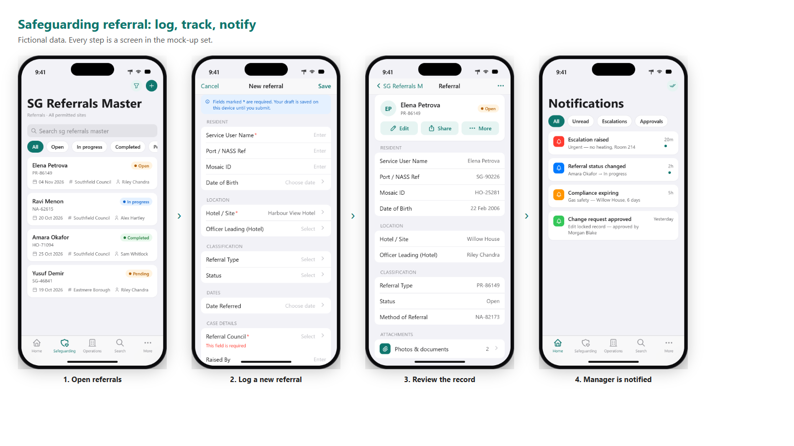
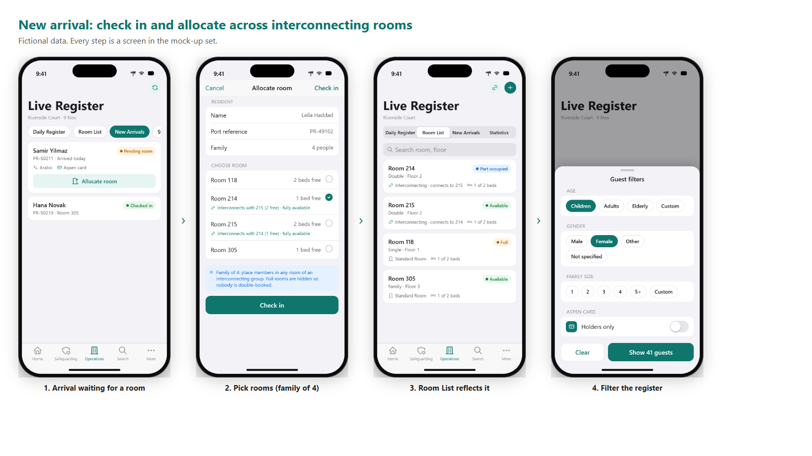
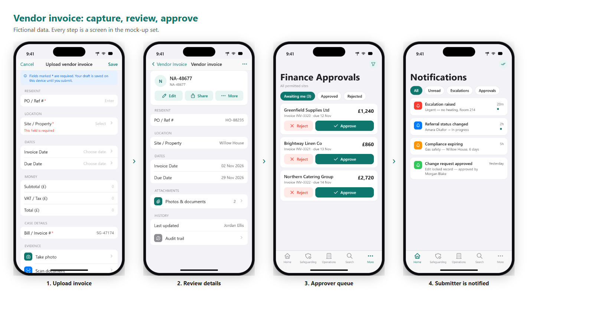
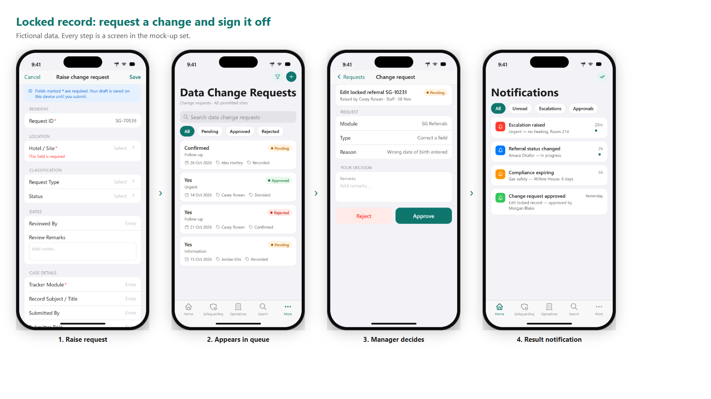
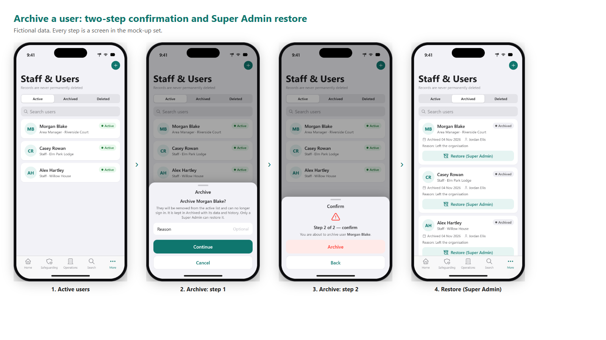
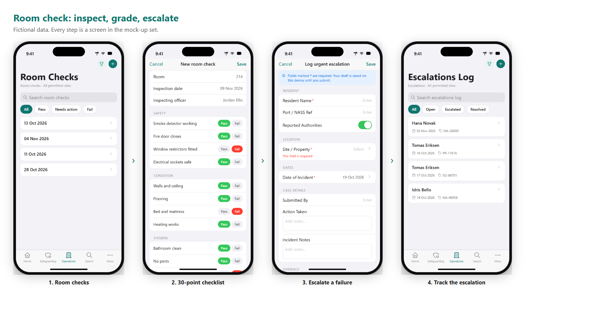

# 05 Workflow references

Six business workflows, each as a strip of real mock-up screens.

## Safeguarding referral: log, track, notify

Frontline staff log a safeguarding referral on the phone, attach evidence, and the manager is notified. Same fields and statuses as the web SG Referrals Master.

Steps: 1. Open referrals → 2. Log a new referral → 3. Review the record → 4. Manager is notified

## New arrival: check in and allocate across interconnecting rooms

A new arrival waits for a room; staff allocate a family of four across two interconnecting rooms (connected rooms and group availability are shown, full rooms are hidden so nobody is double-booked); Room List and Daily Register update; the register is then filtered by guest attributes.

Steps: 1. Arrival waiting for a room → 2. Pick rooms (family of 4) → 3. Room List reflects it → 4. Filter the register

## Vendor invoice: capture, review, approve

A vendor invoice is photographed and submitted; an approver reviews and approves; the submitter is notified. Approval needs the approve action on the finance pages and is not available to Staff.

Steps: 1. Upload invoice → 2. Review details → 3. Approver queue → 4. Submitter is notified

## Locked record: request a change and sign it off

A locked record cannot be edited directly; staff raise a Data Change Request, a manager approves or rejects with remarks.

Steps: 1. Raise request → 2. Appears in queue → 3. Manager decides → 4. Result notification

## Archive a user: two-step confirmation and Super Admin restore

Users and properties are never permanently deleted. Archive takes two confirmations; only a Super Admin can restore.

Steps: 1. Active users → 2. Archive: step 1 → 3. Archive: step 2 → 4. Restore (Super Admin)

## Room check: inspect, grade, escalate

30-point inspection with automatic grade; a failed item can be escalated with a photo, and the escalation is tracked to resolution.

Steps: 1. Room checks → 2. 30-point checklist → 3. Escalate a failure → 4. Track the escalation

