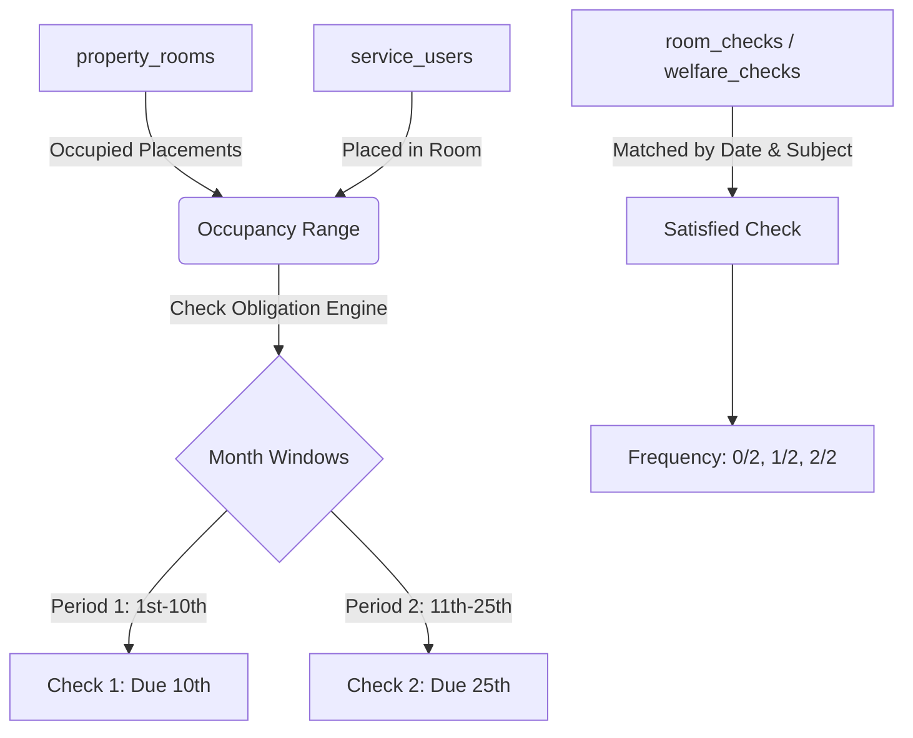
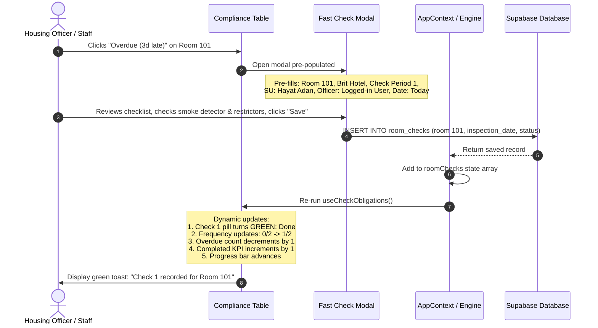

# SDTracker Room Checks & Welfare Checks — UI Audit & Redesign Proposal

**Author:** Antigravity (Google DeepMind Agent)  
**Date:** 13 November 2026  
**Status:** Audit & Proposal Completed — Awaiting Super Admin / Stakeholder Approval (No Production Code Modified)  
**Interactive Prototype:** [docs/prototypes/checks-compliance-prototype.html](file:///d:/SD%20Commercial/APPS/sdtracker/docs/prototypes/checks-compliance-prototype.html)

---

## Executive Summary

This document presents a comprehensive audit of the existing **Room Checks** and **Welfare Checks** implementations within the SDTracker enterprise platform, explains the operational shortcomings of the current dashboard-based check lists, and defines an exhaustive architectural and UI redesign.

In strict adherence to the **Master Prompt Execution Rules**:
- **Zero production components have been modified.**
- **Zero database migrations or schema alterations have been applied.**
- **Zero existing data or permissions have been altered.**
- An interactive, standalone UI prototype has been constructed and verified at `docs/prototypes/checks-compliance-prototype.html`.

Production implementation will proceed only upon explicit stakeholder approval.

---

## 1. Existing Implementation Summary

### 1.1 Architecture & Component Mapping
Currently, Room Checks and Welfare Checks are handled across four main subsystems:

| Subsystem | Existing Path | Purpose & Current Behavior |
| :--- | :--- | :--- |
| **Operations Dashboard** | `src/components/operations/OperationsDashboardView.tsx` | Embeds two full `<CheckObligationsPanel>` instances (lines 431–436). When expanded, these render long tables of all incomplete and overdue checks directly inside the dashboard overview. |
| **Due & Missed Panel** | `src/components/checks/CheckObligationsPanel.tsx` | Standalone accordion component that calculates monthly check obligations on the fly via `useCheckObligations` hook and displays an inline HTML table. |
| **Room Checks Page** | `src/components/room/RoomChecksView.tsx` | Displays a flat history log table of individual inspection records (`RoomCheckRecord[]`) with search and status filters, and embeds `<CheckObligationsPanel type="room">` at line 512 above the table. |
| **Welfare Checks Page** | `src/components/welfare/WelfareChecksView.tsx` | Displays a flat history log table of individual welfare checks (`WelfareCheckRecord[]`), and embeds `<CheckObligationsPanel type="welfare">` at line 420 above the table. |
| **Pure Compliance Engine** | `src/utils/checkObligations.ts` | Pure functional calculation logic that parses occupied rooms, placements, and existing check visits to determine check periods (1st vs 2nd), deadlines (10th vs 25th), statuses (`pending`, `completed`, `completed_late`, `overdue`), and frequencies. |
| **Reactive Hook** | `src/hooks/useCheckObligations.ts` | Reactive hook subscribing to `AppContext` (`roomChecks`, `welfareChecks`, `sites`, `placements`, `properties`, `rooms`, `serviceUsers`) and computing `CheckResult`, `CheckRow[]`, and `CheckTotals`. |

---

## 2. Current Operational Problems

1. **Dashboard Clutter & Cognitive Overload**:
   - The Operations Dashboard is intended for executive and managerial KPIs (occupancy, critical alerts, financial summaries, staff rotas).
   - Embedding raw check tables with 50+ rows creates an unwieldy, vertical layout that distracts operational staff and degrades dashboard load performance.
2. **Disconnected Operational Experience**:
   - The actual **Room Checks** and **Welfare Checks** module pages are relegated to displaying raw past inspection logs.
   - Staff navigating to `Room Checks` see an accordion list at the top and historical logs at the bottom. There is no unified monthly view showing which rooms owe checks, which rooms are 1/2 or 2/2, or which specific check (1st or 2nd) is overdue.
3. **Passive Overdue Reporting (Lack of Direct Actionability)**:
   - When a room or Service User is marked as "Overdue" in the current panel, clicking it does not open a targeted check completion modal.
   - Staff must manually click a generic "Record a check" button, re-select the site from a dropdown, re-select the room or Service User from a selector, and manually check whether they are submitting Check 1 or Check 2.
4. **Obscured Monthly Frequency**:
   - Clear compliance tracking requires an unmistakable monthly frequency metric: **0/2**, **1/2**, or **2/2**.
   - The existing table shows individual check cells ("Done", "Pending", "Overdue"), but fails to present an authoritative frequency indicator or progress percentage per room/SU.

---

## 3. Existing Database Models & Relationships

The existing database architecture is robust and fully supports monthly compliance tracking without requiring schema modifications.

### 3.1 Primary Check Tables

#### `public.room_checks` (Defined in `db/migrations/011_welfare_food_room_checks.sql`)
- `id` (TEXT, PK): Unique record ID (e.g. `rc-179424...`)
- `site_id` (TEXT, FK -> `sites.id`): Site reference
- `site_name` (TEXT): Site display name (e.g. 'Brit Hotel')
- `room_number` (TEXT): Room number (e.g. '101')
- `aic_reference` (TEXT): Property or contract reference
- `officer_name` (TEXT): Conducting Housing Officer
- `inspection_date` (TEXT / DATE): Date check was performed (`YYYY-MM-DD`)
- `overall_status` (TEXT): 'Passed' | 'Issues' | 'Attention Required'
- `data` (JSONB): Contains room checklist items, child question scores, notes, and photos
- `created_at`, `updated_at` (TIMESTAMPTZ)

#### `public.room_check_items` (Child Table)
- Stores responses to the 30 standard Home Office / Clearsprings inspection questions (cleanliness, smoke detector working, window restrictors intact, prohibited items, bathroom condition).

#### `public.welfare_checks` (Defined in `db/migrations/011_welfare_food_room_checks.sql`)
- `id` (TEXT, PK): Unique record ID (e.g. `wc-179424...`)
- `site_id` (TEXT, FK -> `sites.id`): Site reference
- `site_name` (TEXT): Site display name
- `service_user_id` (TEXT): Service user identifier
- `port_reference` (TEXT): Clearsprings / UKVI Port Reference
- `flat_number` (TEXT): Room / Flat number
- `officer_name` (TEXT): Conducting Housing Officer
- `check_datetime` (TIMESTAMPTZ): Timestamp of engagement
- `status` (TEXT): 'Completed' | 'Issues Identified' | 'Follow-up Required'
- Health & Safeguarding fields: `gp_registered`, `physical_health_change`, `mental_health_change`, `wants_welfare_engagement`, `window_restrictors_intact`, `smoke_alarms_working`
- `data` (JSONB): Detailed structured notes and questionnaire responses

### 3.2 Master Entity Linkages
The pure calculation engine (`src/utils/checkObligations.ts`) dynamically resolves relationships without needing a duplicate ledger table:


---

## 4. Existing Functionality to Retain

The redesign strictly preserves all battle-tested operational features:
1. **The 30-Question Room Inspection Protocol**: Full standard Clearsprings / UKVI room checklist questions and critical safety hazard detection.
2. **The Full Welfare Check Health & Safeguarding Form**: GP registration, physical/mental health changes, vulnerability flagging, and escalation triggers.
3. **Historical Audit Logs**: Inspection history logs will remain accessible via a dedicated sub-tab ("Raw History Logs") within the respective pages.
4. **Site Access & RBAC Scoping**: Housing Officers only see their assigned properties; Managers and Admins access all permitted sites.
5. **CSV and PDF Export Engines**: Pre-configured exports for UKVI compliance reporting remain completely functional.
6. **Live Reactive Recalculation**: Submitting a check record immediately updates in-memory `AppContext` and recalculates obligations instantly without page reloads.

---

## 5. Proposed Operations Dashboard Redesign (Phase 2)

### 5.1 Removal of Bulky Dropdown Lists
The following elements are removed from `src/components/operations/OperationsDashboardView.tsx`:
- The collapsible `<CheckObligationsPanel type="room" ... />`
- The collapsible `<CheckObligationsPanel type="welfare" ... />`
- All multi-row obligation tables displayed on the dashboard.

### 5.2 Replacement: High-Level Compliance KPI Cards
Two compact, high-density summary cards are placed in the dashboard grid:

#### Card 1: Room Checks Monthly Compliance
- **Target Count**: Total active rooms requiring inspection for the current month.
- **Completed (2/2)**: Number of rooms with both checks completed on time.
- **Overdue Count**: Prominent red badge indicating outstanding overdue room checks.
- **Monthly Completion Rate**: Visual progress bar and percentage (e.g. `78%`).
- **Direct Navigation Action**: `"Manage Room Checks →"` button linking directly to the Room Checks page, automatically pre-filtering to the **Overdue** tab if overdue checks exist.

#### Card 2: Welfare Checks Monthly Compliance
- **Target Count**: Total active placed residents requiring welfare checks.
- **Completed (2/2)**: Number of residents with both welfare checks completed.
- **Overdue Count**: Prominent red badge indicating outstanding overdue welfare checks.
- **Monthly Completion Rate**: Visual progress bar and percentage (e.g. `74%`).
- **Direct Navigation Action**: `"Manage Welfare Checks →"` button linking directly to the Welfare Checks page, automatically pre-filtering to the **Overdue** tab.

---

## 6. Proposed Room Checks Page Redesign (Phase 3)

The **Room Checks** page (`RoomChecksView.tsx`) becomes the primary monthly compliance console:

### 6.1 Page Header & Controls
- **Title**: `Room Checks — Monthly Compliance`
- **Obligation Badge**: `Twice-Monthly Obligation (Due 10th & 25th)`
- **Month Selector**: Dropdown selector (`November 2026`, `October 2026`, `September 2026`, etc.). Switching months recalculates compliance against that month's historical placements.
- **Site Filter**: Multi-site switcher or single assigned site.
- **Primary Action**: `+ Record Room Check` button.

### 6.2 Summary KPI Cards
- **Total Rooms**: Active occupied rooms requiring checks.
- **Completed (2/2)**: Green indicator, count and percentage.
- **In Progress (1/2)**: Amber indicator, count and percentage.
- **Not Started (0/2)**: Neutral indicator, count and percentage.
- **Overdue**: High-contrast red card with count and `"Action Required"` badge.
- **Monthly Progress**: Visual animated progress bar reflecting overall completion.

### 6.3 Main Tabs
1. **All Rooms**: Full list of applicable rooms with current check progress.
2. **Completed (2/2)**: Rooms where both Check 1 and Check 2 are satisfied.
3. **Due / Pending (1/2 or 0/2)**: Rooms with checks pending whose deadlines have not yet passed.
4. **Overdue**: Urgent filter displaying only rooms with missed deadlines (red count badge).
5. **Raw History Logs (Secondary Tab)**: Traditional tabular view of raw individual inspection records (`RoomCheckRecord[]`) with existing search, sort, and export tools.

### 6.4 Main Compliance Table Columns
| Column Header | Data Source & Representation |
| :--- | :--- |
| **Room** | Room number (e.g., `101`, `204`) with bold emphasis. |
| **Service User** | Current occupant name and Port Reference (`MST/9412027`). If vacant/cleaning, indicated cleanly. |
| **Property / Site** | Property name (e.g., `Brit Hotel`, `Ibis Cardiff City Centre`). |
| **First Check (Due 10th)** | Status Pill: `Done (DD/MM/YYYY)` (Green), `Pending` (Slate), or `Overdue (X days late)` (Red). Clickable when pending or overdue. |
| **Second Check (Due 25th)** | Status Pill: `Done (DD/MM/YYYY)` (Green), `Pending` (Slate), or `Overdue (X days late)` (Red). Clickable when pending or overdue. |
| **Monthly Frequency** | Prominent visual badge: `0/2` (Slate), `1/2` (Amber), `2/2 ✓` (Green). |
| **Compliance Status** | Overall status badge: `Completed (2/2)` (Green), `Due / Pending` (Amber), `Overdue Action` (Red). |
| **Last Checked** | Date of most recent check and conducting officer name. |
| **Assigned Staff** | Property manager or assigned Housing Officer. |
| **Actions** | Quick-action button: `Resolve Check` (Red button if overdue) or `Record Check` (Teal button). |

---

## 7. Proposed Welfare Checks Page Redesign (Phase 4)

The **Welfare Checks** page (`WelfareChecksView.tsx`) follows the exact same high-density, professional layout:

### 7.1 Page Header & Controls
- **Title**: `Welfare Checks — Monthly Compliance`
- **Obligation Badge**: `Twice-Monthly Resident Engagement (Due 10th & 25th)`
- **Month Selector & Site Filter**: Identical placement and behavior.
- **Primary Action**: `+ Record Welfare Check`.

### 7.2 Summary KPI Cards
- **Total SUs**: Active placed residents for the selected month.
- **Completed (2/2)**, **In Progress (1/2)**, **Not Started (0/2)**, **Overdue**, and **Monthly Progress Bar**.

### 7.3 Main Tabs
1. **All Service Users**
2. **Completed (2/2)**
3. **Due / Pending**
4. **Overdue**
5. **Raw History Logs (Secondary Tab)**

### 7.4 Main Compliance Table Columns
| Column Header | Data Source & Representation |
| :--- | :--- |
| **Service User** | Full resident name with Port Reference (`MST/9412027`). |
| **Room** | Room number occupied by resident. |
| **Property / Site** | Property and site name. |
| **First Check (Due 10th)** | Status Pill: `Done (DD/MM/YYYY)` (Green), `Pending` (Slate), or `Overdue` (Red). |
| **Second Check (Due 25th)** | Status Pill: `Done (DD/MM/YYYY)` (Green), `Pending` (Slate), or `Overdue` (Red). |
| **Monthly Frequency** | Prominent badge: `0/2`, `1/2`, `2/2 ✓`. |
| **Engagement Status** | Overall status badge (`Completed`, `Due / Pending`, `Overdue Action`). |
| **Last Checked** | Date and conducting officer. |
| **Assigned Staff** | Assigned Housing Officer / Lead Officer. |
| **Actions** | Direct modal triggers for rapid check logging. |

---

## 8. Monthly Compliance Logic & Frequency Rules (Phase 5)

### 8.1 Schedule & Windows
- **Monthly Periods**:
  - **Check 1**: Window begins on the 1st of the month; due on or before the **10th** (inclusive).
  - **Check 2**: Window begins on the 11th of the month; due on or before the **25th** (inclusive).
- **Minimum Occupancy Threshold**: A room or resident owes a check for a window only if occupied for at least **3 days** of that window (prevents unfair overdue penalties for check-ins occurring on the 9th or 24th).

### 8.2 Frequency Transitions
```
                Initial State: 0/2
                     │
     ┌───────────────┴───────────────┐
     ▼                               ▼
Check 1 Completed               Check 2 Completed (surplus/late)
Frequency: 1/2                  Frequency: 1/2
     │                               │
     └───────────────┬───────────────┘
                     ▼
           Both Checks Completed
              Frequency: 2/2 ✓
```

### 8.3 Independence & Lateness Rules
- Completing Check 1 **never** satisfies Check 2.
- A visit logged between the 1st and 10th satisfies Check 1.
- A visit logged between the 11th and 25th satisfies Check 2.
- If Check 1 was missed and a visit occurs on the 14th, the visit satisfies Check 1 marked as `completed_late`, leaving Check 2 open.
- If today is past the 10th and Check 1 is incomplete, Check 1 is marked `overdue` with an exact lateness counter (`X days overdue`).
- If today is past the 25th and Check 2 is incomplete, Check 2 is marked `overdue`.

---

## 9. Interactive Overdue Workflow (Phase 3.G & 4)

When operational staff click an **Overdue badge** or **Resolve Check button**:



---

## 10. Required Code Changes (Implementation Blueprint)

When approved for production implementation, the following changes will be made:

### 10.1 Frontend Files to Modify

| File | Proposed Modifications |
| :--- | :--- |
| `src/components/operations/OperationsDashboardView.tsx` | - Remove `CheckObligationsPanel` imports and lines 431–436.<br/>- Add compact `Room Checks KPI Card` and `Welfare Checks KPI Card` with deep-links to module pages. |
| `src/components/room/RoomChecksView.tsx` | - Replace line 512 (`<CheckObligationsPanel>`) with the new unified `Monthly Compliance` view.<br/>- Add Month Selector and KPI summary cards.<br/>- Implement the 4 compliance tabs (`All Rooms`, `Completed 2/2`, `Due / In Progress`, `Overdue`) + secondary `Raw History Logs` tab.<br/>- Wire overdue click handlers directly into the check modal with pre-filled room and period context. |
| `src/components/welfare/WelfareChecksView.tsx` | - Replace line 420 (`<CheckObligationsPanel>`) with the new unified `Monthly Compliance` view.<br/>- Add Month Selector and KPI summary cards.<br/>- Implement the 4 compliance tabs (`All SUs`, `Completed 2/2`, `Due / In Progress`, `Overdue`) + secondary `Raw History Logs` tab.<br/>- Wire overdue click handlers directly into the welfare check modal with pre-filled SU and period context. |

### 10.2 Backend & Database Changes
- **Backend**: None required. Existing Express endpoints (`/api/checks/room`, `/api/checks/welfare`) and direct Supabase adapters already handle creation, query, and audit trails.
- **Database**: Zero schema changes or migrations required.

---

## 11. Visual & UX Standards

The redesign adheres strictly to the existing **SDTracker Design System**:
- **Color Palette**:
  - Primary Brand / Interactive: Teal `#0d9488` / Dark Teal `#0f766e`
  - Compliant / Completed: Emerald `#059669` / `#ecfdf5`
  - Pending / In Progress: Amber `#d97706` / `#fffbeb`
  - Overdue / Critical: Red `#dc2626` / `#fef2f2`
  - Neutral / Card Background: `#ffffff`, `#f8fafc`, Border `#e2e8f0`
- **Typography**: Poppins / Inter, tabular figures for room numbers and dates.
- **Compact Density**: 36px table row height, clear status pills, no excessive padding.
- **Accessibility**: High-contrast text on badge backgrounds, aria-labels on interactive cells.

---

## 12. Interactive Prototype Reference

A fully functional, standalone interactive prototype has been created and verified at:
👉 **[docs/prototypes/checks-compliance-prototype.html](file:///d:/SD%20Commercial/APPS/sdtracker/docs/prototypes/checks-compliance-prototype.html)**

### Prototype Capabilities:
1. **Module Switcher**: Toggle between `Room Checks Module`, `Welfare Checks Module`, and `Operations Dashboard Preview`.
2. **Tab Filtering**: Test `All`, `Completed 2/2`, `Due / In Progress`, `Overdue`, and `Raw History Logs`.
3. **Month & Site Filtering**: Switch between months and filter by property with automatic record recalculation.
4. **Clickable Overdue Resolution**: Click any red `Overdue` pill or `Resolve Check` button to open the modal pre-filled with room, resident, and period details.
5. **Live Dynamic Recalculation**: Submitting the modal immediately updates:
   - Frequency from `0/2` → `1/2` or `1/2` → `2/2`
   - Check pill from Red `Overdue` → Green `Done`
   - Overdue count decrements in real time
   - Progress bar advances with animated feedback
   - Toast notification confirms the save

---

## 13. Implementation Sequence & Testing Plan

Once approved, implementation will proceed in the following controlled sequence:

1. **Phase A — Operations Dashboard Cleanup**:
   - Extract `CheckObligationsPanel` from `OperationsDashboardView.tsx`.
   - Embed the compact KPI cards with deep-links to `/room-checks` and `/welfare-checks`.
2. **Phase B — Room Checks Monthly Compliance Interface**:
   - Refactor `RoomChecksView.tsx` to feature the Monthly Compliance table as the default view.
   - Retain raw inspection logs in the secondary tab.
   - Connect the overdue click-to-complete modal flow.
3. **Phase C — Welfare Checks Monthly Compliance Interface**:
   - Refactor `WelfareChecksView.tsx` with identical visual and behavioral symmetry.
4. **Phase D — Verification & Quality Assurance**:
   - Run automated unit test suite (`npm run test:unit`) to ensure all 320 tests remain green.
   - Verify production build compilation (`npm run build`).
   - Validate live reactivity and RBAC site boundaries.

---

## 14. Stakeholder Decision & Next Steps

This concludes **Phases 1 through 8** of the audit and design requirement.

> [!IMPORTANT]
> **Strict Execution Rule Observed:**  
> All existing production code, database tables, and live configurations remain completely untouched.  
> Please review this audit report and test the interactive prototype at `docs/prototypes/checks-compliance-prototype.html`.  
> Awaiting your explicit approval to proceed with the production code implementation.

